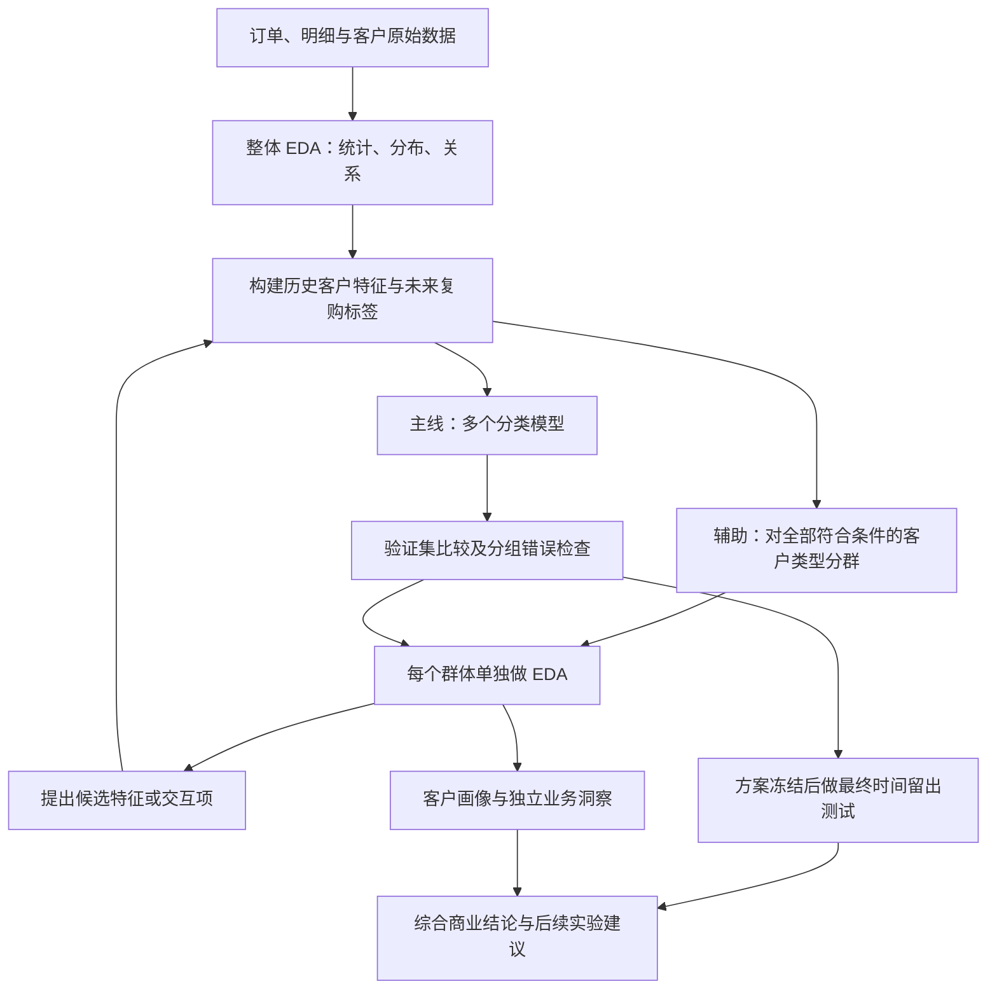

# Olist：复购预测与客户群体洞察

**这个项目研究两件相互配合的事：谁可能再次购买，以及不同类型的客户在购买行为上有什么区别。** 我们希望最后交出的既有预测结果，也有能解释给业务人员听的客户画像和经营建议。

这是 CityU IS6400 小组项目的学习与协作仓库。它不是 Olist 或 CityU 的官方项目，也不是可以直接上线的营销系统。仓库中的数据是 **2016–2018 年历史记录**。

## 第一次来，从哪里开始？

你不需要先会编程。按下面顺序阅读，就能参加讨论：

1. **先理解项目**：[零基础项目说明](docs/01-project-explained.md)。回答我们预测什么、聚类做什么、为什么不能直接宣称提高复购。
2. **认识数据**：[九张表与字段字典](docs/02-data-guide.md)。重点区分订单、商品明细、买家。
3. **看研究怎样进行**：[完整方法与验证设计](docs/03-methodology.md)。包含流程图、时间窗口、模型和组内 EDA。
4. **遇到术语就查**：[人话术语表](docs/04-glossary.md)。不需要一开始全部背下来。
5. **看实际做到了什么**：[探索实验结果及限制](docs/05-results.md)。已有数字与未来计划明确分开。
6. **准备汇报**：[最新版 PPT](slides/olist-repurchase-briefing.pptx) · [3 分钟英文讲稿＋逐段中文翻译](slides/briefing-script-bilingual.md)。
7. 想亲手运行，再看 [从下载到运行的操作指南](docs/06-run-guide.md)。

## 我们现在的研究问题

> **在同一批已有客户中，如果运营每期只能评审前 10%，用过去六个月订单做出的复购排序，能否比最近购买优先找到更多未来 90 天有合格订单的人？**

分群用于解释名单差异、定位预测遗漏和提出特征改进。稳定的历史画像也可补充一项内容试验假设。实际营销增量需用另有对照的干预数据检验。

操作定义暂沿用探索实验：复购指未来 90 天内至少出现一笔 **已批准、商品金额合计为正的订单**。它不是“最终交付且没有退款”，也不等于永久忠诚。正式项目若改变定义，应同步修改代码、标签和说明，不能把不同口径的结果放在一起比较。

## 一张图看懂整体流程



**反馈循环只使用开发／验证数据。** 最终测试结果不能反过来决定用哪些特征。聚类覆盖全部符合条件的客户类型，但聚类模型在开发数据拟合，再给测试客户分配群体；不是先把未来全部数据放进去聚类。

聚类有两个贡献：① 帮助发现候选预测特征；② 即使没有提高预测分数，也可能形成稳定、可解释、与经营决策相关的客户画像。第二点不能只靠给群体起名字，要有具体数据和限制。

## 当前完成状态

2026-11-07 已确认 Briefing 完成、六岗均已认领。6 号已定复购候选名单主线和分群内容试验补充。正式分析从统一样本与评估设计开始，各岗成果待交接。Slides 正式截止为 11 月 15 日 23:59，报告为 12 月 6 日 23:59（香港时间）。展示场次待核。下表保留历史探索记录。

| 内容 | 状态 | 应当怎样理解 |
|---|---|---|
| 官方 Olist 数据包及九表概览 | 已完成 | 原始包已随仓库上传，指纹可检查 |
| 数据入门 Notebook | 已完成 | 可以学习表结构、连接、日期与金额口径 |
| 规则分群与 K-means 小实验 | 已完成，探索性质 | 一次历史窗口，帮助理解分群，不是最终选模 |
| 四种分类模型复购预测对照 | 已完成，探索性质 | 一个测试季度，不能认定普遍最优 |
| 最新五页 Briefing 与英中讲稿 | 已完成草稿 | 描述研究计划，不声称反馈流程已经跑完 |
| 聚类后逐群 EDA、特征改进及前后对照 | **待完成** | 是正式研究主流程的一部分，目前没有改善结果 |
| 多时期验证、置信区间、阈值或预算分析 | **待完成** | 提高证据可靠性，不应补造结果 |
| 真实营销干预实验 | **没有数据，也未实施** | 只能提出未来试验建议 |

## 目前小实验告诉了我们什么？

固定时间测试期有 **37,813 人，299 人复购，占 0.79%**。四个模型中，逻辑回归在排名前 10% 名单里找到 73 名实际复购客户，简单的“最近购买优先”找到 45 名。

这意味着模型具有一定排序能力，但 **73 人不是营销新增的客户**，他们可能不被联系也会购买。模型选择不能只看一个数字，也不能把这次结果称作“精准营销已验证”。详细四指标、样本和限制见 [实验结果](docs/05-results.md)。

## 数据与资料已经包含在仓库里

| 位置 | 内容 |
|---|---|
| [data/olist-v2.zip](data/olist-v2.zip) | Olist 官方原始压缩包，约 42.65 MiB，9 个 CSV 全部包含 |
| [data/source-manifest.json](data/source-manifest.json) | 下载来源、版本、日期及每个原始文件的 SHA-256 |
| [slides/olist-repurchase-briefing.pptx](slides/olist-repurchase-briefing.pptx) | 使用 CityU 模板的最新复购主线 PPT，含可编辑流程图与备注 |
| [slides/briefing-script-bilingual.md](slides/briefing-script-bilingual.md) | 与该 PPT 对齐的英文讲稿和中文翻译 |
| [notebooks/01-data-guide.ipynb](notebooks/01-data-guide.ipynb) | 九张表入门教学 |
| [scripts](scripts/) | 解压、数据准备、分类对比和分群实验代码 |
| [results](results/) | 已复核的探索实验汇总；不含私有身份资料 |

从 GitHub 点击文件名后，可用 **Download raw file** 下载 PPT；或在仓库首页 **Code → Download ZIP** 下载整个项目。完整数据已上传，不需要再申请 Kaggle API Key。压缩包里的 CSV 需要先解压，步骤见操作指南。

## 最短运行顺序

在仓库根目录打开终端，先配置好 Python 环境：

```text
python -m pip install -r requirements.txt
python scripts/extract_data.py
python scripts/run_catboost.py
python scripts/compare_models.py
python scripts/run_segmentation.py
```

前三个分析命令分别生成分类、模型对比和分群结果，写入 `outputs/`，不会覆盖 `results/` 中的已审核结果，也不会改动原始 CSV。完整解释、Windows 操作及错误处理见 [运行指南](docs/06-run-guide.md)。

## 小组协作

打开 [成员任务包](docs/team/README.md) 领取本岗 Markdown，同时阅读 [交接协议](docs/team/protocol.md) 和 [协作时间线](docs/07-team-guide.md)。按 H01–H07 记录输入版本、交付文件、验收和缺件。成员可把任务卡与实际输入交给自己的 Agent，再由本人核对。公开仓库保存可公开材料，逐行客户数据、私有链接和成员资料走组内渠道。

## 来源与许可

- 数据作者／发布方：**Olist**，来源 [Brazilian E-Commerce Public Dataset by Olist](https://www.kaggle.com/datasets/olistbr/brazilian-ecommerce)，原始包保持不变，许可 **CC BY-NC-SA 4.0**。
- 原创代码使用 [MIT License](LICENSE)。数据、数据衍生材料及文档的具体适用范围见 [LICENSES.md](LICENSES.md)，不能把 MIT 理解为可以随意商用 Olist 数据。
- PPT 中 CityU 标识及模板素材保留学校相关权利；仅用于课程展示，不代表学校背书，也未授予商标使用权。
- 最新课程提交规则以 Canvas 为准。本公开仓库供协作与研究，不构成已提交或已评分声明。
