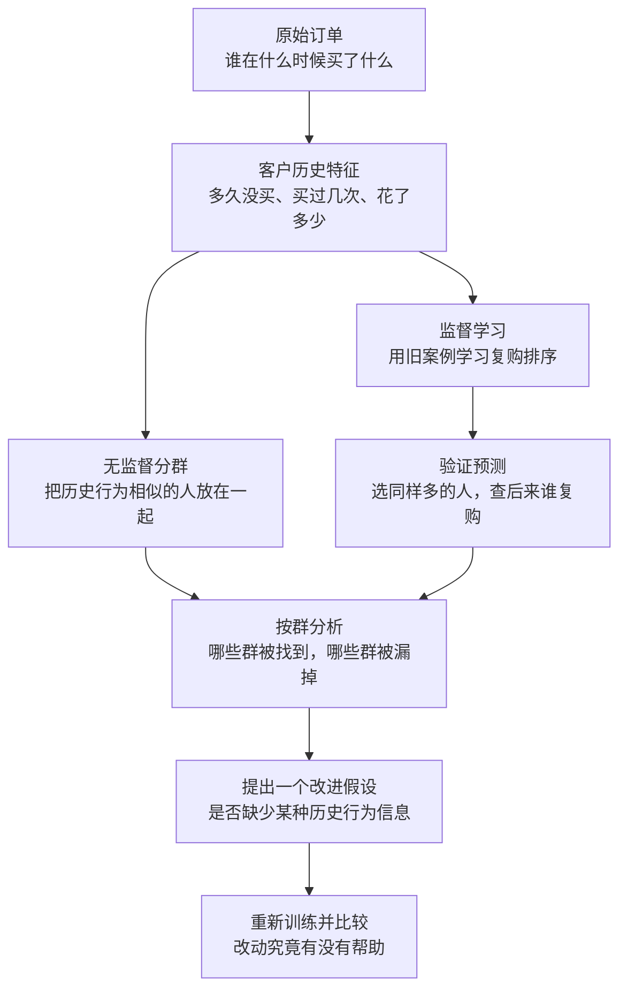

# IS6400 · 全思路解析（2026-11-20 复核）

## 当前读法与已核进度

当前展示采用最终已提交的 13 页 PPT（本人确认）；11 月 25 日、Week 13、第 2 组，准确钟点未新核。主讲页码：1号3、2号4、3号5/6、4号8、5号7、6号1/2/9。本人确认的提交事实保留，独立成功回执待补而不重交；真人计时、问答熟练度与最终报告继续单独推进。A/B、已见四月及辅助研究保留历史，不再作为重新投票、重训或重做 PPT 的待办。

## 当前下一步与边界

按最终 13 页准备 11 月 25 日展示与 Q&A；本人负责第 1、2、9 页及统筹衔接。已有成功回执可补存；报告按已登记建议节奏推进，12 月 6 日 23:59 HKT 正式截止保留。

材料与来源缺口保留；新核读日期不冒充任务完成日期。本人通读、自测、评分、提交事实只沿用明确证据；待确认事项不因本次同步自动变为完成。课程笔记补充资料不计团队交件。

## 本次依据

- [本课远端核读基线](https://github.com/CercaTrovato/olist-repurchase-analysis/commit/c7449e316fbb42a7c8ea6a46abf4e622de491e1d)。
- 本课 assignment.json、管理验收、既有课程回传与登记来源已逐项比对；未变的历史计算和原件按原审范围承接。

## 历史推演与原版本（保留）

下面保留上次正文及当时的下一步，属于注明日期的历史叙述。当前行动以上文和时间线复核后条目为准；不把旧“待交件／禁止提交／待投票”当作当前要求。

# IS6400 项目全思路解析与研究迭代

我们用历史购买记录研究有限名额的复购名单。下面保留最初的数据、模型和分群思路，再接上团队新交件与本地探索；节点按问题和证据关系串联，不冒充精确的发生时刻。

## 当前进展

Six Sigma 展示已确定为 11 月 25 日（周三），Week 13、第 2 组；具体钟点未新核。最终 13 页 PPT 仍为本人确认已提交 Canvas，独立回执待补。接下来按最终稿准备展示与问答，报告继续推进。 主讲页码不变：1号3、2号4、3号5/6、4号8、5号7、6号1/2/9。

下一步：按最终 13 页版本准备 11 月 25 日课堂展示：各成员核对自己页面、数字和转场，再按本人安排进行真人计时与问答准备。已有提交回执可补存以核准确时刻和实际账号；不再催 3 号提交，不修改或重新提交已交附件。

## 第一部分：最初的完整解释（历史起点）

以下保留最初原文的讲解与五张表格。其中的“下一步”和未完成状态属于当时的研究阶段；当前交件与待办见第二部分。

# IS6400 项目全思路解析

可以。你目前缺的是把**问题、数据、模型、结果和决策接起来的解释**。前面我直接让你确认评价方案，讲得太靠后了。我们先把它当成一篇正在完成的研究论文，从开头读到目前的位置。

**这篇论文的核心问题可以写成一句话：从一个客户过去的购买记录，能不能判断他接下来是否会再次购买？我们又能不能通过客户分群，理解预测为什么对某些人有效、对另一些人效果较差？**

整项研究围绕这条线展开：

**先看研究对象——我们究竟在分析谁。**

原始 Olist 数据很像一个商店的账本。账本里有订单、订单里的商品、支付记录、客户编号等。机器学习需要我们先把这些流水账整理成**每个客户的一份“历史行为简历”**。

假设现在站在 **2018 年 1 月 1 日**，有一个客户过去半年买了两次，商品金额分别是 80 和 120 BRL，最后一次购买距今天 20 天。我们可以写成：

| 这个客户的历史信息 | 数值 |
|---|---:|
| 距最近一次购买多久，简称 R | 20 天 |
| 过去半年买过几笔订单，简称 F | 2 笔 |
| 过去半年商品金额合计，简称 M | 200 BRL |

R、F、M 就是三项**特征**。特征可以理解为“做判断时已经掌握的线索”。你们团队的模型还用了运费占比、近期购买情况、州代码等，总共 8 个字段。

1 号的工作就是可靠地做出这些客户简历。比如，一笔订单买了三件商品，购买次数仍然算一笔。否则模型会把“买了一次、一次买三件”的人，误认为“回来买了三次”的人。**数据整理错了，模型学到的规律也会跟着错。**

**然后，我们给每份历史简历配一个后来发生的结果。**

仍以 2018 年 1 月 1 日为分析日，向后看 90 天。如果同一个客户又出现了合格订单，就记为 **1**；观察窗口覆盖足够、没有看到合格订单，就记为 **0**。这个结果叫**标签**。

于是，每条训练案例都包含两部分：

> 客户过去是什么样子 → 他后来有没有再次购买。

这里的“复购”有明确的项目定义——出现新的、有批准时间、商品金额为正的订单。它反映这份 Olist 数据中的购买记录。过去半年和未来 90 天也是团队选定的研究窗口，方便所有人使用相同口径，并没有证据证明它们是唯一最好的选择。

**监督学习，就是让模型从很多这样的旧案例中学习如何判断。**

可以把逻辑回归理解成一套**由数据学习出来的评分办法**。它尝试给不同线索分配权重，把这些线索合成一个分数。训练时，模型不断根据旧案例的真实结果调整权重，让复购者通常获得更高分。

例如，“过去买过多次”可能是一条有用线索，“多久没买”也可能有用。它们各自应该占多少分，由训练数据决定。我们没有实际查看模型系数之前，不能断言某个字段具体加几分或减几分。

随机森林和 CatBoost 是另外两种学习方法，可以组合更多条件，学习更复杂的关系。例如，一条规则可能同时考虑购买次数和最近购买时间。**方法复杂一些是否更有用，需要在相同数据上比较。**

团队现在的结果是逻辑回归命中 46 人、随机森林 44 人、CatBoost 45 人。差距很小，足以说明三种方法在这一期表现接近，尚不足以宣布某个算法普遍更好。

**训练、验证和后期评价，解决的是三个不同问题。**

用学校学习作类比，训练数据像带答案的例题，模型从中学习。验证数据像练习卷，用来发现问题、比较方案。理想的最终评价像事先没做过的考试卷，检查选好的方法换一批案例能否继续工作。

你们的时间安排是：

| 用途 | 假装站在哪一天 | 使用此前什么信息 | 查后面什么结果 |
|---|---|---|---|
| 训练 | 2017-10-01 | 过去 6 个自然月的订单 | 后续 90 天是否复购 |
| 验证 | 2018-01-01 | 过去 6 个自然月的订单 | 后续 90 天是否复购 |
| 四月候选回测 | 2018-04-01 | 过去 6 个自然月的订单 | 后续 90 天是否复购 |

当前新特征就是根据一月的表现来讨论的，所以一月承担“练习、比较、改进”的作用。

四月的标签和部分分析已经看过，它更接近**以前接触过、后来再做一遍的试卷**。冻结方法之后再跑，仍能检查换一个时期的表现，但证据强度受到已看过结果的影响。因此前面才提出“已见窗口回测”的表述。

**模型先给每个人打分，我们再检验分数排得好不好。**

一月有 **29,368 位客户**，其中只有 **230 人**在后续 90 天复购，比例约 **0.78%**。

这里有一个很容易误解的地方。假如模型把所有人都预测成“不复购”，准确率也能达到约 **99.22%**，但它一个复购者都找不到。因此，普通准确率在这个项目里很难说明模型是否有用。

你们采用的方法是比较**相同长度的名单**。前 10% 是团队设定的实验条件，29,368 的 10% 向上取整，得到 2,937 人。

| 排序方法 | 选多少人 | 其中多少人后来复购 |
|---|---:|---:|
| 随机抽取的期望 | 2,937 | 约 23 |
| 最近购买者优先 | 2,937 | 30 |
| 团队逻辑回归 | 2,937 | 46 |

这个结果说明，模型在这一期把更多复购者排到了前面。

同一结果还可以从两个角度读：

- **46 ÷ 2,937 ≈ 1.57%**。名单里每 100 人，约有 1.57 人后来复购。这叫精确率。
- **46 ÷ 230 = 20%**。全部实际复购者中，名单找到了五分之一。这叫召回率。

这两个数字同时说明了效果和局限。模型比简单规则更集中地找到了复购者，但名单里绝大多数人仍没有在该窗口复购。**“比基线更好”和“已经很好用”是需要分别评估的两件事。**

**那为什么还要分群？因为一个总体数字，解释不了模型在哪些客户身上有效。**

4 号暂时把复购标签放到一边，根据客户过去的购买间隔、次数和金额，把历史行为相近的人放在一起。这就是**无监督学习**。

你可以想象把很多客户简历摊在桌上，让行为相似的简历靠近。K-means 用数值距离做这件事，形成几个群中心，再把客户分到附近的中心。

天数和金额的单位不同。金额数值可能很大，直接算距离容易让金额主导分群，所以先做变换和标准化，让各列处于可比较的尺度。选择哪些字段、怎么变换、分几群，都会改变分组。

因此，团队得到三群，本地得到四群，**本身不代表某一方做错了**。两边都找出了同一批 703 位历史多单客户，主要区别在于如何继续划分只买过一次的人。

**5 号把预测和分群合起来后，才发现了现在讨论的“久单群问题”。**

下面每一行是团队的一群客户。入选人数来自已经排好的**全局前 10% 名单**。

| 群体 | 客户数 | 后来复购的人 | 模型入选 | 命中 |
|---|---:|---:|---:|---:|
| 较近的单单客户 | 16,335 | 112 | 2,228 | 18 |
| 较久的单单客户 | 12,330 | 90 | 17 | 0 |
| 历史多单客户 | 703 | 28 | 692 | 28 |

模型明显偏向历史多单客户，而久单群只分到了 17 个名额，90 位实际复购者全被漏掉了。

但这里需要修正前面讨论中容易形成的印象：**久单群漏判多，并不能单独证明模型的名额分配不合理。**

历史多单群的实际复购比例约 **3.98%**，久单群约 **0.73%**。如果目标是相同名额下尽量多找复购者，优先选择复购比例较高的人有合理依据。真正需要研究的是——**久单群里那 90 位复购者，有没有能在分析日前识别的特殊线索？**

如果有，模型可能在不牺牲整体表现的情况下找回其中一些人。如果现有数据没有这样的信息，仅仅多分名额给久单群，可能让全体命中下降。

**“特征改进”就是围绕这个问题提出一个可检验的猜想。**

例如，团队怀疑久单群里某类历史购买行为更常出现在复购者身上。2、4 号就需要同时查看复购者和未复购者，核对差异及人数，再写出一个仅依赖历史记录的计算方法。

接着，3 号在原模型上只加这一项，其他条件尽量相同。5 号重新比较名单。这个过程类似在一道配方中只换一种原料，方便判断味道变化是否与这项改动有关。

下面是**说明决策逻辑的假设结果**：

| 新版结果 | 可以怎样理解 |
|---|---|
| 全体命中 50，久单群命中 4 | 在这一月验证期，两方面都改善，值得保留候选 |
| 全体命中 43，久单群命中 5 | 群覆盖改善，但整体少找到 3 人，需要决定是否接受 |
| 全体命中 51，久单群仍是 0 | 整体排序改善，久单群问题仍然存在 |

前面提出的“至少 46 且久单群改善”，是一条可选的工作规则。**46 是原版成绩，不是机器学习里规定的合格线。** 选择这条规则，代表你希望改善群覆盖时尽量守住原来的总命中。即使满足规则，也还要交代同一验证期被反复使用、改善可能较小等限制。

**你们最终能写出的论文结论，应当一层层对应证据。**

目前可以说，历史订单中存在一定的复购排序信号，团队模型在一月同容量比较中优于最近购买规则。分群揭示了这种优势主要来自哪里，也暴露了久单客户的覆盖缺口。下一轮实验要回答，一项新特征能否改善这些结果。

如果新特征无效，完整记录它为什么被提出、如何比较、结果怎样，仍然构成研究成果。项目也能据此得出“现有线索对久单群的区分能力有限”的结论。

运营拿到这些结果，可以据历史画像设计内容试验、组织候选客户和对照组。实际发消息或发券能增加多少订单，需要干预实验提供证据。你们当前测到的 46 人，是后来确实复购的人，其中可能包含本来就会回来购买的人。

**你作为 6 号，接下来先让大家交一张能够支持选择的对照表。** 表里放原版、新版、最近购买基线的全体命中，以及各群入选和命中，再附新特征的计算方法。你看到这张表后，要判断的是“这项改动帮助了谁、损失了谁、有没有回答我们原来的问题”。具体算法参数交给 3 号解释，数据和时间口径让 1、2 号举证。

当前真实数字和同群比较可在这两份记录中核对。[团队首轮结果](E:/AIworkspace/codex-workspace/olist-repurchase-analysis/docs/team/evidence/h04-ranking.csv) · [团队与本地的同群对照](E:/app-data/codex/outputs/is6400-team-intake-20261110/common-group-metrics.json)

---

> 最新进展：v0.4 四月名单已复现。下列 v0.3 段落保留当时状态，当前待办见本篇末尾。

## 第二部分：从更强基线到本轮团队交接

### 1. 50 人要与哪些简单办法比较

加权模型命中 50 人，是否足以说明复杂方法一定更好？

这里的类别加权是在训练时提高误判复购样本的代价，与模型给各特征学习系数不同；评分后仍全局排序，不是强制给某群名额。再加入“历史多单客户优先、组内按最近购买”的规则，并比较三字段/八字段加权前后。

一月同取2,937人，多单优先规则48，三字段未加权51、加权48，八字段未加权46、加权50。

50相对最近购买30有提升，但相对更强规则48只多2；加权的作用随字段组合变化，不能把50称为所有已试方法中的最高分。

下一步：报告保留这些对照，并把候选选择的理由和局限写清。

依据：[本地探索与更强基线对照](E:/app-data/codex/outputs/is6400-board-source-86d0ead-20261110/docs/team/local-exploration.md) · [一月不同名额的简单规则对照](E:/app-data/codex/outputs/is6400-board-source-86d0ead-20261110/docs/team/evidence/local-january-capacity.csv) · [三字段与八字段的加权对照](E:/app-data/codex/outputs/is6400-board-source-86d0ead-20261110/docs/team/evidence/local-weighting-ablation.csv)

### 2. 历史：H04 v0.3 收到了什么，还缺什么

交接说明写了四月结果，是否就代表评分过程已经可验收？

将一月已核数据、更新的说明文件和四月评分过程分开检查。

H04 v0.3原有脚本、配置和数据表与v0.2相同；课程回传具体核到13项一致。四月45／64／65只见于交接说明；README与交接单两项校验值不匹配。

相同数字能作为待核声明，不能替代团队评分入口、模型配置、冻结记录和逐人结果。

下一步：后续 v0.4 已补齐评分材料并完成名单复现，见后续“v0.4 补齐四月评分证据”节点；正式冻结仍单独待确认。

依据：[最新团队进度与验收边界](E:/app-data/codex/outputs/is6400-board-source-86d0ead-20261110/docs/team/current-status.md) · [公开汇总证据索引](E:/app-data/codex/outputs/is6400-board-source-86d0ead-20261110/docs/team/evidence/README.md)

### 3. 加群号提高全体命中，群内是否更准

只加群号后命中52，是久单群内部排序改善了吗？

固定同一套H05和全局2,937名额，四版依次是：原八字段加权；只加群号；加群号并与历史金额、近30天订单数做两项交互；加群号并仅与历史金额交互。交互让同一历史字段在不同群的评分作用可以不同。另在久单群内部单独排序，各取79人检查群内顺序。

全体命中分别50／52／42／42。全局名单中久单入选/命中为79/2、172/3、176/3、172/3；固定久单79人后则为2／2／0／0。

只加群号后，全局名单里久单命中多1，名额也从79增到172；另在久单群内各取79人时，仍命中原来的两人。后者不是把全局名单预分配79个名额，不能把覆盖增加直接说成群内排名更准。两项交互和仅金额交互在本次配置都变差。

下一步：同时保留全局与固定群内名额两套结果，只在一月开发比较后决定是否继续。

依据：[本地探索与更强基线对照](E:/app-data/codex/outputs/is6400-board-source-86d0ead-20261110/docs/team/local-exploration.md) · [群号和群特征交互对照](E:/app-data/codex/outputs/is6400-board-source-86d0ead-20261110/docs/team/evidence/local-h05-interactions.csv) · [群号交互后的各群名额与命中](E:/app-data/codex/outputs/is6400-board-source-86d0ead-20261110/docs/team/evidence/local-h05-interaction-groups.csv) · [十月群内候选筛选记录](E:/app-data/codex/outputs/is6400-board-source-86d0ead-20261110/docs/team/evidence/local-h05-interaction-screen.csv)

### 4. H06 把团队加权增量逐群核清

全体多命中的4人来自哪里，哪些群有损失？

固定H02/H05、29,368人、230正例与2,937名额，对照两版逐人结果及逐群汇总。

团队H06已交并复核：全体46→50；近期单单命中18→21、久单0→2、多单28→27。久单入选17→79，90位复购者仍有88位未入选。

增量为+3、+2、−1，合计+4。H06的一月验收已完成，不应继续催同一份旧交件；这仍不是团队四月过程验收。

下一步：保留一月 H06 的各群取舍与固定容量；后续 v0.4 四月名单已由课程会话复核，不再催要已经补齐的材料。

依据：[最新团队进度与验收边界](E:/app-data/codex/outputs/is6400-board-source-86d0ead-20261110/docs/team/current-status.md) · [H06 一月加权前后对照](E:/app-data/codex/outputs/is6400-board-source-86d0ead-20261110/docs/team/evidence/h06-weighting-comparison.csv)

### 5. 图模型增加结构，结果仍要逐项比较

残差和对比训练是否能在保住总体命中的同时改善久单覆盖？

固定预测日前曾向同一卖家购买的客户关系、两层8维和三个种子。GCN汇总这些邻居的历史信息；残差将客户自身历史字段经线性投影直接加回；对比训练让同一客户两份轻度遮盖的历史记录在模型表示中接近。四格分别只改是否有残差、是否有对比目标。

一月仍是同一批29,368人，每版取2,937。按种子2026/2027/2028，原GCN全体46/46/43、久单3/2/2；只加对比为40/40/39、久单4/3/4；残差＋对比为46/48/44、久单0/1/0。这里久单命中从全局名单按群统计。

“拉回”指从只加对比到残差＋对比：全体多6/8/5，同时久单少4/2/4；不能说久单固定名额下也改善。三个种子共用同一已见一月，不是三期外推，也不能只挑48那次。本地探索不计为组员交件。

下一步：若继续探索，仍用十月训练与一月开发验证，固定输入和预算逐项比较。

依据：[本地探索与更强基线对照](E:/app-data/codex/outputs/is6400-board-source-86d0ead-20261110/docs/team/local-exploration.md) · [同卖家 GCN 残差与对比训练汇总](E:/app-data/codex/outputs/is6400-board-source-86d0ead-20261110/docs/team/evidence/local-gcn-residual.csv) · [三种历史图与层数维度完整汇总](E:/app-data/codex/outputs/is6400-board-source-86d0ead-20261110/docs/team/evidence/local-gcn-graph-grid.csv) · [本轮监督回执与机制读法（共享摘要）](supervision-report.md)

### 6. 历史：同样的四月数字，证据来源仍不同

本地已复现45／64／65，能否替团队确认四月评分已完成？

本地沿用十月拟合的八字段模型和名单规则，在同一四月客户池各取3,782人；团队评分过程另收材料。

本地37,813人、299个正例下，最近购买45、原版64、加权65。加权AP约0.02037，原版约0.02067；团队v0.3说明写相同命中数，但过程证据仍待补。

平均精确率（AP）综合不同名单长度下的排序表现；只取3,782人时加权多命中1人，但AP略低，不能说整体排序都改善。本地结果不替代团队过程验收；四月是已见窗口，不用其反馈选择特征、模型或名单规则。

下一步：后续 v0.4 已补齐评分材料并完成名单复现，见后续“v0.4 补齐四月评分证据”节点；正式冻结仍单独待确认。

依据：[最新团队进度与验收边界](E:/app-data/codex/outputs/is6400-board-source-86d0ead-20261110/docs/team/current-status.md) · [本地已见四月回测汇总](E:/app-data/codex/outputs/is6400-board-source-86d0ead-20261110/docs/team/evidence/april-seen-window.csv)

### 7. v0.4 补齐四月评分证据

补件后，能否确认团队四月名单是怎样生成的？

按 v0.2 配置仅用十月数据重新拟合；课程会话先不读四月标签生成名单，再用标签核命中，并与交件逐人对齐。

19 项校验通过。37,813 位客户、299 位复购者，每法取 3,782 人，最近购买／原版／加权命中 45／64／65，三份名单的入选差异均为 0。加权分数最大差约 8.05e-5，不能称浮点分数逐位相同。

团队评分过程与名单现已能复现；仍不能据评分后生成的配置 JSON 证明事前冻结，也不能恢复四月的独立盲测性质。尚无充分证据判定历史选型是否受四月结果影响。

下一步：3 号改正“不重新训练”和“最终测试”表述；6 号记录真实的选择依据、版本与时间，H07 可并行推进。

依据：[H04 v0.4 核验摘要](E:\app-data\codex\outputs\is6400-v04-board-20261110\h04-v04-summary.md) · [核验数字](E:\app-data\codex\outputs\is6400-v04-board-20261110\verification-summary.json)

### 8. 当前收尾：修说明、记冻结、收 H07

哪些动作完成后，才能进入最终合稿与提交？

主方案候选保持原八字段＋类别加权逻辑回归＋全局 Top 10%。后续选择继续用十月训练与一月开发验证；实际冻结依据必须有真实记录，不按四月成绩反推。

一月 H06、H05 复跑与 v0.4 四月名单核验已完成。交接措辞、正式冻结记录及 H07 仍待完成。

不重复催要已经收到且核验的材料；名单可复现、文档准确、决策已冻结和最终提交是不同状态。

下一步：3 号修正交接说明；6 号确认正式冻结并写真实依据、版本、时间；全组并行交 Slides、英文讲稿和报告要点。

依据：[H04 v0.4 核验摘要](E:\app-data\codex\outputs\is6400-v04-board-20261110\h04-v04-summary.md) · [核验数字](E:\app-data\codex\outputs\is6400-v04-board-20261110\verification-summary.json)

## 记录边界

本页把课程回传和公开汇总整理成连贯解释；主监督另读既有实验说明解释图模型操作，但本轮没有重新训练、读取群聊、打开原ZIP或处理私有逐行客户数据。团队交件与本地探索分别记账，四月只作已见窗口回测披露。

本轮公开资料版本：[GitHub 86d0ead](https://github.com/CercaTrovato/olist-repurchase-analysis/tree/86d0ead3d597e571cdf4fe7c13501cf3216181d1)。上面的文件依据在看板内打开。

本次 v0.4 增量承接课程会话的原始核验输出；总监督另核原包哈希，没有再次训练或上传原包、逐人数据。旧 v0.3 段落是历史记录，不能据此继续催已关闭的材料缺口。

## 第三部分：第三轮首批研究（发群前阶段，后续见第四部分）

在统一名额下，复杂方法是否比强规则更可靠，新增信息能否改善结果？

本地以十月训练、一月开发验证比较六方法，主名额 2,937 人；久单另取固定 79 人作诊断。保留配对重采样区间、字段与时间核验，以及 13 组可复用图表。

六方法主名额命中依次为最近购买 30、多单规则 48、三字段 51、原八字段 46、加权 50、加群号 52。新增配送、评价和组合版为 46／45／46，未超过原加权的 50；固定久单分别为 2／1／1，原版为 2。

加权相对最近购买差 +20，固定已拟合分数下 2,000 次配对客户重采样的 95% 区间为 [7,34]；对三种强对照的区间均跨 0，不能据单次高分宣称稳定胜出。这不是重训或新时期泛化区间；候选日期仍没有补齐独立盲测证据。内容试验目前只有设计，没有执行。

本人已确认全体命中优先、久单作诊断，11 月 12 日 21:00 冻结展示采用；最终模型仍由本人统一比较后选择。第三轮成员任务包已备，先由本人分发并确认成员交期，不记成已经接单或完成。

[结果与完整限制](E:\app-data\codex\outputs\is6400-round3-board-shared-20261111\docs\team\round-3-results.md) · [第三轮成员任务](E:\app-data\codex\outputs\is6400-round3-board-shared-20261111\docs\team\round-3\README.md) · [13 组图表与数据](E:\app-data\codex\outputs\is6400-round3-board-shared-20261111\docs\team\visual-assets.md)

图表 PNG 可在课程资料库内预览；SVG 和绘图源码保留固定 GitHub 版本入口。总监督承接本轮独审及执行回执，未重新训练。

[SVG、绘图源码及公开完整图表包](https://github.com/CercaTrovato/olist-repurchase-analysis/tree/cb28e953f52db83b30c00b5fdd116134a2759bdd/research/round3)。

## 第四部分：此前已完成的本地后续比较（新门禁见第五部分）

在统一比较口径下，新的历史上下文或策略能否同时改善全体和久单群命中？

用户已确认第三轮任务发群。本地预先固定 11 个新候选，只用十月训练和一月已见开发，主名单 2,937 人，久单单独取 79 人；四月没有新评分或标签解析。

历史卖家版全局命中 54、固定久单 2；卖家与篮子／支付组合版为 56／1，原加权为 50／2。14 字段未加权浅树全局 50、固定久单 3，但全局名单实际给久单 0 个名额。新旧共 17 方法和 18 组图表均保留。

组合版的全局久单 200 个名额命中 3 人，不等于固定 79 人的成绩。卖家版全局差 +4 的条件区间为 [-2,10]，组合版 +6 为 [-4,14]；全部 11 个主指标差异区间跨 0。区间只基于固定分数的已见期重采样，不覆盖重训、方法搜索或新期泛化；静态字段在预测日可知且未回写仍是保留假设。

已发群不等于成员已接单、承诺或交件。等待第三轮实际回传，与本地完整对照一起比较；D05 最终模型仍待本人选择，11 月 12 日 21:00 展示采用截止及 H07 安排保持。

[本轮结果与方法边界](E:\app-data\codex\outputs\is6400-extension-board-shared-20261111\docs\team\round-3-extension.md) · [18 组图表索引](E:\app-data\codex\outputs\is6400-extension-board-shared-20261111\docs\team\visual-assets.md)

[固定公开版本中的 SVG 与绘图源码](https://github.com/CercaTrovato/olist-repurchase-analysis/tree/0597769d52fe910d477741cb5bbf47a6af3f6ccf/research/round3-extension)。

## 第五部分：历史 D08 设计阶段（当前已由 D10 解除等待开测）

继续增加模型之前，哪些问题需要先解释清楚，新的研究到底以什么为主目标？

按本人明确答复，本轮只建表、解释、只读核查和设计。Q01–Q18 分开记录已有事实、待检验假设和拟议读数；新增实验统一等待本人明确说开测。

18 条问题和验证方案草案已准备，所有新实验均为 not_started、结果为 null，本批新增实验为 0。现有流程是全量合格客户训练和打分，固定 K 只影响输出名单；已有类别权重处理与未加权的实现分别核实，不能概括为从未处理不平衡。

科学预测层的概率质量与商业选择层的容量排序回答不同问题，主次仍待 D09 决定。论文中的少数簇不等于复购少数类，潜空间伪表示的迁移路线也只是设计；不能把读完论文或画出方案当作已采用、已实现或已验证有效。

本人继续审阅并追加质疑，明确主指标和后续开测指令后再执行。D05 最终采用仍待定。第三轮原成员任务已经发群并继续等待回传，本轮门禁不代表停止组员原任务。

[18 条问题台账](E:\app-data\codex\outputs\is6400-design-gate-board-shared-20261111\docs\team\research-questions.md) · [验证方案草案](E:\app-data\codex\outputs\is6400-design-gate-board-shared-20261111\docs\team\research-protocol-draft.md) · [论文迁移短摘要](E:\app-data\codex\outputs\is6400-design-gate-board-shared-20261111\docs\team\mvsib-transfer-notes.md) · [机器记录](E:\app-data\codex\outputs\is6400-design-gate-board-shared-20261111\research\question-design-20261111\question-register.json)

## 第六部分：D10 授权后的首批逐步验证

解除原等待开测后，哪些质疑已有实测回答，哪些仍不能直接下结论？

本人以 D10 明确允许逐步验证，D08 等待开测仅保留历史。按冻结矩阵分别检查概率质量、容量排序、字段、异常/分群、学习模块，并补优化充分性控制；不同训练人数和预处理的矩阵分别解释。

本批 P1/P2/P3、P4A/P4B/P4C 首批矩阵及数值控制已核。更多字段的 LR 未自动改善，全结构 CatBoost 为全局54／久单独立79命中3；异常线按弱支持规则停止。群初始化、共享支路、采样和样本注意力没有一致优胜，列门和 AE 只显示局部线索。新增22图，连同历史共40图。

默认 LR 停止精度会改变名单，已另补7项控制；深群原后端拟合不足，固定原群归属矩阵、补统一高精度 LR 后端后，仍不能把原差距归为深聚类无效。跨矩阵不能拼因果排行榜；MVSIB 为简化适配，不是完整论文复现。一月已见及时间泛化限制继续保留。

先把少量有依据候选放到统一输入、预处理、训练人数、停止精度与校准下比较，再冻结研究候选并推进 P5 系统消融和时间验证。D09 最终主指标、D05 团队采用仍待本人决定；真实组员第三轮回件、H04措辞、H07与提交状态不因本地研究而升级。

[执行范围与结果边界](E:\app-data\codex\outputs\is6400-validation-board-shared-20261111\docs\team\validation-execution.md) · [问题台账](E:\app-data\codex\outputs\is6400-validation-board-shared-20261111\research\validation-20261111\question-register.json) · [40图入口](E:\app-data\codex\outputs\is6400-validation-board-shared-20261111\figure-gallery.md)

## 第七部分：历史 D11 统一比较（后续判断已由 D12 更新）

字段更多、模型更复杂，究竟是否更能找到复购客户？

每档比较加权LR、未加权LR、统一编码CatBoost、同结构等权神经参照、列门控、AE。未加权LR帮助拆出类别权重的作用；等权参照帮助判断门控/AE是否额外有用。原生类别CatBoost只在完整字段另作桥接，它还改变数值变换和缺失处理，不能把桥接差异只归因于类别编码。

建议优先保留“完整字段＋AE三种子概率融合”作为研究候选，CatBoost作为概率质量对照；列门控暂不优先。现在尚无足够证据宣布新的稳定命中赢家，也未替小组冻结正式采用版本。 AE融合在五个训练/校准扰动中全体4胜1平、久单5胜，但参考划分的命中差条件区间仍跨0。

所有名单差区间都跨0。因此目前可以说“有改善线索、部分训练扰动方向一致”，不能说已经证明稳定提高命中。CatBoost两域的Log loss差条件区间均小于0，概率质量的证据更强；这也不能直接升级为固定名单命中优势。

研究候选范围已收窄，正式主指标及小组采用版本仍待真实决定。原八字段加权LR继续作为既有主方案候选与参照，当前不提前运行系统消融。下一步围绕候选先确定采用何种目标，再按同预算的AE重建/额外训练、信息组等做正式消融，并设计不使用四月的新时间验证；已见窗口的限制继续披露。

[已审完整说明](E:\app-data\codex\outputs\is6400-common-board-shared-20261112\docs\team\common-candidate-comparison.md) · [57 图入口](E:\app-data\codex\outputs\is6400-common-board-shared-20261112\figure-gallery.md)

## 第八部分：历史 D12 AE 验证（后续滚动与价值研究已由 D13 收尾）

AE 的线索来自更多训练、哪些输入，还是只在当前时间组合有效？

新做135个正式监督拟合、105次AE预训练；复用65个旧模型原件，不重训旧参照。另行准入的时间分支做13个正式监督拟合、3次AE预训练，因此本轮正式新增监督共148、预训练108；另有仅fit数据的小试计时和合成验码，实际进程训练调用数不只148，它们不计正式模型。所有失败、种子和负结果保留，没有看一月分数后改变轮数、字段组合或再挑子集。

AE在这个组合少于同口径基线5个全局命中、1个久单命中；未保持一月的相对优势。CatBoost全局命中较多，但久单、AP及概率指标不一致，也不是统一赢家。这里只跑冻结设置，没有根据十月结果再调参数。

上一轮“AE优先研究”的依据是同一月训练扰动较一致，本轮已补预算、字段及较早时间诊断。现有证据不足以将AE升级为正式模型；不推荐凭一月最高分删行为块，也不自动换掉原加权参照。

建议下一阶段先增加多时间截面的训练与严格按时间滚动验证，明确批准订单目标和业务需要；再在固定目标下比较少量模型。新时期若仍使用项目已见目标，就继续披露，不能换名称制造盲测。对真正未知未来的能力与营销增量，当前仍未验证。

[已审完整说明](E:\app-data\codex\outputs\is6400-ae-board-shared-20261112\docs\team\ae-validation-results.md) · [66 图入口](E:\app-data\codex\outputs\is6400-ae-board-shared-20261112\figure-gallery.md)

## 第九部分：D13 补齐价值层，冻结研究清单收尾

此前已经给全体客户预测，也比较了概率排序、分群和很多模型，但主要盯着“同样名额找到多少复购者”，没有完整实现你要求的价值排序层。这是此前目标落实的缺口；不能把概率名单的结果说成已经验证了价值名单。

主原式保留为 p × F × M：F 是历史半年批准订单数，M 是同一半年累计商品金额。它同时偏好更可能复购、买过更多次、累计花费更多的客户，是合理的业务偏好分。

这只是解释用的一组，完整结果没有只挑这一组：预先确定的 3 个窗口 × 2 种训练策略 × 3 种概率家族 = 18 个组合中，主原式和预计金额各在 15/18 个组合捕获金额高于概率排序；预计金额只在 11/18 个组合高于主原式。三期有客户重复、目标日期也重叠，这 18 个组合不是 18 次独立试验。

久单也没有被总体金额掩盖：上述同一加权模型，群内各选 79 人，概率排序命中 2 人、捕获金额 177.00；原式命中 0 人、金额 0；预计金额命中 1 人、金额 756.88。价值规则没有同时稳定改善全体和久单的命中人数；经理偏好较高消费与希望覆盖更多久单客户可能冲突。

我的建议是：保留已认可的加权全局方案为团队参照，补上一页“全体概率 → 价值公式 → 可调容量”的业务延伸，把原式及预计金额并列呈现。不要为了某一期更高的数字，临时把模型、目标和容量同时换掉。

[已审完整说明](E:\app-data\codex\outputs\is6400-final-board-shared-20261112\research\final-validation-20261112\README.md) · [72图与完整包](E:\app-data\codex\outputs\is6400-final-board-shared-20261112\figure-gallery.md)

## 第十部分：第三轮真实组员回件，验收与合稿补件

真实组员交了什么，哪些结果已核，哪些补件仍影响合稿？

共同口径：十月全部 21,160 人拟合，一月全部 29,368 人开发评价，实际复购者 230 人；全局各选 2,937 人。久单另固定选 79 人，是独立的群内诊断，不是全局名单中的久单席位。

组员这轮结果支持保留原八字段加权逻辑回归、全局排序作为团队主方案参照：3 号的本轮全局 2,937 人名单命中 50 人，配送版 48、评价版 46、加群号 50、分群模型 49，已由逐人表重新计算。但正式采用版本、业务主指标和真实冻结时间仍由 6 号记录，组员自报“冻结”不等于全组已经正式采用。

有三处需要合稿前理清：2 号新筛的特征组合尚未被 3 号这套模型实际测试；4 号原画像卡带的是旧 46 命中名单；2 号部分效应区间人数用错。 后两项已在本地提供衍生修正版，原包保持不变。第一项如实标“未测试这组组合”即可，不要求为合稿重开调参。

1号沿已核时间材料；2号确认并替换修正区间／图／哈希；3号补元数据、环境和CV／已见窗口措辞，明确2号完整组合未测；4号使用当前R3画像；5号按新分数回团队验收；6号记正式目标、模型、公式容量和真实冻结时间，并收H07合稿。没有新增模型搜索任务。

[已审完整说明](E:\app-data\codex\outputs\is6400-team-board-shared-20261112\research\team-round3-20261112\README.md) · [85图与完整包](E:\app-data\codex\outputs\is6400-team-board-shared-20261112\figure-gallery.md)

## 第十一部分：历史D14采用解读（已于11月14日更正），5号验收仍有效

报告采用哪条主线，5号的回传能证明到哪一步？

本人明确转述团队共同意见：最终报告选择技术验证更完善、分析更深入、效果更好的路线，即 6 号的独立本地研究线。这是一项已经确认的报告主线决定，不再默认让组员 R3 F0 充当正式主方案。

5号15个成员文件已收到。已有R3输入复算的加权50、未加权46、加群50、分群49、三群汇总与三组名单交换均吻合；课程补齐4方法×3容量和群切片。这不是模型重拟合或全部脚本执行证明。

本地路线是一整套已核研究：字段与模型对照、概率质量、时间验证、消融、全体预测、客户价值及名单容量。它没有一个在所有目标和时期都胜出的模型；路线被采用，不等于已经证明某个新网络全面最好，也不把最高一月分数直接设成最终模型。成员原始交付和技术贡献继续保留并标明来源。

现在可继续筛选材料、整理图和叙述。具体最终模型和主指标留待本人后续回复；不再默认用“组员F0主线＋本地仅附录”的旧建议。本批也没有把AE一月高分、删块最高分或某一金额公式自动升为最终赢家。

[完整核验与边界](E:\app-data\codex\outputs\is6400-role05-board-shared-20261113\research\role05-mainline-20261113\README.md) · [本人主线决定](E:\app-data\codex\outputs\is6400-role05-board-shared-20261113\research\role05-mainline-20261113\report-mainline-decision.json) · [88图与完整包](E:\app-data\codex\outputs\is6400-role05-board-shared-20261113\figure-gallery.md)

## 2号v1.1定向补件收尾（2026-11-13）

收到的技术包标识为R3-role02-feature-v1.1，因此按2号特征证据修订登记，不推定转发者或修改者。全量56行及smoke56行区间复算一致，3个区间列各20行修正，点估计/AUC不变；对应图与解释已补齐。

可以关闭2号20行区间支持人数及对应说明／图的缺口，但这不是3号的新模型交付，也没有证明2号组合已入模有效。3号CV／元数据、5号区间图／归因／版本身份仍待修；附件的11月14日宽限说法没有本人确认，不改变日程。

按D14已采用的本地研究线继续整理报告。使用成员v1.1修正表和图，保留描述性区间、组合未测及版本声明的边界；仅跟进3号和5号各自剩余修订及实际H07材料。具体配置、主指标等仍等你稍后回复，不新增催答或研究。

[已核说明与补件范围](E:\app-data\codex\outputs\is6400-role02-v11-board-shared-20261113\research\role02-v11-20261113\README.md)

## 第十二部分：历史A/B对照（待票状态已由11月15日选B覆盖）

B怎样承接A并进一步分析，哪些仍需全组共同确认？

本人通过D16统一名称：A为现有成果整理版，B为在A基础上的深入分析版。B承接A的数据审计、逻辑回归基线、字段／分群和核验成果，再深入概率可靠性、信息／模型控制、时间／消融反证、客户价值和容量。

详细对照、图释、具体提案、8分钟页序和详细群稿已统一名称；本批没有新实验、数值或图变化。D14/D05/D09仍待团队真实投票与共同确认，未制作正式PPT。

“在A基础上”描述分析范围和承接关系，不表示沿用相同训练／校准划分，也不表示全员运行全部实验。A50/B49不是受控胜负，B内部43/49也同时换信息与模型；已有贡献、反例与限制保留。

先完整阅读详细README和图释，再按A/B＋理由及配置异议投票。票齐共同确认版本、配置、指标与分工后才冻结及制作；本批D16只更新沟通口径，不代发群或代投。

[六份完整版本对照与提案](E:\app-data\codex\outputs\is6400-wording-board-shared-20261114\route-vote-reader.md) · [92图与35文件包](E:\app-data\codex\outputs\is6400-role05-board-shared-20261113\figure-gallery.md)

## 第十三部分：历史制作交接（当前已成初稿，先组审修改，不得提交）

团队选B以后，今天怎样从资料进入可审阅PPT和真实提交？

本人明确投票已完成并选择B，要求今天完成并提交PPT，同时自行开启新会话。D14路线已确认；D05具体配置、D09主指标仍独立记录，先以既有B提案制作完整成品。

完整交接、复制指令、要求/采用记录和31项素材索引已核。教师指南是8+2分钟、全员、经理受众；今日Canvas重开需登录，11月15日23:59截止来自昨日已核。这里只完成交接，没有PPT成品或提交回执。

5页/3分钟属于Briefing，20–25页属于报告；8主讲页和460秒只是建议。B获选不等于具体配置早已冻结，也不等于模型全面胜出；原证据和限制继续保留。

本人开启制作会话，完整读交接并先做可编辑PPT与讲稿/排练支持/Q&A，逐页渲染核数。本人审阅后再核正确Canvas入口上传提交并保存回执；登录等候不停止可独立制作，不重训或重开投票。

[完整交接与复制提示](E:\app-data\codex\outputs\is6400-ppt-board-shared-20261115\presentation-handoff-reader.md)

## 第十四部分：第一版已接收，小组审阅修改前不得提交

第一版技术核验通过以后，当前允许推进到哪一步？

本人最新明确“不能提交，整体方向对的，我说了这是第一版，我还需要给小组成员过目并且修改”。D18记录当前停止提交；B方向认可不等于批准本版或D05/D09采用。

稳定PPTX、原生PDF、12页预览/Notes、讲稿、中文支持和14项Q&A已接收。25文件及26项ZIP核验一致，今日Canvas要求已由制作会话登录复核。当前未选文件、未上传、未提交。

技术初稿可给成员看，但分工提案不是认领、词数预算不是真人排练，方向认可不是最终版本授权。只用1–6号、不需名字。此前“今天提交”目标不能覆盖最新不得提交指令。

本人将对应页/讲稿/Q&A发成员，收意见后制作会话统一修订。成员审阅、修改、排练、具体采用和未来最终版本授权据实记录；本批不再次催提交批准、不操作Canvas。

[当前第一稿组审入口](E:\app-data\codex\outputs\is6400-draft-board-shared-20261115\first-draft-review-reader.md)

## 第十五部分：当前A稿已完成，制作直连组审修改

改回熟悉的A后，当前成品和成员准备到哪一步？

本人明确当前PPT用A现有成果整理版，理由为成员熟悉度和共同讲述准备；分歧按原编号中立记录，不裁定动机或把观点当比较可靠性结论。B研究/原稿保留历史。

当前制作会话已完成12页A PPTX/PDF、讲稿、14问答和分工，26文件与稳定Git一致，独审两项定向修复已闭。此前“尚待新A制作”只属早期记录，不能据此重复制作或等待旧会话接收。

A用R3全十月LR8排序与46/50同容量结果，不能混B校准/CB/value主结果；全局久单73与另固定79分开。技术稿齐不代表成员认领/已会讲、真人排练、最终采用或提交获批。

从GitHub当前A入口按页码＋问题＋建议反馈，由当前制作会话统一修订并直接回本人/总监督。不新建ZIP、不重训、不再A制作、不操作Canvas或追问本稿提交批准。

[当前A稿完整阅读](E:\app-data\codex\outputs\is6400-a-draft-board-shared-20261115\A-draft-review-reader.md)

## A初稿v2定向更新（2026-11-15）

当前A初稿v2已核并Git发布：P4按本人指定H04 v0.2七方法CSV展示50/46/45/44/36/35/30，以Top10%命中选择weighted LR；P5起仍R3，分数/名单版本不混。3号经本人转达改讲P4/5共150秒，5号P6为55秒；964词、16问答。仍待全组审阅与真人排练，禁止提交不变。

P4为指定H04 v0.2模型筛选，P5起为后续R3。WLR按固定Top10%命中最多选择，不称所有指标最优；同为50也不能把两版AP/AUC、名单或群切片混用。3号主讲调整已有本人转达，不能扩展为全员认领或真人排练完成。

[当前v2协作入口](https://github.com/CercaTrovato/olist-repurchase-analysis/tree/main/slides/a-draft-20261115)

## 当前状态：A v2 已获团队认可，进入讲稿熟悉与排练

2026-11-15T16:48:58+08:00

本人已转述全组认可当前 A v2，下一步按本版熟悉讲稿、计时排练和检查转场。PPT、PDF、数据与讲稿正文未改；3 号讲第 4、5 页共预算 150 秒，5 号讲第 6 页预算 55 秒。成员掌握及真人排练尚未核实，仍未授权提交 Canvas。

依据：制作会话 01a1dd44-e244-7dd1-aab8-0a3255e1cf64 的本人原消息 01a1de5d-a695-7cb1-bafd-e71813007054（2026-11-15）：目前大家都认可这个PPT了，给我过一遍这个PPT。 总监督已只读核实原消息，并核 Git `07bfcac704da37deb34d15ebf7fe8b0e5e2e685e` 的 7 个状态文件增量及全部 28 文件 SHA；本次没有修改 PPT/PDF 或重新审查科学结果。

下一步：全组先熟悉各自页面的数字、结论和转场，再安排一轮计时排练；6 号统筹记录各人实际用时、超时或答不清的问题，按页码交当前 PPT 制作会话统一修订。具体排练时间待定，当前不得提交 Canvas。

P4 仍为 H04 v0.2 七方法筛选，P5 起仍为后续 R3；认可 PPT 不代表重新确认独立盲测、营销增量或全部指标最优。460 秒正文加 20 秒换页仍为预算，未替代真人计时。

## 当前 A v3：本人认可，3 号最后修改后提交

2026-11-15T19:43:18+08:00

本人已认可 A v3 完整流程版并要求发布：14 页，前 9 页主讲、后 5 页备查。新增第 2 页预测/分群双线流程，第 14 页区分已测 F1/F2 与未测 G1/G2。3 号负责最后修改后提交 Canvas；代理不代提交，目前尚无成功回执。真人排练未核。

1 号第 3 页/60 秒；2 号第 4 页/50 秒；3 号第 5、6 页/140 秒；4 号第 8 页/60 秒；5 号第 7 页/55 秒；6 号第 1、2、9 页/95 秒。935 词、460 秒正文 + 20 秒转场仍为预算，17 项问答；真人计时未核。

下一步：3 号基于当前 A v3 汇总最后修改，检查 PPTX/PDF 一致后自行提交正确 Canvas Slides 入口；提交前再核页面截止与附件，提交后回传成功页面、时间、文件名和实际提交版。本人（6 号）协调修改并收回执，代理只同步资料，不代提交。

依据：制作会话 01a1dd44-e244-7dd1-aab8-0a3255e1cf64，本人原消息 01a1defd-e566-7470-abff-cccac22150f1：这个版本可以，帮我同步到 GitHub 和看板，再给我一段可以直接发群的更新说明，附上新版链接和每个人对应的页码，提醒 3 号最后修改后提交 Canvas。

已核 Git `b688bda713ad80b55cff8e922b103ff95281768a`：新版目录 27 个文件（26 文件哈希表加 manifest 自身）；PPT/PDF 与本人认可本机稿逐字节一致。PPTX `9c98c111fd963275cf7639a89af57898a025ff74fd27c019fc152d3a1df61873`；PDF `2b88513ce9a8bf2024bc9409fbf12c1c7da7324298777acfc616e0d30a8b99c6`。承接已有 36 项核验及新增第 2/14 页定向独审，两处旧页码已关闭，不重审未变科研结果。原图表资产、既有数据与研究结果保留，无重训、新实验或四月新评分；一月仍为已见开发期。

封面已按本人要求列成员拼音、字母排序与 LI Binxiong（Team correspondent），去组名。Team correspondent 是封面角色；本次实际提交由本人安排 3 号，不冒称教师指定。截止沿已核 2026-11-15 23:59 香港时间，3 号提交时再核。PPT v1/v2/B 保留历史；本次认可不等于全组再认可 v3、成员已掌握、排练完成或已提交。

## 当前最终 PPT：本人确认已提交，11 月 18 日课堂展示

2026-11-15T23:18:34+08:00

本人已提供最终 13 页 PPT，并明确确认已提交 Canvas；Slides 待提交事项已关闭。本人同时确认 11 月 18 日（周三）课堂展示，具体钟点未新核。成功页面、准确提交时刻和实际账号仍待独立核验；这项证据缺口不改变本人确认已提交的状态。

主讲页码不变：1 号第 3 页；2 号第 4 页；3 号第 5、6 页；4 号第 8 页；5 号第 7 页；6 号第 1、2、9 页。第 10–13 页备查。旧 v3 第 13 页来源/职责页已删除，原第 14 页反馈备查改为第 13 页。

下一步：按最终 13 页版本准备 11 月 18 日课堂展示：各成员核对自己页面、数字和转场，再按本人安排进行真人计时与问答准备。已有提交回执可补存以核准确时刻和实际账号；不再催 3 号提交，不修改或重新提交已交附件。

来源：PPT 制作会话 01a1dd44-e244-7dd1-aab8-0a3255e1cf64：本人消息 01a1dfc2-789f-71a2-8272-97691d1f9edb「最终PPT，已提交canvas」及 01a1dfc3-9c29-7cd2-acf9-522812d1e73a「确认了这周三上课的时候要pre」。总监督已直接只读核原消息。日期按 2026-11-15 后的周三换算，未另核教师公告或准确钟点。

最终原文件 `IS6400_Final_PPT_Team Six Sigma_20261115.pptx`（70,283 字节，SHA-256 `9452af19a145bc491532fb414c2d1704eecb9362998ca14eed59814486cbd8b2`）原名原字节保留。PDF `5c4d6e65fafd5842edccc74b2f240f34ab85ab775add796abc1162abdeeedbee` 为原生 PowerPoint 导出预览（364,945 字节），不推定 PDF 也提交 Canvas。固定 Git `fc5186ecb804149cb5aad177d5c10dfb3b16fb85` 中 20 文件哈希清单 + manifest 共 21 文件已核。

最终封面本人标签为 Coordinator；第 5/6 页有团队措辞/布局修改，多页脚注精简。13 页 notes 保留，两张图缓存仍为 30/35/36/44/45/46/50 与 50/48/46/50/49。此次承接文件结构/导出及差异核对，不冒称重新完整审查团队最终科学修改，不恢复旧文案，不重训或新增实验。旧 v3 的讲稿、17 项问答和时间预算只作历史准备资料，未证明与最终稿逐字一致。报告与课堂展示尚未完成；本次已提交只指 Slides。

## 展示日期更正：Six Sigma 为 Week 13、第 2 组

2026-11-17 本人提供最新分周安排截图，并明确“我们是 Six Sigma，也就是下周三”。截图列 Six Sigma 在 Week 13、第 2 组（随机数 0.679855）。据本人“下周三”及当前日期登记 **2026-11-25（周三）**，替代此前 2026-11-18 的换算记录。具体钟点未新核，不由组内第 2 位推算精确开始时刻。

Slides 仍为本人确认已提交；最终 13 页 PPT/PDF 原件不改。独立提交回执、真人计时与最终报告状态不因改期变化。下一步按最终稿准备 11 月 25 日展示；6 号负责第 1、2、9 页。
