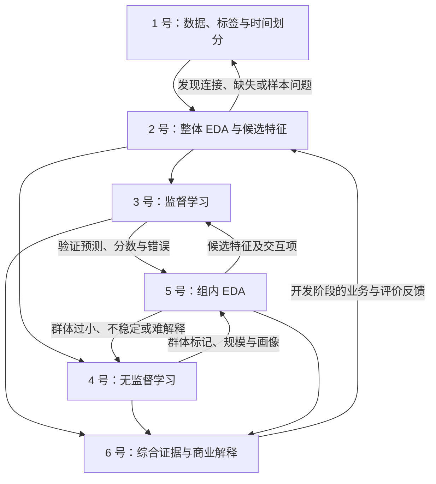

# 六人分工、依赖关系与交付倒排

更新于 2026-11-07。已核实 Slides 于 **11 月 15 日 23:59** 截止，最终报告于 **12 月 6 日 23:59** 截止，时刻均为香港时间（UTC+8）。Six Sigma 课堂展示场次待核。以下内部节点为建议，待组内确认。

## 当前进度与研究方向

Briefing 已完成，六岗均已认领。6 号已定方向，主线 A 为「有限名额的复购候选名单」，B 为分群后的内容试验补充。各岗正式产出待回报。仓库的数据、代码及 [探索结果](05-results.md) 可供参考，正式分析按统一口径组织。

方法框架是 **监督学习 + 无监督学习相结合**。先做整体探索分析（EDA）和特征构建，再并行开展复购分类预测与客户聚类。通过组内 EDA 和预测错误分析提出候选特征，反馈给分类模型并验证改动前后的表现。同时评价客户画像的稳定性、解释价值及其对经营决策的意义。

用过去 6 个月的订单信息，比较预测模型和最近购买优先在同一前 10% 名单容量下，能找到多少未来 90 天有合格订单的客户。客户分群可提出内容主题及特征改进，再以证据筛选。实际触达增量需要另有对照实验。1、3、6 号核定客户资格、时间窗口、标签和评价切分。共同口径见 [交接协议](team/protocol.md)。

已有探索测试期的结果已经查看。正式阶段仍须记录这些查看历史，由 1、3、6 号确定可行的最终评价与跨时期检验安排，说明数据覆盖和不确定性。开发循环使用开发／验证数据，方案冻结后执行预先确定的最终评价。

## 岗位与首轮交接

六个岗位均已认领。请先打开 [成员任务包](team/README.md)，把对应岗位 Markdown、[交接协议](team/protocol.md) 与实际输入文件一并交给 Agent。各岗先回报已做内容、可交版本和阻塞。表中日期为组内拟定时间。

| 岗位 | 认领 | 状态 | 首次交付 | 最新交接情况 |
|---|---|---|---|---|
| 1 号 · 数据与样本 | 已认领 | 产出待回报 | 11 月 8 日统一数据第一版 | 待交接 |
| 2 号 · 整体 EDA 与初始特征 | 已认领 | 产出待回报 | 11 月 8 日初步 EDA | 待交接 |
| 3 号 · 监督学习 | 已认领 | 产出待回报 | 11 月 9 日初版验证预测 | 待交接 |
| 4 号 · 无监督学习 | 已认领 | 产出待回报 | 11 月 9 日第一版分群 | 待交接 |
| 5 号 · 组内 EDA 与特征反馈 | 已认领 | 产出待回报 | 11 月 8 日比较框架，9 日接入结果 | 待交接 |
| 6 号 · 业务目标与项目统筹 | 已认领 | A＋B 方向已定，样本及评价待核 | 11 月 7 日收各岗进度、核 H01 | 已整理岗位卡与交接协议 |

后续工作状态可用“待启动、进行中、待交接、需协助、已交接”。交接时补上对应的 Issue、Pull Request 或文件链接，接收者核对后记录接收情况。遇阻塞及时写明需要谁提供什么。

## 每个人负责什么、交出什么

| 成员 | 主责与交付 | 共同完成的工作 | 完成检查 |
|---|---|---|---|
| **1 号 · 数据与样本** | 数据处理代码、统一客户分析表、字段字典、标签和时间划分、筛选前后样本量及复购率 | 与 2 号处理数据问题，与 3、6 号锁定任务和评估口径 | 能追踪具体客户的特征和标签形成过程，核对订单汇总及观察期完整性 |
| **2 号 · 整体 EDA 与初始特征** | 缺失、异常、分布及变量关系分析，关键图表、初始特征清单和选择依据 | 与 1 号修正数据，与 3、4 号讨论各自适用的输入和预处理，后期从统一入口复跑主要结果 | 图表注明样本、窗口、分母和单位，特征建议有数据依据，复跑差异得到解释 |
| **3 号 · 监督学习** | 简单规则与分类模型、预测代码、模型比较表、验证预测、最终评价及改进前后对照 | 向 5 号交预测与错误信息，与 5 号实施和验证候选特征，与 1 号核对信息可用时点 | 比较使用相同样本和指标，参数及特征选择在开发／验证阶段完成 |
| **4 号 · 无监督学习** | 聚类代码、输入和群数选择依据、客户群标记、规模、画像与稳定性结果 | 与 2 号确定聚类输入，与 5 号讨论群体解释及调整，尽早交第一版群标记 | 聚类使用历史特征，覆盖符合资格的客户类型，评价客户按冻结规则分配群体 |
| **5 号 · 组内 EDA 与特征反馈** | 组内行为、复购及错误分析，1–2 项有依据的候选特征或交互，实验记录与前后结果解释 | 与 3、4 号共同迭代，3 号维护预测实现，4 号维护聚类实现，5 号维护组内分析与假设记录 | 每项改动说明针对什么问题、如何比较，改善有限或无改善的尝试也记录 |
| **6 号 · 业务目标与项目统筹** | 业务决策场景、评价目标、进度、证据与建议对照表、综合结论和局限、合并后的 PPT／讲稿／报告工作稿、Canvas 要求记录 | 前期与 1、3 号统一口径，中期参与策略讨论，后期组织核数、排练与提交准备 | 主要建议可追溯到结果，成本假设明确，营销效果留待后续干预实验检验 |

每人还须交自己部分的报告段落、PPT 页面和英文讲稿，并对该部分的来源、数字和解释负责。6 号负责合并与统一表达。展示时全员发言、全员参加问答。

## 依赖关系与协作组合

- **1＋2 号组成数据与探索组合**，优先处理会影响全组样本和统计口径的问题。
- **3＋4＋5 号组成研究迭代组合**，共同讨论假设、实验和结果。代码分别由对应负责人维护。
- **6 号贯穿两个组合**，开头确定业务目标和评价标准，中期检查分析能否回答问题，后期整合结论。

分类与聚类共用客户资格和时间边界，各自选择适合的特征与预处理。纯画像的描述结果和预测评价分别标明样本与用途，组内反馈过程遵守开发／验证边界。

| 循环 | 触发情况 | 联动成员 | 调整范围 |
|---|---|---|---|
| 数据 ↔ 整体 EDA | 金额重复、缺失严重、窗口内正样本不足 | 1＋2，任务定义变化时加 3、6 | 先修数据，记录对样本、标签和下游结果的影响 |
| 初始特征 ↔ 两种学习方法 | 极端值、变量冗余、频率变化小或距离受单位主导 | 2＋3＋4 | 分别检验预测与聚类所需的特征、变换和预处理 |
| 聚类 ↔ 组内 EDA | 群体过小、分群不稳定、画像解释不足 | 4＋5 | 调整输入或群数后重新计算受影响的组内统计 |
| 组内 EDA ↔ 监督学习 | 某群错误集中，群体间行为关系有差异 | 3＋5，4 提供群标记 | 在相同验证条件下比较少量候选特征改动 |
| 分析结果 ↔ 商业解释 | 名单命中、可联系人数或画像支持量与业务需要存在差距 | 6＋相关负责人 | 在开发阶段补充分析或调整策略，记录决策理由 |

5 号从开头参与指标和比较表设计。第一版群标记交付后即可做行为画像，第一版验证预测交付后再合并复购与错误分析。3、4 号分别及时交接，5 号持续记录尚缺的输入。

## 交接、版本与迭代记录

按 [H01–H07 交接表](team/protocol.md#交接表) 指定发方、收方、时间、文件列与验收动作。每次交接带上以下内容，收方回执后再使用。

| 项目 | 需要说明 |
|---|---|
| 数据与样本 | 数据版本、客户资格、快照日期、训练／验证／评价划分、行数及正样本数 |
| 对齐方式 | 客户编号 `customer_unique_id` 与快照日期的组合键，群标记和预测逐行对应 |
| 方法 | 特征版本、预处理、模型／聚类参数、随机种子、运行入口及依赖 |
| 结果与解释 | 保存的表图、指标分母、关键发现、局限和仍待讨论的问题 |
| 接收情况 | 本次变动、影响范围、接收者、交接链接及阻塞 |

样本资格、标签或时间划分变化，由 1 号通知全组并更新版本，共同确定需要重算的数据、模型、群体统计和图表。改动后的结果与对应版本绑定。模型或聚类的单项调整，由负责人通知直接依赖方。

在组内固定一份交接索引。每轮记录问题、证据、拟改动、执行人、版本、验证标准、修改前后结果与是否采纳。可公开内容用 Issue 或 Pull Request，逐行数据和私有链接留在组内。每次先改一两项，保留旧基线和无改善记录。

11 月 9 日讨论第一版结果，10 日开展组内分析，11–12 日实施并验证有依据的改动，12 日冻结方法。额外迭代用于解决会影响结论的具体问题，由 3、4、5 号与 6 号共同确定范围。冻结后的修正记录原因、影响和重新评价情况。

## 倒排计划

以下为 2026-11-07 修订的组内拟定计划，时刻为香港时间。6 号已定业务方向，各岗回报可交时间后确认内部节点。Slides 正式截止为 **11 月 15 日 23:59**，入口同刻关闭。

| 时间 | 交付与决策 | 主要负责／接收 |
|---|---|---|
| **11 月 7 日 21:00** | 6 号同步已定方向，1、3、6 号核 H01 的客户资格、标签、样本时点、主指标和最终评价设计。各岗回报已有版本、阻塞和可交时间 | 6 号牵头，1、3 号参与，全员回报 |
| **11 月 8 日 21:00** | 统一数据第一版、初步整体 EDA、组内比较框架，交监督与无监督两路 | 1、2、5 号交接，3、4 号接入 |
| **11 月 9 日 21:00** | 最近购买规则、初版分类验证预测、第一版分群与群标记 | 3、4 号交接，5 号接入 |
| **11 月 10 日 21:00** | 组内行为、复购及错误分析，提出 1–2 项候选特征或必要分群调整 | 5 号提出，3、4 号实施，2 号提供依据 |
| **11 月 11–12 日，12 日 21:00 前** | 验证修改前后表现并记录理由，冻结口径与方法。各岗同时起草 Slides 与讲稿 | 3、4、5 号完成实验，1、6 号核对 |
| **11 月 13 日 21:00** | 执行冻结后评估、复跑和核对主要数字。每人交 Slides、英文讲稿、报告段落要点，附结果版本和来源 | 1–5 号交付，6 号收稿 |
| **11 月 14 日 12:00／19:00** | 中午完成合稿与数字对照。19:00 全员计时排练和模拟问答，登记待修处 | 全员，6 号协调 |
| **11 月 15 日 13:00／18:00** | 13:00 完成排练修订、文件冻结与全组核对。建议经团队确认的代表 18:00 前上传并回读 Canvas 回执，留 5 小时 59 分处理问题 | 6 号协调。代表、版本、回执待团队实际确认 |
| **课堂展示场次待核** | 保留第 12–13 周口径。确认 Six Sigma 场次后再安排现场集合和最终彩排，展示后记录反馈 | 6 号查 Canvas／课程通知，全员参加 |

若数据或模型交接延迟，6 号当日缩减额外模型、额外容量情境或重复调参，优先保留统一样本、最近购买基线与一个分类模型、一个可解释分群、一次组内反馈验证。若评估或反馈未完成，明确报告已跑部分与缺口。先保住 14 日合稿、排练及 15 日的上传缓冲。

### 最终报告单独倒排

| 时间 | 报告交付 |
|---|---|
| **11 月 28 日 21:00** | 各岗交完整报告段落、方法版本、复跑入口和原结果，吸收已取得的展示反馈 |
| **12 月 2 日 21:00** | 6 号合稿，全员复跑关键数、检查图表分母、结论边界、来源与格式 |
| **12 月 4 日 18:00** | 团队核准报告定稿、确认上传代表与拟交文件 |
| **12 月 5 日 18:00** | 建议组代表提交并回读回执，距正式截止 29 小时 59 分 |
| **12 月 6 日 23:59** | Canvas 最终报告正式截止 |

旧版以 11 月 18 日为假设场次，并安排 11 月 16–17 日排练和上传，现已由上表取代。完整原计划见 [11 月 5 日历史版](https://github.com/CercaTrovato/olist-repurchase-analysis/blob/c46bd7b232a8212484a98b7f44796ac6686d4678/docs/07-team-guide.md)。

## 展示与报告准备

按现有 Project Guideline 的 8 分钟展示、2 分钟问答安排。全员各讲自己负责的内容，6 号串联商业问题和综合结论。可先按以下顺序排练，正文讲解目标约 7 分 40 秒，留约 20 秒用于换页和交接。

| 顺序 | 负责人 | 内容 | 参考时长 |
|---|---|---|---|
| 1 | 6 号 | 商业问题与研究目标 | 30 秒 |
| 2 | 1 号 | 数据、样本、标签与时间划分 | 60 秒 |
| 3 | 2 号 | 整体 EDA 与特征依据 | 60 秒 |
| 4 | 3 号 | 监督学习与主要评价结果 | 100 秒 |
| 5 | 4 号 | 无监督学习、稳定性与客户画像 | 80 秒 |
| 6 | 5 号 | 组内发现、特征反馈及前后比较 | 100 秒 |
| 7 | 6 号 | 综合建议与局限 | 30 秒 |

每条主要结论都能回答研究问题、数据范围、方法与对照、具体结果及不确定性、解释与替代解释、建议与后续验证方式。预测结果支持排序能力判断，营销收益需要另外的干预证据。画像检查群体人数、品类覆盖、购买次数差异和稳定性。

## GitHub 协作与材料保存

- 有写权限的成员可在自己的分支更新交接和任务，再发 Pull Request。6 号协调合并，避免多人同时改表产生冲突。
- 组内用约定的渠道发送交接单和回执。适合公开的进度或问题可在 Issue 中记录。公开讨论使用岗位号或小组代号。
- 仓库权限由主人按实际需要管理，账号和 Token 各自保管。
- 历史探索结果保留在 `results/`，新运行先写 `outputs/` 并核对。需要纳入仓库的正式结果由负责人明确版本、提交相应代码和结果摘要，再更新说明。
- 原始 ZIP 和 CSV 保持原件，继续排除本地环境、缓存、密钥、微信截图、学号清单、Canvas 凭证及其他课程材料。
- [运行指南](06-run-guide.md) 提供现有代码的运行入口，[发布验证记录](08-verification.md) 保留历史验证范围。正式阶段的新交接与验证按本页记录。

本页记录任务认领、内部计划和实际交接。Canvas 提交、评分和学习完成情况按团队确认及平台记录分别更新。
