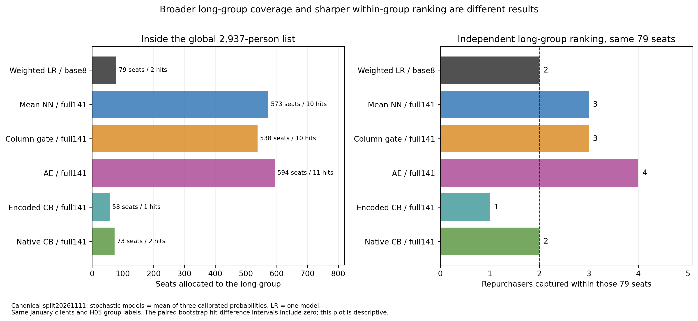
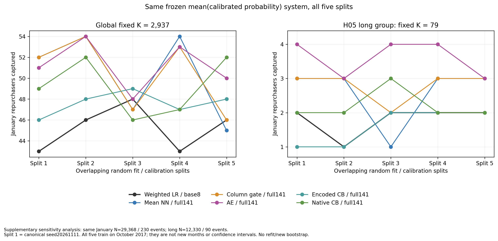

# 四候选统一比较：字段、模型和稳定性

> 最新接续：预算/字段组消融与较早回测已完成，见 [AE后续验证](ae-validation-results.md)。新证据不支持把AE当稳定升级；本页保留当时研究范围/结果，不是新正式采用决定。

2026-11-12。本批155个监督模型、30次AE预训练以及完整统计/独立读回已经完成。四月没有新增快照、标签解析或评分；一月仍是已见开发窗口，正式系统消融尚未开始。

我们要用客户过去的订单信息，预测他未来90天会不会再次购买。实际在这90天买了的客户叫“正例”；名单里选到了这样的客户，就算一次“命中”。所有合格客户都输入模型，前10%只是团队约定的名单评价容量，不能解释为运营实际只能看这些客户。

本页分开比较“多给模型哪些字段”和“用什么方法从字段学复购模式”。下面的“融合”指三个模型的概率先取平均，再按平均概率选名单；不是平均三份名单的命中数。

**建议优先保留“完整字段＋AE三种子概率融合”作为研究候选，CatBoost作为概率质量对照；列门控暂不优先。现在尚无足够证据宣布新的稳定命中赢家，也未替小组冻结正式采用版本。** AE融合在五个训练/校准扰动中全体4胜1平、久单5胜，但参考划分的命中差条件区间仍跨0。

[主统计与完整表](../../research/common-comparison-20261112/statistics/README.md) · [经典实现](../../research/common-comparison-20261112/classical/README.md) · [神经实现](../../research/common-comparison-20261112/neural/README.md) · [冻结方案](../../research/common-comparison-20261112/task_plan.md) · [分数语义澄清](../../research/common-comparison-20261112/protocol-clarification.md) · [融合稳定性补充](../../research/common-comparison-20261112/ensemble-stability-supplement.md)

## 先认识本轮的几种做法

|名称|这次实际做什么|
|---|---|
|逻辑回归（LR）|对处理后的字段组合一个线性分数，再转换为复购概率估计。加权版让训练更重视少数复购者的错误；未加权版用来区分权重作用。|
|等权神经参照|把行为、地理、商品、交易、服务和卖家六组字段各学成一份表示，再平均；它是后两种改法共同的参照。|
|列门控|在同一结构前，给每个编码列乘一个随字段当前值变化、可以学出来的系数。是否比参照更好要看对照结果。|
|AE（自动编码器）|先不看复购标签，把输入压缩后尽量还原；再用真实复购标签训练预测。重建做得好不保证复购预测好，而且它多用了预训练预算。|
|CatBoost|用许多浅树逐步学习字段与复购的关系，可以表达分段和非线性模式。统一编码与原生类别两版另作处理方式对照。|
|fit、cal、种子|fit是拟合基础预测器的客户；cal是把预测分数校正成概率估计所用的另一批客户，准确程度仍须在一月检验。种子是固定随机设置，便于重复不同初始化。|

Log loss看概率是否押得准，越小越好；AP概括从排序前段往后看的精确率/召回表现，越大越好。固定2,937人的命中是另一项容量指标，不要求与前两者同向。

## 怎样保证是在公平比较

所有客户输入和打分：十月21,160人/211正例，一月29,368人/230正例。每个训练/校准划分固定fit16,928人/169正例、cal4,232人/42正例；五个划分来自同一十月且高度重叠，不能称五个新时期。随机模型每格三个固定种子，确定性LR只跑一份。

“编码”是把州等文字类别变成数值输入，所以八个逻辑字段可以对应34列，不等于34项独立新信息。同一编码矩阵分为两档：原八字段保留34个编码列，所有新增列及其缺失标记/代理列置0；完整字段使用141个结构摘要。两档列数和六个神经分支形状一致，各模型直接读取同一份矩阵。原八字段独立变换误差小于4.36e-12；新增列确实全部为0。神经执行float32、经典float64，精度区别单列。

每档比较加权LR、未加权LR、统一编码CatBoost、同结构等权神经参照、列门控、AE。未加权LR帮助拆出类别权重的作用；等权参照帮助判断门控/AE是否额外有用。原生类别CatBoost只在完整字段另作桥接，它还改变数值变换和缺失处理，不能把桥接差异只归因于类别编码。

校准仅用十月cal，以正斜率Platt变换得到概率。单次模型用校准概率，三种子系统用三个校准概率的平均值，概率误差、AP和名单均按这个相同分数比较。raw/prior单独保留诊断，有限精度同分另行核对。[共享数据与输入哈希](../../research/common-comparison-20261112/shared/data-manifest.json)

原始九表的静态维表/录入后未改写假设继续保留；本批没有重新认证生产时点的全部可恢复性。141列包含新记录和已有字段的派生表达，不代表141项独立新信息。

## 参考划分得到什么

参考划分为事先指定的seed20261111。以下随机模型都是三个校准概率平均后的完整系统，LR只有一份。全局各选2,937人；久单各自在同一H05群12,330人/90正例中独立选79人。

|方案|全局命中|久单79命中|全局名单中久单名额/命中|全体Log loss ↓|全体AP ↑|
|---|---:|---:|---|---:|---:|
|原八字段加权LR，同口径重拟合|43|2|79/2|0.045788|0.026114|
|原八字段未加权LR，权重参照|44|1|5/0|0.045462|0.028529|
|完整字段＋等权神经参照|52|3|573/10|0.045302|0.021852|
|完整字段＋列门控|52|3|538/10|0.045468|0.018026|
|完整字段＋AE|51|4|594/11|0.045582|0.022033|
|完整字段＋统一编码CatBoost|46|1|58/1|0.044854|0.035415|
|完整字段＋原生类别CatBoost桥接|49|2|73/2|0.044864|0.035623|

旧全十月加权模型的50命中保留为历史。这里基础预测器只用80%十月客户拟合，其余20%用于校准；不能把新43与旧50直接解释为模型退化，也不能把新52与旧50作同训练预算提升。

Log loss看概率押得准不准，AP看整条精确率/召回排序表现，固定名单命中看给定容量下选到了多少复购者。它们不会自动同向：神经方案在10%容量命中更多，但AP低于本轮八字段加权参照；CatBoost的概率误差和AP较好，10%命中并不最高。

AE在全局名单里给久单594个名额、找到11人，基线仅给79个名额、找到2人。**这包含扩大久单覆盖的收益。** 固定都选79人时是4对2，才能讨论群内挑选能力；不能把11对2全部说成群内识别提高。

## 字段和模型各起了什么作用

同一个模型比较完整字段与原八字段，才是在看字段组合变化。直接给两种LR全部字段，本轮全体/久单命中都下降；给神经参照、列门控或AE增加完整字段，整体更有利。这个方向依赖学习方法，不能说字段越多越好，也不能说完整字段普遍无用。

同一字段档比较模型，才能看学习包差异。列门控参考划分与等权参照都是52/3；AE为51/4。结果没有支持“加模块就全面更好”。同字段探索性配对中，列门/AE的全体Log loss比等权参照更大，而名单差区间都含0。[完整模型×字段表](../../research/common-comparison-20261112/statistics/main-model-information-by-split.csv) · [同字段完整配对附表](../../research/common-comparison-20261112/statistics/exploratory-complete-same-information-canonical-CI.csv)

AE额外有20轮无监督重建，列门初值会把输入缩放为0.5；零输入分支仍能学常量。当前比较整个候选包，没有把额外预算、缩放、架构与具体机制完全拆开。逐信息层、预算或模块的贡献在候选后的正式消融再回答。

## 稳定性得到什么证据

统计中保留了两个不同问题：先平均每个seed的指标，研究单次模型波动；先平均三个概率再挑名单，研究真正的融合系统。两者不相等。补充敏感性对全部13个已有系统都计算五个划分的同一融合规则，没有新训练或新bootstrap，也不是结果前单项确认性检验。

|完整字段系统相对同划分八字段加权LR|五划分全局胜/平/负|五划分久单79胜/平/负|
|---|---|---|
|等权神经参照|3/0/2|4/0/1|
|列门控|3/1/1|4/1/0|
|AE概率融合|4/1/0|5/0/0|
|统一编码CatBoost|5/0/0|0/4/1|
|原生类别CatBoost桥接|4/0/1|2/3/0|

这支持AE融合对训练/校准客户变化的方向较一致，**不证明换月份仍有效**。同一月的90位久单复购者被重复评价，五个划分不是五份独立测试数据。

参考划分另做2,000次固定分数配对客户重抽样；每次在带复制观测的伪客户池里重排同容量，区间不含重训、校准拟合、探索选模和时间漂移的不确定性，且未做多重比较校正。

|参考划分相对八字段加权LR|全局命中差及95%条件区间|久单79命中差及95%条件区间|
|---|---|---|
|等权神经参照|+9，[-4,22]|+1，[-3,6]|
|列门控|+9，[-3,21]|+1，[-3,6]|
|AE|+8，[-4,20]|+2，[-3,6]|
|统一编码CatBoost|+3，[-6,13]|−1，[-4,3]|
|原生类别CatBoost桥接|+6，[-5,17]|0，[-3,4]|

所有名单差区间都跨0。因此目前可以说“有改善线索、部分训练扰动方向一致”，不能说已经证明稳定提高命中。CatBoost两域的Log loss差条件区间均小于0，概率质量的证据更强；这也不能直接升级为固定名单命中优势。[主条件区间](../../research/common-comparison-20261112/statistics/canonical-paired-bootstrap-intervals.csv)

## 候选、未完成和下一步

|研究安排建议|依据|尚不能声称什么|
|---|---|---|
|优先保留完整字段AE三种子概率融合|同系统五划分全体4胜1平、久单5胜，参考久单4对2|尚无名单差条件区间排除0或新时期证明；不等于正式采用|
|保留完整字段等权参照|参考全局52、概率误差较门/AE更好，是解释模块收益的必要参照|同系统全局仍有2个划分低于基线|
|保留完整字段CatBoost作概率质量对照|两个表示版本的全体/久单Log loss改善较有条件证据|固定名单命中并非明确胜出；两表示处理包不可混称|
|列门控暂不优先进入下一轮|与等权参照52/3相同，额外参数/缩放未显示明确收益|这不是证明所有门控无效，全部结果继续保留|

研究候选范围已收窄，正式主指标及小组采用版本仍待真实决定。原八字段加权LR继续作为既有主方案候选与参照，当前不提前运行系统消融。下一步围绕候选先确定采用何种目标，再按同预算的AE重建/额外训练、信息组等做正式消融，并设计不使用四月的新时间验证；已见窗口的限制继续披露。

组员继续已分发的第三轮任务，实际回件后按键、时间、训练范围和名单规则并列核对。回件与本地影子研究分开计，不用本地155模型替代成员交付。11月12日21:00展示采用截止、13日21:00收稿及14日合稿排练沿用已定安排。

## 可复核材料与实际边界

- [冻结科学方案](../../research/common-comparison-20261112/task_plan.md)、[执行中分数语义澄清](../../research/common-comparison-20261112/protocol-clarification.md)、[结果后融合敏感性说明](../../research/common-comparison-20261112/ensemble-stability-supplement.md)分开保留，没有覆盖原分析或伪称所有追加比较事前确认。
- 65经典模型195期重放、90神经模型270数组重放一致；两实现作者互审对方。统计独立核3200概率行、1280容量行、1040行区间的端点、260组显式复制池，并核100校准箱守恒。根补充130融合指标、260名单配对及130方向行由统计代理再核，差0。
- 20个LR均按函数变化准则停止，实际梯度未达到请求gtol1e-10；校准success也不等于该残差达标。所有真实梯度、下界、预算和失败均保存，不声称非凸网络全局最优。
- 本批17对PNG/SVG已实际查看，提供表、代码及完整负结果；精确公共清单不含逐人数据、模型或原论文。源代码是本机运行记录，重跑需要内部H02/H05与P2派生表，不能称独立下载即跑的公共包。
- 一月反复参与开发，客户在时期之间可能重复；本批没有真正未见的最终测试、没有营销干预对照，不能把历史命中解释为增量订单。

GitHub、本地看板及线上看板各自的完成状态以本批独立收尾回执为准，不把模型文件保存当作三端同步完成。

[总监督简报与待决事项](common-board-note.md) · [历史与本批 57 图统一索引](all-57-figures.md)。
