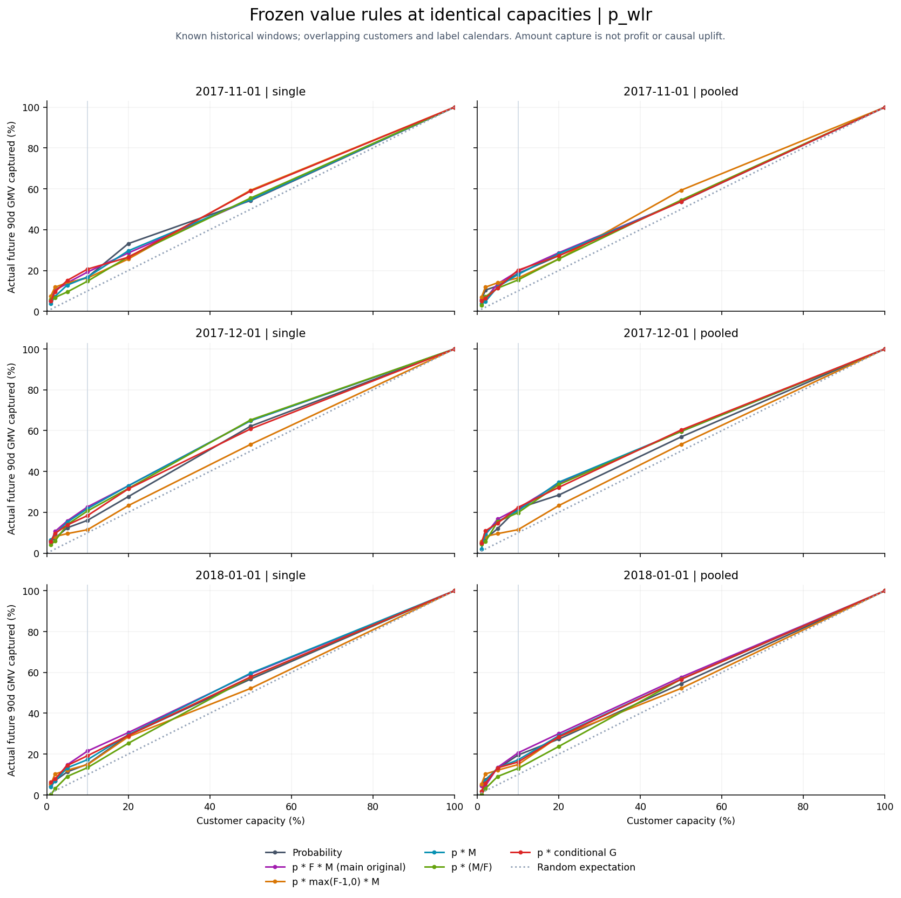
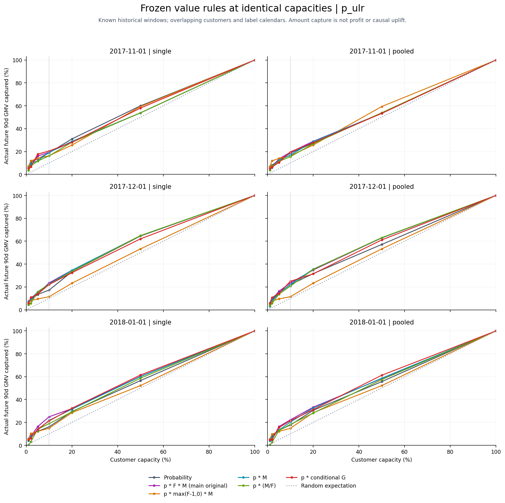
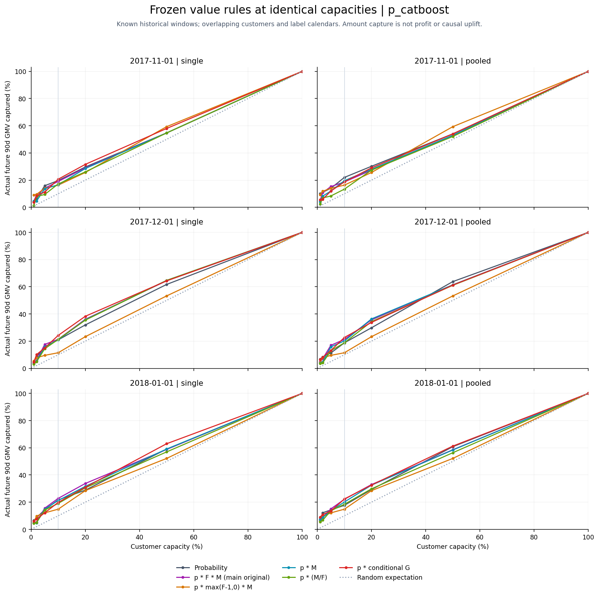
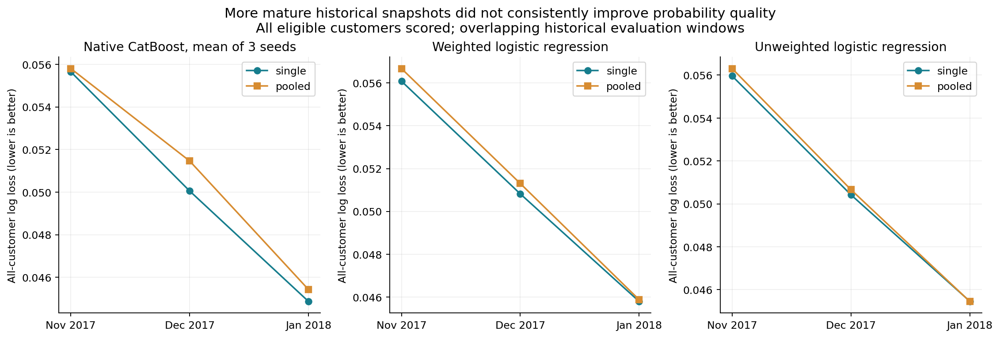
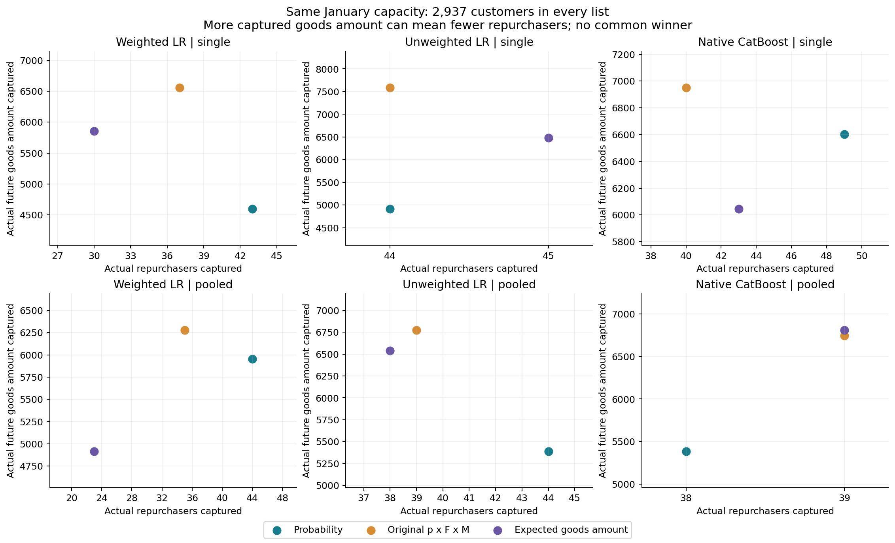
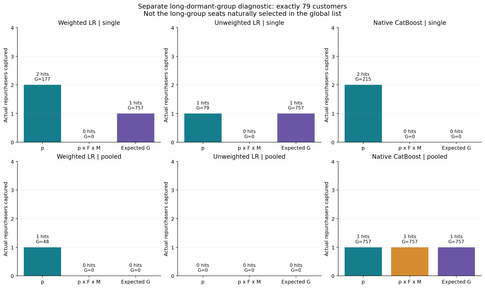

# 最后固定批次6图：全体概率、价值与容量

本批新增6幅主图（每幅PNG/SVG），此前66幅合计72。下列图文件由各作者实际生成；本文提供图义与入口，不代替独立视觉查看回执。

[主说明](final-research-closeout.md) · [价值规则](final-value-guide.md) · [全部72图入口](visual-assets.md)

## 01 p_wlr：容量与商品额份额

同窗口/策略看容量增加时的金额覆盖；不同规则同名额比较，100%全部收敛，不能由某一点挑最佳K。

[PNG](../../research/final-validation-20261112/value/figures/capacity-gmv-p_wlr.png) · [SVG](../../research/final-validation-20261112/value/figures/capacity-gmv-p_wlr.svg)

## 02 p_ulr：容量与商品额份额

同窗口/策略看容量增加时的金额覆盖；不同规则同名额比较，100%全部收敛，不能由某一点挑最佳K。

[PNG](../../research/final-validation-20261112/value/figures/capacity-gmv-p_ulr.png) · [SVG](../../research/final-validation-20261112/value/figures/capacity-gmv-p_ulr.svg)

## 03 p_catboost：容量与商品额份额

同窗口/策略看容量增加时的金额覆盖；不同规则同名额比较，100%全部收敛，不能由某一点挑最佳K。

[PNG](../../research/final-validation-20261112/value/figures/capacity-gmv-p_catboost.png) · [SVG](../../research/final-validation-20261112/value/figures/capacity-gmv-p_catboost.svg)

## 04 三日期滚动：单期与多期概率

同评价日比较全体对数损失（越低越好）；AP另见概率指标表。多期训练还改变历史与词典，不是纯样本量效应。三个窗口客户/目标日历重叠，不是独立盲测。

[PNG](../../research/final-validation-20261112/figures/01-rolling-probability.png) · [SVG](../../research/final-validation-20261112/figures/01-rolling-probability.svg)

## 05 一月同容量：命中与商品额取舍

同一概率改名单公式，人数命中与商品额捕获可以相反。完整18组合并列，不凭某一格的高额宣布统一赢家。各小图坐标独立，按刻度读，不比点的视觉距离。

[PNG](../../research/final-validation-20261112/figures/02-january-hits-value-tradeoff.png) · [SVG](../../research/final-validation-20261112/figures/02-january-hits-value-tradeoff.svg)

## 06 久单群固定79人：规则比较

单独观察久单群内挑选，不能用全局久单席位变多当成群内变准。F−1敏感性让久单全零分；主规则和预计额仍有弱结果和零命中。

[PNG](../../research/final-validation-20261112/figures/03-long79-rule-comparison.png) · [SVG](../../research/final-validation-20261112/figures/03-long79-rule-comparison.svg)

数据与源码：[容量表](../../research/final-validation-20261112/value/capacity-results.csv)、[概率指标](../../research/final-validation-20261112/probability/primary-eval-metrics.csv)、[价值绘图源码](../../research/final-validation-20261112/value/plot_value.py)。固定Jan条件区间不含重训/搜索/漂移；三个滚动窗口不是独立盲测。
