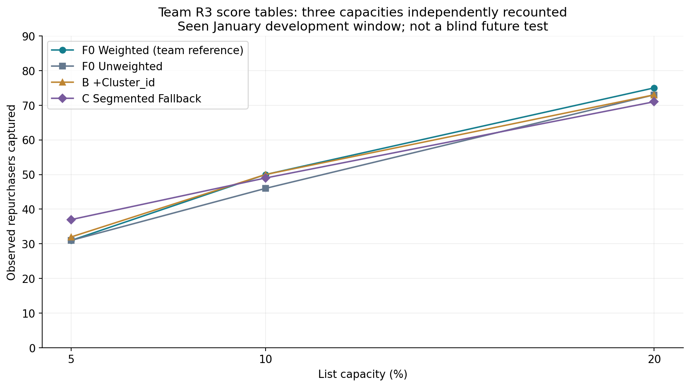
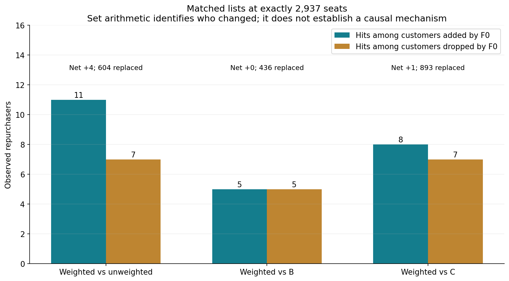
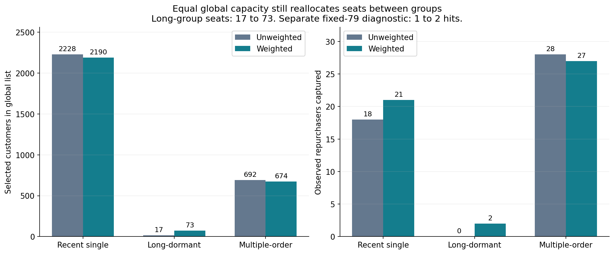

# 5号回传核验：3组当前图

原错误95%区间图不采用。3幅均从已核聚合绘制，提供PNG/SVG与源数据；此前85幅保留，总计88幅。

## 四模型三容量回算

包含F0加权/未加权/B/C；已见一月开发结果，不是独立未来测试。

[PNG](../../research/role05-mainline-20261113/figures/01-role05-capacity-recount.png) · [SVG](../../research/role05-mainline-20261113/figures/01-role05-capacity-recount.svg)

## 配对名单换入换出

604换入11、换出7是净+4的集合分解，不单独证明机制。

[PNG](../../research/role05-mainline-20261113/figures/02-role05-paired-changes.png) · [SVG](../../research/role05-mainline-20261113/figures/02-role05-paired-changes.svg)

## 相同全局名额下的群间席位变化

全局2937相同，久单席位仍从17到73；另固定79才是同群容量诊断。

[PNG](../../research/role05-mainline-20261113/figures/03-role05-group-allocation.png) · [SVG](../../research/role05-mainline-20261113/figures/03-role05-group-allocation.svg)

[本批验收](local-line-role05.md) · [数据和源码](../../research/role05-mainline-20261113/README.md) · [此前85图](all-85-figures.md)
