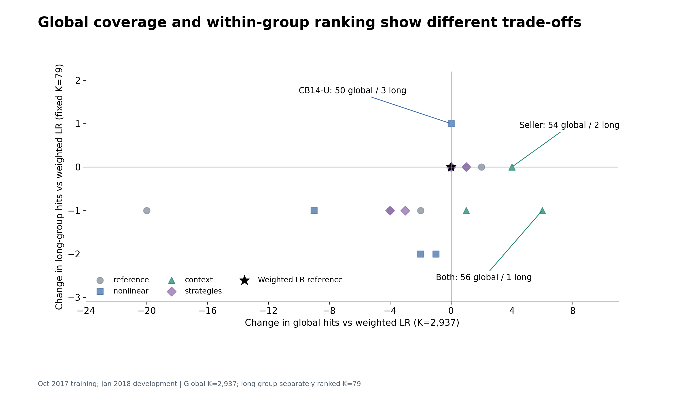

# 第三轮本地后续探索

2026-11-11。本人已确认第三轮任务发群，成员接单与新结果待回传。本地后续预先固定11个新候选，仍用十月训练、一月已见开发验证，全局2,937名额、久单cluster_id=1单独79名额。四月新模型评分与快照标签解析均为0。最终采用模型仍待成员回传后统一比较。

[前一批研究](round-3-results.md) · [全部图表](visual-assets.md) · [本批数据与绘图源码](../../research/round3-extension/README.md)

## 本轮结果

表中久单命中是单独固定79人的诊断，和全局名单分给该群的实际名额分开读取。

| 方法 | 全局5% | 全局10% | 全局20% | 久单单独79 |
|---|---:|---:|---:|---:|
| 原八字段加权LR | 31 | 50 | 74 | 2 |
| 浅树8字段，未加权 | 36 | 48 | 72 | 0 |
| 浅树8字段，平衡权重 | 32 | 49 | 67 | 0 |
| 浅树14字段，未加权 | 31 | 50 | 72 | 3 |
| 浅树14字段，平衡权重 | 29 | 41 | 66 | 1 |
| 加历史卖家上下文 | 33 | 54 | 73 | 2 |
| 加篮子/支付上下文 | 39 | 51 | 80 | 1 |
| 两组上下文都加 | 36 | 56 | 73 | 1 |
| 等权排名融合W＋三字段LR | 36 | 50 | 71 | 2 |
| 等权排名融合W＋加群号版 | 32 | 51 | 75 | 2 |
| 等权排名融合W＋配送＋评价版 | 31 | 46 | 70 | 1 |
| 训练支持量收缩群模型 | 34 | 47 | 73 | 1 |

5%、10%、20%名额分别为1,469、2,937、5,874。既有三字段与加群号等六个对照也保留在 [17方法共同诊断表](../../research/round3-extension/chart-data/all-methods.csv)。

## 新增信息与策略为何这样比较

**浅树四格。** 固定CatBoost深度3、300轮、学习率0.03、L2=10、seed=2026；原8字段和原8＋既有6项配送评价字段，各试未加权/平衡权重。没有用一月早停或改超参。14字段未加权版的全局命中仍为50，固定久单多1人，但全局名单实际给久单0个名额。它提示可继续研究群内排序与跨群分数的关系，当前还没有稳定改善证据。

**历史卖家上下文。** 在各快照的历史半年内，按卖家与买家统计不同订单。为当前买家提取卖家规模和历史重复购买占比时，扣除该买家本人的贡献，再对其接触过的卖家等权聚合。三项为其他买家数/订单数的log均值，以及固定Beta(1,19)平滑的历史重复买家占比。没有用未来复购标签来给卖家编码。

**篮子/支付上下文。** 六项为每单不同卖家、商品、品类的数量均值，信用卡与boleto订单占比，以及有效分期最大值均值。未知记录单列，填补/缩放只在十月拟合。商品目录与支付表没有逐字段历史日志，“批准时可知且没有事后改写”仍是保留假设。卖家、交易与组合三版均沿用原加权LR参数。

**固定融合与群模型。** 三种融合先将全体分数转成按固定同分规则生成的名次，等权组合，未扫描权重。群模型将平衡模型的decision_function减去log(训练负例数/正例数)，再按λ=群内训练正例数/(群内训练正例数+100)，合并该群与全局的先验校正logit分数；该分数没有被证明是校准概率。四种策略全部保留。

## 差异的含义与可靠性

卖家版在全局多找到4人，固定久单仍为2；与原版的条件95%百分位区间为[-2,10]。组合版全局多6人、固定久单少1，全局区间[-4,14]；它给久单200个全局名额、命中3，原版为79个名额、命中2。浅树14未加权版固定久单多1，区间[-2,4]。所有11个新候选的全局主指标差异区间均跨0。[全部主指标区间](../../research/round3-extension/chart-data/paired-intervals.csv)

区间来自2,000次相同客户抽样、固定已拟合分数的配对重采样。它们没有包含模型重训、反复方法搜索或新时间窗口的不确定性。当前结果来自已见开发期，不能据此证明跨期稳定胜出。

输入哈希、字段与参数冻结、预测日边界和名单重排均已核。卖家正向结果另做独立复核：两期全部卖家–买家组合逐个排除当前买家重构，三个卖家字段误差0；删除预测日起未来订单及关联商品/支付后，新增9字段完全不变；54／56及2／1和配对重复值均复现。图14–18经独立实读与源表核对，未见实质缺陷。

## 后续衔接

第三轮成员仍按已发任务自由设计策略，回传后与本地同容量结果并列检查。正式采用版本与真实冻结由6号决定，H07继续收稿。图内CB8/CB14分别指8/14个逻辑输入字段，U/B分别指未加权/平衡权重。

