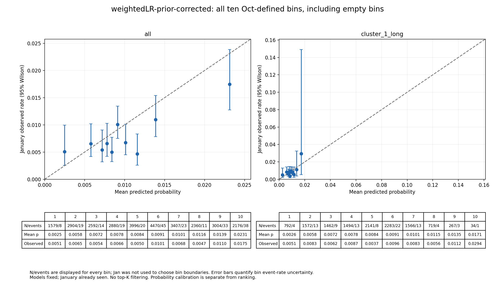
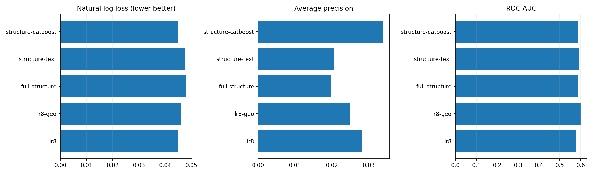
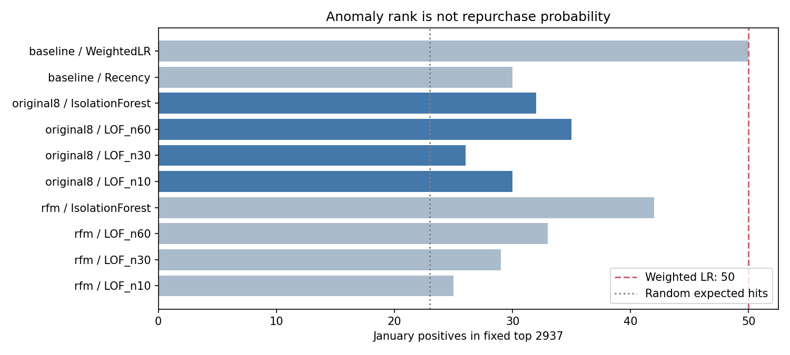

# 从建模质疑到逐步验证

用户在 2026-11-11 明确授权开测。此前设计阶段“新增实验 0、等待指令”的记录保留为历史，现在按 Q01–Q18 逐项执行。真实组员第三轮回传仍待收，本页记录本地研究。

[项目进度](current-status.md) · [原问题与当前状态](research-questions.md) · [代码、数据和图](../../research/validation-20261111/README.md)

## 要回答什么

用分析日之前的信息，给每位合格老客户估计未来 90 天复购的可能性。客户本来就是全量输入：十月训练 21,160 人，其中 211 人复购；一月全量评分 29,368 人，其中 230 人复购。

这次分别检查三件事：概率是否押得准；能否把复购者排得更前；业务只能选一部分人时名单有多有效。原 2,937 个名额与久单群内固定 79 个名额属于第三件事。真实营销能增加多少订单，还需要另做干预对照；当前历史标签不能回答。

一月已多次用于开发，不能当作新增盲测。四月本批不新评分、不解析快照或标签。所有变换、群统计、校准、采样与表示学习均限定在十月训练侧。

## 推进顺序与当前状态

|阶段|为什么做|本批状态|接下来由什么决定|
|---|---|---|---|
|P1 概率与基率|防止把排序分数当真实概率，检查单单客户是否有增量信息|基础验证完成|保留自然分布科学面板；正式主指标仍待采用决定|
|P2 可用字段|检验原八字段是否漏了有用信息，补地区、距离及历史文本|五候选完成及回源核验|继续区分信息贡献和模型表达能力|
|P3 异常与分群|检验异常是否就是目标客户，检验三群是否必要|基础验证完成；异常后端按弱支持停止|聚类几何与监督收益分别判断|
|P4 权重、分支、注意力与损失|检验群内差异、学习方式、不平衡和表征是否带来收益|首批固定矩阵完成与交叉核验|同输入/划分比较；优化充分性另做控制；不依据一月扩参数|
|P5 最终系统消融|解释选定系统到底靠哪部分|最终候选冻结后执行|先有明确候选及主指标，再拆组件|

展示采用方法仍按已确认的 11 月 12 日 21:00 截止推进，13 日 21:00 收 Slides 与讲稿，14 日合稿排练；香港时间。研究可继续，但未验证的方案不能提前写入正式结论。

## P1：先区分概率与名单

类别加权让训练时更加重视少数复购者，也改变了输出的概率尺度。原加权模型在一月平均给出约 47.17%，实际只有 0.7832% 的客户复购，所以它的原分数不能直接解释成自然复购概率。

|方法|Log loss ↓|Brier ↓|AP ↑|全局 2,937 命中|
|---|---:|---:|---:|---:|
|十月常数基率|0.046032|0.00777490|0.007832|同分名单不解释为能力|
|未加权三字段 LR|0.044976|0.00770666|0.032458|51|
|未加权八字段 LR|0.045072|0.00771366|0.028239|46|
|加权 LR 原分数|0.660372|0.23446377|0.029797|50|
|加权 LR 训练先验修正|0.045410|0.00771376|0.029797|50|
|加权 LR 十月折外 Platt 校准|0.045711|0.00776620|0.029797|50|

Log loss/Brier 衡量概率误差，AP 衡量排序。先验修正把分数拉回接近自然发生率的尺度，名单顺序保持不变。它没有新增信息，也没有证明加权模型的概率已经优于未加权模型。

久单客户用“十月久单群的平均复购率”作常数参照，比使用全体平均更公平。目前多数候选的增量概率收益区间跨 0，尚未证明在这群人中有可靠收益。有限历史仍可从相似客户学习群体风险，但不能据此承诺准确辨认每个久单个体。全预测“不复购”已有 99.2168% Accuracy，说明本题不能只看准确率。

图中横轴为预测概率，纵轴为实际复购率；越接近虚线越校准。下表列每箱人数/事件，误差线表示该箱实际发生率的不确定性。完整箱、阈值和条件区间见 [P1](../../research/validation-20261111/probability/README.md)。

## P2：更多字段有没有用

原始九表的 52 个字段位置都做了处置目录，不能把连接键、重复值和预测日未知的结果直接当输入。最终形成 141 个结构摘要列，包括 21 个新增地区/距离列；编码后 913 维，训练侧文本另有 1,317 个词。23 个原字段的使用依赖静态维表或录入后未回写的假设，完整时点可恢复性仍有限制。

|相同十月/一月的候选|Log loss ↓|AP ↑|全局 2,937 命中|共同久单群内 79 命中|
|---|---:|---:|---:|---:|
|八字段 LR|0.045071|0.028243|46|1|
|八字段加地理 LR|0.045999|0.024914|49|0|
|全结构 LR|0.047910|0.019658|42|0|
|结构加历史评价文本 LR|0.047689|0.020542|39|0|
|全结构 CatBoost|0.044881|0.033910|54|3|

更多列未自动提高表现。地理 LR 的全局命中和 AUC 上升，但概率误差/AP 变差；不能把它概括为全面改善。全结构 CatBoost 这次读数较好，尚不能据一月单个固定种子宣布稳定胜出。它的 54 对八字段 LR 的 46 同时改变了信息和模型，不能把 8 人全部归因于新增字段：同为 LR，八字段到全结构是 46 到 42；同为全结构，LR 到 CatBoost 是 42 到 54。

P2 八字段 LR 统一使用稀有类别合并和固定缺失指示，与旧存档的预处理略有不同：AP 州 12 人与 RR 州 9 人被合并编码，含缺失指示共 40 列；旧州分别编码。它们的微小指标差是预处理实现差异，不能全称为浮点噪声，也不能视作提升。P2 内部五格使用冻结的统一预处理规则。

左右三图分别看概率误差、AP 和 AUC，方向不同。上述名额命中见 [P2 完整表与容量图](../../research/validation-20261111/features/README.md)。

执行时发现并纠正两处偏差：坐标预处理曾偏离冻结方案，归档后按原方案整轮重跑；久单曾误用其他群号，改用权威 H05 cluster_id=1，仅重算容量，未据一月结果选模型。正式表使用 12,330 人/90 正例的共同久单群，错误轮保留本机。

## P3：异常与三群的假设

原八字段空间中，LOF 的 10/30/60 邻居分别命中 30/26/35 人，IsolationForest 命中 32 人，低于原加权模型的 50 人，AP 也较低。它们有的略高于随机期望约 23 人，但没有显示作为主排序替代品的足够支持，按冻结规则停止扩展这条线。

训练几何指标偏好 K=2；RFM 空间的两群几乎就是单单和多单。K=3 在此基础上按最近购买时间再拆单单，能复现原 H05 分区，数字群号有置换。GMM 的 BIC 偏好搜索上界 K=8，不能称真实最佳群数。密度法虽不用直接指定 K，仍受密度参数和噪声处理影响，一种 RFM 配置在抽样时明显不稳定。

这些结果回答的是“群怎样形成、是否稳定”，没有证明两群或八群最适合预测复购。软硬群是否帮助监督模型，在 P4 的同口径比较中判断。见 [P3](../../research/validation-20261111/structure/README.md)。

## P4：群差异和学习方式有没有贡献

P4 统一将十月划为 fit 16,928 人/169 正例，cal 4,232 人/42 正例。输入变换和无监督群只拟合 fit，校准只用 cal；不在一月选训练轮数。小正例数意味着结果会波动，这一划分的成绩必须与同划分参照比，不能把旧全十月模型的 50 人当同训练预算基线。

群统计初值、固定/可学习群偏移、共享群残差和软硬门控已比较。零初值和相关初值到达近同凸解，初值本身没有可宣称的收益；ReLU 支路相对同参数 identity 支路也没有概率与名单同时改善的证据。这个负结果只适用于固定正则与预算，不能排除所有群模型。[P4A 全部结果](../../research/validation-20261111/group-learning/README.md)

不平衡和目标函数完成 20 个模型运行、50 个分数版本：weighted、过采样、SMOTENC、focal 和 pairwise 没有一致超过本矩阵未加权 LR。focal 校准后 AP 较高，但命中反而略少。SMOTENC 会产生非整数计数字段，是数学插值样本，不可当作真实交易记录；单独修正先验不足以消除其条件分布变化。[P4B 全部结果](../../research/validation-20261111/objectives/README.md)

六视图表征完成 39 个固定预算模型，神经候选保留三个种子。下表是同一 P4C 输入、预处理、fit/cal 和监督预算下的均值；51.33 表示三个整数命中的平均值，不能解释为额外一轮人数。

|P4C 候选|raw Log loss ↓|raw AP ↑|全局 2,937 命中均值|久单群内 79 命中均值|
|---|---:|---:|---:|---:|
|六视图等权均值|0.045318|0.017354|51.33|2.33|
|全局可学习视图权重|0.045289|0.017717|53.33|1.67|
|样本视图注意力|0.055166|0.015303|37.33|2.33|
|按编码列学习门控|0.045304|0.018023|55.33|2.67|
|AE 预训练后监督适配|0.045221|0.018754|51.33|4.33|
|全部简化启发模块|0.045246|0.020446|53.67|2.33|

列门控有局部名单收益，AE 有局部概率/AP及久单收益，但 AE 额外用了 20 轮无监督预训练；不能把它完全归因于某个模块。对比、同伪簇负对降权、潜原型和中心对齐的增益不单调。AE 到 NCE 还同时改变了 mask 增广，需后续拆解。注意力权重也不是因果解释。

少数伪簇不等于复购正类，潜原型只用于无监督一致性，没有虚构复购标签。这是明确定义的 MVSIB-inspired 简化；完整论文困难样本机制尚未复现。样本注意力有一个种子的 Platt 斜率为负，会翻转排名，因此表中 raw 名单与校准概率 AP 分开给出。三种子范围只表示初始化波动。[P4C 全部模型、图和边界](../../research/validation-20261111/representations/README.md)

## 优化充分性：同一模型也可能给出不同名单

交叉核查发现，P4A/B 的 fit 客户、顺序、34 维矩阵和 C 完全一致，但默认求解停止精度不同，造成 44 与 47 命中。仅提高停止精度后，两个无群模型回到近同目标值和同一 44 人命中名单。这属于数值求解差异，不能解释为群模块贡献。[专门诊断](../../research/validation-20261111/numerical-convergence-audit/README.md)

为此另冻结 7 个既有全十月 LR 的停止精度控制，保留原预处理/C/权重，只改 tol 与最大迭代数。更高精度下，LR3 的命中 51→50，LR8 46→46，加权 50→50；P2 四个 LR 分别 46→46、49→48、42→41、39→39。全结构/文本 LR 仍未超过原八字段，但名单替换人数可超过 200，不能只看总命中相同便称逐人结果稳定。请求 tol=1e-10 不等于实测梯度已满足该数值，回执保留了实际梯度和停止限制。[完整数值控制](../../research/validation-20261111/convergence/README.md)

P1 的条件区间只属于其原分数，不能自动转移给新优化后的分数。各矩阵内部都有参照；跨矩阵还存在输入、预处理、训练人数和优化预算差异，不能把所有数字拼成同一因果排行榜。

原深聚类成员头的训练损失仍差于常数，50 轮预算不足。另以相同已冻结成员矩阵拟合统一高精度 LR 后端，训练损失全部降到常数以下；这确认原差距不能只归因于表征。控制后 RFMlog-soft 的一月 AP/全局/久单为 0.033622／49／0，deep-soft 为 0.022199／47.33／1，仍有指标取舍，没有证明深群优于参考。没有重选 K、重训表征或依据一月改学习率；此 RFMlog 与 H05 的 R 变换不同，不能称同口径复现 H05。[群成员后端控制](../../research/validation-20261111/cluster-head-control/README.md)

## 尚未完成与下一步

本批回答了不少具体假设，没有证明穷尽所有方法或实现最终业务效果。下一步应先把少量有依据的候选放进同一输入/预处理/训练预算的比较，再冻结研究候选并做系统消融，拆信息组、列门和预训练预算，补 AE+mask 无 NCE 的必要控制；增加合适的时间验证并披露窗口重叠与已见限制。其余旧 LR 候选尚未全部按同一停止精度重拟合，暂不把不同矩阵的最高分当最终胜者。

最终正式主指标、模型采用和完整系统消融的对象仍未确定。组员按已分发第三轮任务独立推进，回件后逐键核验并列比较，不要求他们复制本地策略。本批继续执行不需要用户补充数据；临近展示采用时再据完整对照作具体取舍。

本页各已完成矩阵均有计算、来源/模型读回、图像检查与交叉复核。整批 GitHub/本地看板/线上看板是否完成，以三端收尾回执为准。固定分数 bootstrap 不包含重训或方法搜索不确定性，所有一月比较都保留已见开发窗口限制。

[总监督接续与当前授权状态](validation-board-note.md) · [40图统一入口](validation-figure-gallery.md)。
