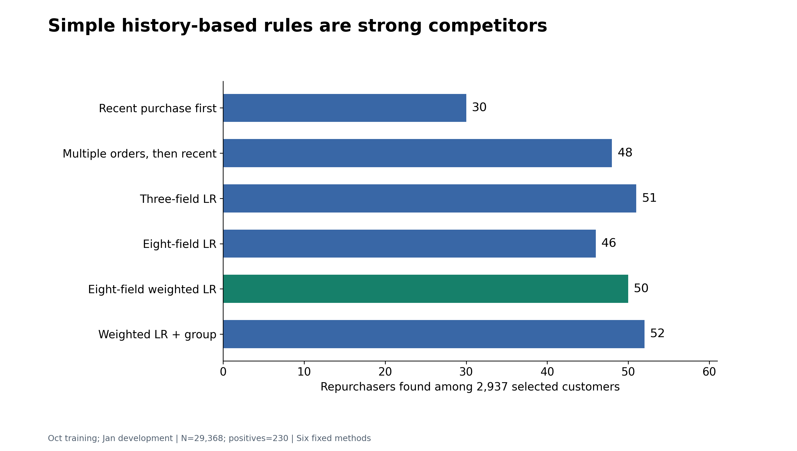
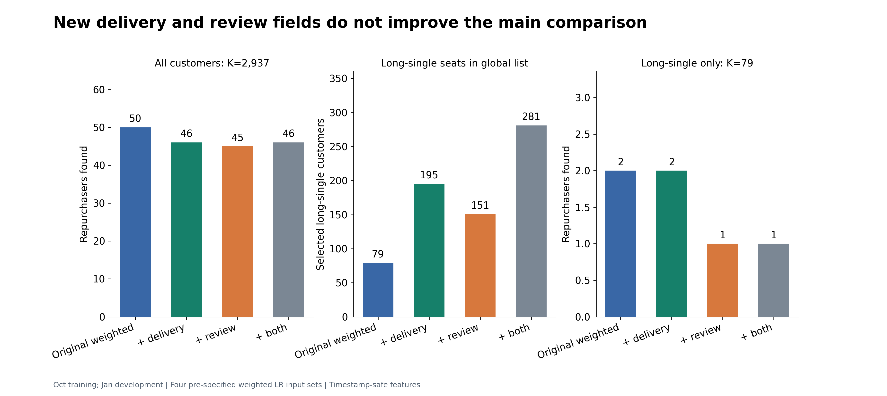

# PPT与报告图表素材：累计72幅

> 当前92幅：此前89幅＋本批3幅既有汇总比较图；8幅旧图复用不重复计新增，无新模型。[92图入口](all-92-figures.md) · [配对图库](route-image-comparison.md)。

> 当前素材累计88幅：此前85幅＋本批3幅核验衍生图。[88幅入口](all-88-figures.md)。原5号95%区间图不列当前素材。旧批次数量保留历史。

> 最新累计85幅：此前72幅＋本批13幅。[本批13图与当前画像](round3-team-figures.md) · [85图总入口](all-85-figures.md)。旧批次数量仅为历史。

**当前累计72幅主图：此前66幅＋最后概率/价值/容量6幅。** [最新6图及图义](final-validation-figures.md) · [最终研究主线](final-research-closeout.md) · [含历史66图入口](all-66-figures.md)。每幅PNG/SVG按同一主图计数；不把两个格式算两幅。

**历史至上一批累计66幅：此前57幅＋AE后续验证9幅。** [本轮9图](ae-validation-figures.md) · [对应结果](ae-validation-results.md)。下文旧批次数量与分数保留历史，跨期只与各自同口径基线比较。

[当前结果](round-3-results.md) · [第三轮成员任务](round-3/README.md) · [绘图源码与数据](../../research/round3/README.md)

2026-11-11。此前共57幅图：前两批18幅、逐步验证22幅及统一比较17幅。每幅提供PNG、可编辑SVG、聚合数据与源码。默认图内英文，适合英文展示。LR为逻辑回归，GCN为图卷积模型。K代表名单人数。不同训练人数/预处理/停止精度的矩阵分别解读，不能拼成同一因果排行榜。

## 最新统一比较17幅

[17幅逐图预览/PNG/SVG/数据](common-comparison-figures.md) · [字段与模型、完整结果和限制](common-candidate-comparison.md)。新增2幅经典训练诊断、3幅神经训练支持、10幅统计/校准图及2幅融合/久单覆盖图。三个种子的指标均值与先平均概率的融合结果分表；所有五split都是同一月的训练扰动。

## 上一批逐步验证22幅

|组|图数|看什么|素材与数据|
|---|---:|---|---|
|P1 概率|7|全体/群内校准、每箱人数事件、概率尺度和proper loss|[P1](../../research/validation-20261111/probability/README.md)|
|P2 全字段|2|不同信息和模型的概率/排序及多个容量|[P2](../../research/validation-20261111/features/README.md)|
|P3 异常/分群|2|异常目标交集、K和GMM训练准则|[P3](../../research/validation-20261111/structure/README.md)|
|P4A 群学习|2|群斜率、初值和共享支路|[P4A](../../research/validation-20261111/group-learning/README.md)|
|P4B 损失/采样|3|raw/prior/Platt概率差及固定名单|[P4B](../../research/validation-20261111/objectives/README.md)|
|P4C 融合/表征|2|注意力、列门与预训练，三seed范围|[P4C](../../research/validation-20261111/representations/README.md)|
|LR停止控制|2|训练梯度、概率/名单对停止条件的敏感性|[数值控制](../../research/validation-20261111/convergence/README.md)|
|群成员后端|2|原50epoch拟合不足与同成员LR控制|[后端控制](../../research/validation-20261111/cluster-head-control/README.md)|

读图时先看训练人数和排名规则。seed范围是初始化波动，固定分数bootstrap是条件区间，二者都不等于新时期验证。新优化分数不能承接旧bootstrap区间。以下18幅保留原历史配置，具体数字按其当时模型解释。

## 建议用于主线的图

07说明强基线，09说明小差异的不确定性，03区分名单覆盖与群内排名，11呈现本轮新增信息结果，10交代评价边界。12与13适合业务建议，其他图作研究扩展。

## 全部素材

### 01-group-size-and-rates

一月分群规模与复购率。近期单单16,335人、久单12,330人、多单703人。多单群复购率较高。单单指历史半年内只买一次。

[PNG](../../research/round3/figures/01-group-size-and-rates.png) · [SVG](../../research/round3/figures/01-group-size-and-rates.svg) · [数据](../../research/round3/chart-data/01-groups.csv)

### 02-fields-by-weighting

一月相同2,937个名额，三字段加权51→48，八字段加权46→50。加权收益取决于输入组合。

[PNG](../../research/round3/figures/02-fields-by-weighting.png) · [SVG](../../research/round3/figures/02-fields-by-weighting.svg) · [数据](../../research/round3/chart-data/02-weighting.csv)

### 03-global-versus-fixed-group

加入群号全局50→52，但固定久单79名额仍命中2人。两项交互和金额单项交互都降为全局42、固定久单0。

[PNG](../../research/round3/figures/03-global-versus-fixed-group.png) · [SVG](../../research/round3/figures/03-global-versus-fixed-group.svg) · [数据](../../research/round3/chart-data/03-h05-totals.csv)

### 04-graph-design-grid

格内为三种子命中中位数，括号为最小—最大。所有结果来自同一已见一月，不是三期验证。

[PNG](../../research/round3/figures/04-graph-design-grid.png) · [SVG](../../research/round3/figures/04-graph-design-grid.svg) · [数据](../../research/round3/chart-data/04-graph-grid.csv)

### 05-gcn-residual-contrast

同卖家图、两层8维。加残差与对比后的全局命中46/48/44，久单0/1/0。点是随机种子，不能解释为时间稳定性。

[PNG](../../research/round3/figures/05-gcn-residual-contrast.png) · [SVG](../../research/round3/figures/05-gcn-residual-contrast.svg) · [数据](../../research/round3/chart-data/05-residual.csv)

### 06-feature-evidence-shift

久单群家具装饰候选在十月差异较大，到一月差距收窄。历史比例用于提出特征假设，模型增益另验。

[PNG](../../research/round3/figures/06-feature-evidence-shift.png) · [SVG](../../research/round3/figures/06-feature-evidence-shift.svg) · [数据](../../research/round3/chart-data/06-category-shift.csv)

### 07-six-method-comparison

一月同取2,937人，最近购买30，多单优先48，三字段51，原八字段46，加权50，加群号52。较高的单期分数仍需结合差异区间判断。

[PNG](../../research/round3/figures/07-six-method-comparison.png) · [SVG](../../research/round3/figures/07-six-method-comparison.svg) · [数据](../../research/round3/chart-data/07-baseline-10pct.csv)

### 08-capacity-sensitivity

统一比较5%、10%、20%容量，候选排序随名额改变。连线辅助读取三个已计算容量点。

[PNG](../../research/round3/figures/08-capacity-sensitivity.png) · [SVG](../../research/round3/figures/08-capacity-sensitivity.svg) · [数据](../../research/round3/chart-data/../data/baselines/january-metrics.csv)

### 09-conditional-uncertainty

点为观察到的命中差，线为2,000次配对客户重采样95%百分位区间。加权相对最近购买+20[7,34]，与另外三种强对照的区间均跨0。已拟合分数条件下的区间不包含重训或新时期的不确定性。

[PNG](../../research/round3/figures/09-conditional-uncertainty.png) · [SVG](../../research/round3/figures/09-conditional-uncertainty.svg) · [数据](../../research/round3/chart-data/09-bootstrap-differences.csv)

### 10-time-window-validity

候选日期的90天目标与已见一月/四月目标日历重叠。7月目标虽不重叠，但有25天超出源合格事件日期上界。日历重叠不是逐客户标签完全相同的证明，数据日期覆盖也不证明无漏采。

[PNG](../../research/round3/figures/10-time-window-validity.png) · [SVG](../../research/round3/figures/10-time-window-validity.svg) · [数据](../../research/round3/chart-data/10-time-windows.csv)

### 11-new-information-ablation

冻结两个新字段组后，一月全局原版50，配送46、评价45、组合46；久单固定79人分别2、2、1、1。组合版在全局给久单281个名额、命中4，与固定名额结果同时报告。

[PNG](../../research/round3/figures/11-new-information-ablation.png) · [SVG](../../research/round3/figures/11-new-information-ablation.svg) · [数据](../../research/round3/chart-data/11-new-field-results.csv)

### 12-content-theme-support

床品/卫浴/餐桌用品主题按十月全体历史支持人数选择。一月三群买过的客户为1558/16335、1355/12330、165/703，整体3078/29368。客户按类别去重，比例为历史支持。

[PNG](../../research/round3/figures/12-content-theme-support.png) · [SVG](../../research/round3/figures/12-content-theme-support.svg) · [数据](../../research/round3/chart-data/12-theme-support.csv)

### 13-content-trial-feasibility

假设控制率0.783%、双侧5%、80%功效，识别绝对+0.5个百分点约需每组6420人。历史主题支持池3078人只是联系资格损失前的上限。最小效应需由真实业务价值确定。

[PNG](../../research/round3/figures/13-content-trial-feasibility.png) · [SVG](../../research/round3/figures/13-content-trial-feasibility.svg) · [数据](../../research/round3/chart-data/13-trial-power-planning.csv)

## 使用时保留的说明

一月是已见开发验证，三种随机种子属于同一时期。09的区间条件于已拟合分数，没有重训，模型选择过程与时间泛化未包含。10标的是目标日历重叠与事件日期范围，不能直接解释为逐客户标签相同或源系统完整。13为未来试验设计假设，未执行。

所有图支持结论与限制一并展示。正式采用的模型版本、时间和理由由6号在统一比较后记录。

## 后续5幅素材

14–18承接同一十月/一月口径。全局与固定久单排名分别解释，正向差异的条件区间仍跨0，模型搜索与未来时间泛化未包含。具体方法见 [后续探索](round-3-extension.md)。

### 14-shallow-tree-inputs

四版CatBoost固定300轮、深度3和种子。主容量命中48/49/50/41，久单固定79命中0/0/3/1。14字段未加权版在全局实际未选久单，固定群内多1人的条件区间[-2,4]，两项诊断分开读。

[PNG](../../research/round3-extension/figures/14-shallow-tree-inputs.png) · [SVG](../../research/round3-extension/figures/14-shallow-tree-inputs.svg) · [共同数据](../../research/round3-extension/chart-data/all-methods.csv) · [条件区间](../../research/round3-extension/chart-data/paired-intervals.csv)

### 15-seller-commerce-context

卖家组54/2、交易组51/1、组合56/1，依次为全局命中/固定久单79命中，原版50/2。卖家统计排除当前买家且只用历史。正向差异的条件区间仍跨0，支付及产品静态时点假设保留。

[PNG](../../research/round3-extension/figures/15-seller-commerce-context.png) · [SVG](../../research/round3-extension/figures/15-seller-commerce-context.svg) · [共同数据](../../research/round3-extension/chart-data/all-methods.csv) · [条件区间](../../research/round3-extension/chart-data/paired-intervals.csv)

### 16-fusion-and-group-shrink

三种等权全体排名融合与一个训练支持量收缩群模型，未扫描融合权重。全局50/51/46/47，久单2/2/1/1；相对原版的主指标区间均跨0。

[PNG](../../research/round3-extension/figures/16-fusion-and-group-shrink.png) · [SVG](../../research/round3-extension/figures/16-fusion-and-group-shrink.svg) · [共同数据](../../research/round3-extension/chart-data/all-methods.csv) · [条件区间](../../research/round3-extension/chart-data/paired-intervals.csv)

### 17-extension-conditional-intervals

11个新候选全部列出。点为观察差，线为2,000次配对客户重采样95%百分位区间，条件于已拟合分数；不包含重训、模型搜索和新时期不确定性。

[PNG](../../research/round3-extension/figures/17-extension-conditional-intervals.png) · [SVG](../../research/round3-extension/figures/17-extension-conditional-intervals.svg) · [共同数据](../../research/round3-extension/chart-data/all-methods.csv) · [条件区间](../../research/round3-extension/chart-data/paired-intervals.csv)

### 18-global-and-within-group-diagnostics

包含6个既有对照和11个新候选。横轴是全局命中变化，纵轴是独立固定久单79的命中变化，均相对50/2。点重叠时表示同一组诊断值，候选方法的完整结果见CSV；本图不表示统计显著性。

[PNG](../../research/round3-extension/figures/18-global-and-within-group-diagnostics.png) · [SVG](../../research/round3-extension/figures/18-global-and-within-group-diagnostics.svg) · [共同数据](../../research/round3-extension/chart-data/all-methods.csv) · [条件区间](../../research/round3-extension/chart-data/paired-intervals.csv)
