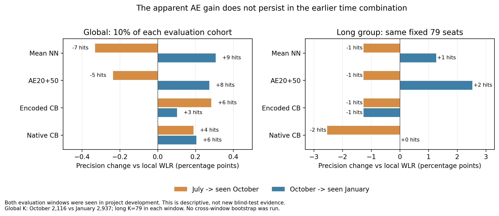

# AE 后续验证：预算、信息块与较早时间回测

2026-11-12。上一轮把 AE 概率融合作为优先研究线索；本轮固定这个实验对象后，完成预算/信息块消融及一组较早时间回测。**新证据没有支持把 AE 升为稳定升级方案。** 本轮没有替小组确认正式采用版本，也没有使用2018年四月快照、标签或评分。

这里仍然预测全部合格客户未来90天是否出现正商品金额的**已批准订单**。被选入固定名单、且后来符合这个标签的客户算“命中”。标签按批准时间，不是下单时间；名单容量是团队评价约定，不代表真实运营只能看这些人。

AE是自动编码器，先压缩输入再学习还原；LR是逻辑回归，对处理后的字段组合线性分数，加权版在训练时更重视少数复购者的错误。本文的Log loss衡量概率误差，越小越好；AP概括整段精确率/召回排序表现，越大越好。它们与固定名单命中不一定同向。

## 先看结论

1. 单纯多做监督训练没有复现 AE 的命中表现，但不能因此把全部收益归因于 AE 学到了客户结构：打乱客户配对的重建对照，概率误差还更低，名单差却仍不明确。
2. 去掉行为块，一月参考划分命中从51到58；但条件区间包含0、久单没有同步稳定提高，不能据此删掉RFM或宣布行为信息无用。
3. 七月训练、十月评价时，AE为31/久单1，原加权LR为36/久单2。它没有延续一月的相对改善。这是已见窗口的新时间组合，不是新的独立盲测。

**建议保留原加权LR作为既有参照，不因一月最高分临时改用AE。后续优先改进多时间截面的训练/验证设计，再讨论哪些模型或字段值得保留。** 正式展示采用仍由本人按真实版本与依据确认。

[冻结研究候选](candidate-freeze.json) · [预算/块消融计划](task_plan.md) · [预算结果](budget/README.md) · [完整统一统计](statistics/README.md) · [早期时间回测](temporal/README.md) · [时点语义澄清](time-audit/clarification/README.md)

## 本轮做了什么，怎样保持可比

AE先不用复购标签，把输入压缩后尽量还原，再用真实复购标签训练预测。冻结的候选使用完整141个结构字段、六视图各16维：六组输入各学成16个数字的表示，六份表示在网络内部等权平均，再交给预测头得到一个分数。等权参照mean与AE的预测结构相同，差别是AE先多做重建训练。

网络内部的平均，与模型间的概率融合是两件事。这里三个seed分别训练出三个预测器，校准后对同一客户的三个概率取平均，再评价概率、排序和名单；不是平均三份名单的命中数。

预算与信息块部分仍用同一十月训练客户、一月评价客户、五个高度重叠的训练/校准划分及三种固定初始化。fit是学习基础预测器参数的数据；cal只调整输出分数到概率估计，不再训练该预测器。seed是固定随机初始化和批次顺序的编号，三个seed就是三次训练，不是三个新月份。每划分fit16,928/169正例、cal4,232/42正例；一月29,368/230正例，久单群12,330/90正例。校准只用cal，预测器和预处理只用fit。

新做135个正式监督拟合、105次AE预训练；复用65个旧模型原件，不重训旧参照。另行准入的时间分支做13个正式监督拟合、3次AE预训练，因此本轮正式新增监督共148、预训练108；另有仅fit数据的小试计时和合成验码，实际进程训练调用数不只148，它们不计正式模型。所有失败、种子和负结果保留，没有看一月分数后改变轮数、字段组合或再挑子集。

## 1. 收益只是训练得更久吗

同一参考划分、一月各选2,937人，久单在同一群内独立选79人：

|系统|实际改变|全局命中|久单79命中|全局Log loss ↓|全局AP ↑|
|---|---|---:|---:|---:|---:|
|原八字段加权LR|既有参照，同口径重拟合|43|2|0.045788|0.026114|
|等权参照mean50|不重建，监督50轮|52|3|0.045302|0.021852|
|AE-full|重建20轮，再监督50轮|51|4|0.045582|0.022033|
|mean70|不重建，监督70轮|50|2|0.045785|0.021084|
|mean3040|不重建，持续3040次监督更新|41|0|0.046021|0.024491|
|AE-shuffled|同样重建/监督预算，重建目标换成别的客户|50|3|0.045261|0.020527|

mean70与AE总输入曝光轮数同为70，但标签曝光、更新数和计算量不同。mean3040匹配AE两阶段合计更新次数，却有更多标签客户曝光，也没有AE的重建输出层（decoder）；不能把它们叫精确运算量（FLOPs）匹配。两个监督预算对照的前50轮参数都与旧mean50逐项一致，确认比较起点没有暗变。

AE-shuffled用同一批次的其他客户作为重建目标，六视图共用一个无固定点置换；输入顺序、结构、训练步数和两阶段优化器流程不变，重建不使用复购标签。它保留了相似训练过程，却破坏了“还原同一位客户”的关系。

两种纯监督预算对照在五个重叠划分的全局和久单命中都低于AE。这说明更多监督训练并不自动等同于AE的候选表现。但AE相对打乱目标只多命中1/1，名单差区间仍含0；打乱目标的Log loss反而低约0.000321，条件区间[-0.000509,-0.000132]，而AP较差。**不能将“AE优于某个预算对照”直接解释为配对重建已被证明有效。** 更多训练、概率质量与固定名单命中是不同问题。

这里Log loss衡量概率误差，越小越好；AP概括排序的精确率/召回表现，越大越好。单次容量命中不必与两者同向。

## 2. 哪一组输入值得保留

逐一把六组编码列置0，保持所有列数、分支和其余输入不变，从相同初始化重新做20轮重建与50轮监督。重建目标也遮蔽同一块。以下是同一参考划分：

|AE输入|全局命中|久单79命中|相对完整AE的全局/久单变化|
|---|---:|---:|---|
|六块完整|51|4|参照|
|去掉行为块（含最近购买间隔R、次数F、金额M等）|58|4|+7 / 0|
|去掉地理块|51|2|0 / −2|
|去掉商品块|51|1|0 / −3|
|去掉交易块|50|4|−1 / 0|
|去掉服务块|51|3|0 / −1|
|去掉卖家上下文块|53|2|+2 / −2|

去行为块的全局命中在五个训练/校准划分都提高3至7人，是值得记录的线索。但参考差+7的95%固定分数条件区间为[-1,16]，久单差0的区间[-2,4]；久单五划分只有1胜、2平、2负。不能只挑58这个数字宣布稳定删块。

这些是“其余块还在时，这个表示块的条件作用”。其他块可能仍含订单次数、金额、地区等语义代理；置0的分支仍能学常量，AE重建零目标也更容易。因此不是彻底清除了某种原始信息，更不是因果重要性；六块影响不能相加。没有继续扫删块组合追一月最高分。

[全部14系统/70融合格](statistics/ensemble-primary-by-split.csv) · [五重叠划分方向](statistics/five-overlapping-split-directions.csv) · [全部350条条件区间](statistics/canonical-paired-bootstrap-intervals.csv)

本段区间来自各scope2,000次固定分数配对客户重抽样，在复制观测池里重排相同名额。它不重训、不含整个候选选择和时间漂移的不确定性，也没有多重探索校正；不能当独立测试认证。

## 3. 换一个较早的训练/评价时间组合呢

原始九表成功重建七月全部141字段，并逐键复现十月21,160人/211正例及141字段+y；最大数值差约1.46e-11。旧15个服务/上下文字段从日期化函数重算，没有拿十月缓存冒充七月。

用七月样本训练：总14,012人/120正例，fit11,209/96、cal2,803/24。预处理词典和缩放只fit七月fit，校准只七月cal；十月只评价。七月90天批准目标在9月29日闭合，因而可在10月1日前拟合/校准后预测。不是在7月1日当天提前知道未来标签。

十月所有模型各选前10%=2,116人，久单群9,121人/78正例中各选79人。它与一月的2,937人不是同一个分母，**只比较各自窗口相对基线，不能直接用31与51判断退步**。

|七月训练→十月评价，三seed校准概率融合|前10%命中|久单79命中|AP ↑|Log loss ↓|
|---|---:|---:|---:|---:|
|八字段加权LR，确定性一份|36|2|0.026281|0.055944|
|完整字段等权参照|29|1|0.014734|0.055920|
|完整字段AE20+50|31|1|0.012953|0.055944|
|统一编码CatBoost|42|1|0.016934|0.055821|
|原生类别CatBoost|40|0|0.016595|0.055965|

AE在这个组合少于同口径基线5个全局命中、1个久单命中；未保持一月的相对优势。CatBoost全局命中较多，但久单、AP及概率指标不一致，也不是统一赢家。这里只跑冻结设置，没有根据十月结果再调参数。

图中横轴是相对本窗口加权LR的精确率差（百分点），条上标注命中人数差。两窗分母不同，重点看相对方向；这张描述图没有新增跨窗bootstrap。

十月标签以前用于项目训练/开发，客户也重复，所以这是**已见窗口的跨时间组合诊断，不是新盲测**。样本量、基率、编码词典及cal正例数也随时期变了；它反驳“当前证据足以宣布稳定升级”，不证明AE在所有数据上无效，也不能把变化只归因于季节。

## 4. 数据时点到底核了什么

本项目历史与目标都以批准时间筛选。七月43笔、十月45笔“下单在截止前、批准在截止后”的候选，实际入史均为0；没有本项未来资格倒灌。不能只看到“批准非空”这一道资格条件，就忽略后续明确的批准时间 `<t` 守卫。

七月12,261笔是整个目标窗口的合格订单池，匹配七月已有客户的实际复购为129笔/120人；十月匹配为230笔/211人。不能把全窗口订单池全算成原cohort的复购。七月目标事件到了十月已经发生，可以合法成为十月历史，但这也不使两个时期统计独立。

源仍缺真实入库/属性变化日志；七月历史前四日零记录原因未知。141字段复现只证明计算一致，不认证完整源数据或生产as-of可恢复性。此处没有改成下单日期标签；两种事件定义不能混写。[事件池/批准守卫的完整核查](time-audit/clarification/README.md)

## 当前研究判断与后续

上一轮“AE优先研究”的依据是同一月训练扰动较一致，本轮已补预算、字段及较早时间诊断。**现有证据不足以将AE升级为正式模型；不推荐凭一月最高分删行为块，也不自动换掉原加权参照。**

建议下一阶段先增加多时间截面的训练与严格按时间滚动验证，明确批准订单目标和业务需要；再在固定目标下比较少量模型。新时期若仍使用项目已见目标，就继续披露，不能换名称制造盲测。对真正未知未来的能力与营销增量，当前仍未验证。

原展示采用节点不因科研自动改期，正式版本/冻结时间由本人据真实团队材料记录；本地148个新模型不替代组员交付或提交回执。

## 交付与复核

- 预算45模型135期state回放、字段组90监督/90预训state回放、时间13模型39期前向均通过；旧原件与源分数不覆盖。
- 主统计只处理135新+65旧的200份一月分数，14系统/70融合格；56,000复制结果、350区间/350方向全部读回。13个时间模型独立表，不混入一月条件区间。
- [预算](budget/README.md)、[六块](feature-groups/README.md)、[统计](statistics/README.md)、[时间](temporal/README.md)保留方案、源码、全部聚合、实际预算/梯度和局限；逐人分数、模型和名单私有。校准程序success不等于数学精确最优。
- 原冻结计划、数据恢复审计及新增时间分支协议各自留痕，不伪称全部是原一月方案的一部分。可视化提供PNG/SVG、源码和数据；本批发布白名单及三端状态按最后操作回执分别核对。
