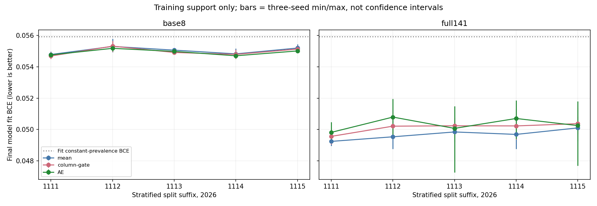
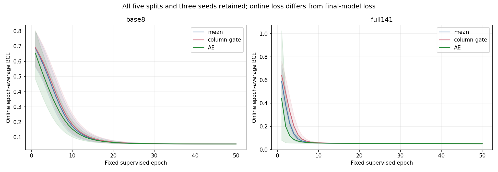
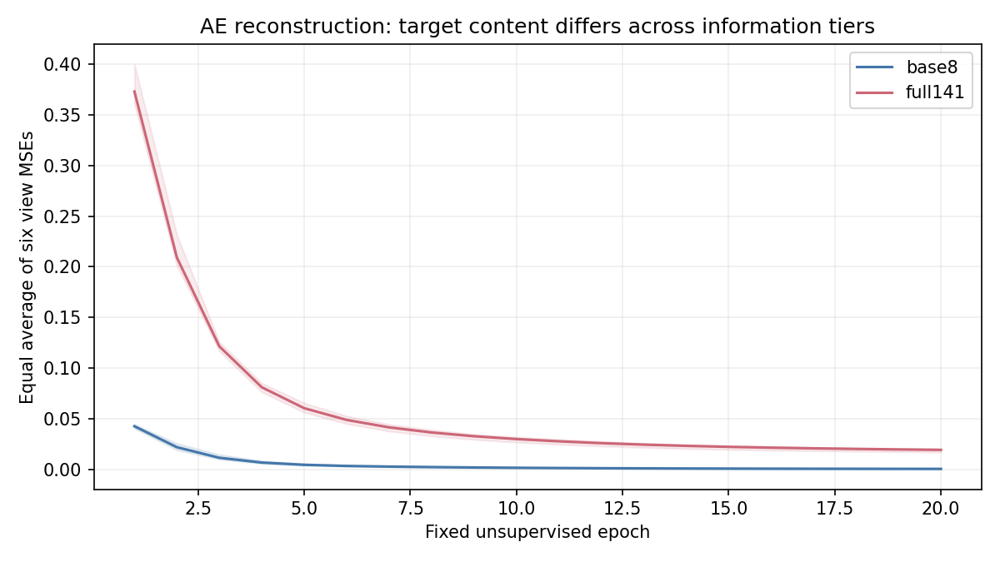

# 统一神经比较：共享矩阵、固定预算与保存后读回

完成 90 个监督模型、30 次 AE 预训练；5 个固定 fit/cal 划分 × 3 seeds × 两档信息 × mean/column-gate/AE。全部候选保留，不用一月挑 seed、epoch 或架构。正式矩阵执行 702.4 秒，另有 fit-only 两 epoch 计时小试；小试没有 cal/Jan 评分，不计正式模型。

## 共同输入与初始化配对

所有数据只调用根 eval_harness.load_split(split, information, dense=True, dtype=float32)：五个 split20261111..20261115，每个 fit16928/169 正例、cal4232/42 正例，Jan29368/230 全体评分。完整六视图总维度依次808/813/817/813/812，base8恒34编码列；base8由根接口把所有新增列置0，六分支形状不变。这里没有重新构造特征、拟合变换或重新切分。预处理/矩阵/掩码责任与来源见根共享manifest。

同 split/seed 的六个模型组合（两个信息档×三家族）enc/head初始值哈希一致；监督 batch 顺序用 generator(seed)，AE 预训练用 generator(seed+901)，各配对格顺序哈希一致。参数形状只随该 split 的训练类别字典改变，不随信息档改变。输入执行为float32；保存logit使用float64容器，只保留实际float32推理值，不声称恢复已损失的计算精度。

## 模型与预算

每视图Linear(d,16)+ReLU，六视图等权平均，再Linear(16,1)。mean为必要参照；column-gate先对每编码列施加x*sigmoid(a*x+b)，a=b=0，因此初始整体缩放为0.5。门控新增参数和初始缩放均保留，不把差异解释为纯门机制因果效果。

AE使用相同enc/head主体，额外每视图Linear(16,d) decoder。预训练20epochs、batch256、Adam.001，loss为六个视图各自MSE再等权平均（不是所有编码列统一MSE）；只用fit X，不使用y。之后移除decoder，用真实fit y监督50epochs、batch512、Adam.001、未加权BCE、dropout0，全参数适配，不冻结encoder、不早停、没有额外L2。mean/gate也完全相同50轮监督预算。

90×50共4500个监督epoch记录（153000次更新），30×20共600个预训练epoch记录（40200次更新）。这不是新增独立客户或独立时期。AE多了20轮无监督预算，而且base8重建目标有更多常数0列；gate初始缩放及AE额外预算/目标差异留待后续消融，不用本比较宣称已分离全部机制。没有跑NCE/FN/潜原型等额外格。

## 训练支持（不代替一月评价）

|信息档/家族|监督模型数|监督参数范围|最终fit BCE均值|最终fit BCE范围|AE预训秒合计|
|---|---:|---:|---:|---|---:|
|base8/AE|15|13041–13185|0.054931|0.054550–0.055356|91.1|
|base8/column-gate|15|14657–14819|0.054973|0.054511–0.055655|0.0|
|base8/mean|15|13041–13185|0.055039|0.054575–0.055786|0.0|
|full141/AE|15|13041–13185|0.050328|0.047253–0.051958|89.6|
|full141/column-gate|15|14657–14819|0.050123|0.049043–0.051392|0.0|
|full141/mean|15|13041–13185|0.049682|0.048753–0.050822|0.0|

共同fit常数BCE为0.05592551；各模型相对它的最终fit BCE差范围为-0.00867213至-0.00013979。这是训练优化支持，不是最优收敛或未见期收益证明。最终模型fit BCE由保存的fit logit重算，和训练过程中权重持续变化的online epoch平均loss分开。

监督参数含enc/head，gate另含2D门参数；AE监督时decoder已移除。AE预训练总参数还包括decoder和当时未参与重建损失的17个head参数，run-support另列pretraining_active_parameters排除该head。base8的零占位列不提供客户信息，部分权重因此没有非零输入梯度，但分支bias仍可能学常数。名义保留列数不等于独立信息量。

## 共同校准与评价

每个run直接调用根write_run，用Octcal自然分布拟合共同的正斜率单调Platt，并保存raw/校准概率、自然概率指标、全局2937与共同H05久单群内独立79等容量。没有自建第二套校准或指标函数。cal校准后读数是同批cal标签再代入，不当作无偏验证；一月已见，不称盲测。

共同harness产生1800行指标、720行策略；校准success=90/90，下界命中5格。raw与校准Top2937集合发生变化的run为0格；全部保留于calibration-status.csv，不能只据理论单调性省略实际核查。

主策略和ensemble由根统一管理：单run读取各自raw排名/正斜率校准；canonical ensemble最终用三个seed校准概率的均值作为统一分数，AP/名单/概率评价不混接不同分数。跨五split的配对差、初始化与划分扰动、研究候选取舍由根统计矩阵回答；本目录不因最高seed宣布赢家。

## 保存、来源与读回

run-support.csv保存90格支持、参数、真实时长、最终fitBCE、AE初末MSE和顺序/初始化哈希；supervised-curves.csv / pretrain-curves.csv保存全部曲线。每run公共record来自共同harness，common-metrics.csv / common-capacities.csv只是其原值汇总。private有90个监督state_dict、30个预训练state_dict、逐run三时段logit/曲线、共同raw/校准概率及Platt参数。逐人键/标签只沿根共享private定位，不写公共表。

source-freeze.json在真实pilot与90模型之前冻结本地plan/model/driver/读回源码和根manifest/harness哈希。source-fidelity.json另用64行合成张量比对原上批源码：初始化/forward/两epoch监督state逐参数相同，AE两epoch预训练state也相同；这不是客户实验，也没读取旧Jan成绩择参数。

readback-verification.json为PASS：从保存state_dict用独立显式线性运算重放90个模型的fit/cal/Jan共270个logit数组，全部逐元素相同；float64容器、最终fitBCE、共享初始化与batch顺序、共同harness保存的logit一致。没有在读回调用fit。工程读回不冒称另一位代理的科学独审。

本目录只负责固定神经矩阵，最终采用与正式消融由主任务继续。没有安装、外发、Git或看板操作；没有读取或新评分四月。局部完成和最终三端同步分别报告。
