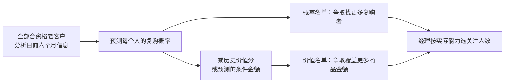

# 最终研究收尾：全体预测 → 价值打分 → 经理名单

2026-11-12｜本地独立研究；真实小组回件和正式采用另记。

## 先把原意和完成情况说清楚

你的原意一直可以这样实现：**给全部合资格客户预测未来 90 天复购概率，再结合客户价值打分，交给经理一份可排序、可按能力截取的名单。** 这轮已把这条链条补齐。

此前已经给全体客户预测，也比较了概率排序、分群和很多模型，但主要盯着“同样名额找到多少复购者”，没有完整实现你要求的价值排序层。这是此前目标落实的缺口；不能把概率名单的结果说成已经验证了价值名单。

**“全量”和“10%”不互相替代。** 输入和预测覆盖全部客户；10% 只是输出名单的一个固定比较点。现在同时提供 1%、2%、5%、10%、20%、50%、100% 的对照，经理不必被规定只能看 10%。本批没有得出“全量不如 10%”。

本次冻结清单的计算、结果核对和图表已完成：7 个数据快照、3 个滚动评价日期、单期/多期训练、30 个概率模型位置（25 个新拟合、5 个原件复用）、6 个条件金额模型、18 份全量经理私表、完整容量对照及原 18 条质疑和本轮新增 2 条的逐项结案。没有给下一轮留下本清单内待跑的模型。GitHub 与看板发布状态以独立收尾回执为准；这份科学说明不预填发布成功。

## 1. 我们到底预测什么

在一个分析日，先找到此前六个自然月有合格订单的老客户。每人一行，输入按分析日前已知信息构建。部分静态属性和付款字段缺少变更或入库日志，按既有时点可得性假设处理，不能认证生产环境中的历史状态可完全恢复。

| 对象 | 大白话 | 怎样检验 |
|---|---|---|
| 复购概率 p | 未来 90 天会不会再买，可能性多大 | 对全体客户检查概率误差、校准和区分能力，不需要先取 10% |
| 条件金额预测 | 假如会购买，未来 90 天一共可能买多少钱 | 只用成熟训练期中真正购买客户的金额训练 |
| 预计商品金额 | p × 条件金额预测 | 与未来真实商品金额比较，也用于价值排序 |
| 经理名单 | 按概率或价值，从全部客户中挑优先关注的人 | 同样名额比较命中人数、商品额、订单和久单覆盖 |

未来真实购买、金额和订单数只在隔离的评估表中。经理表里没有这些答案。商品金额沿源数据金额单位，不含运费、退款、成本或毛利；捕获更多商品金额不等于营销增加了收入。

分群仍用于看模型漏了哪些人、提出特征假设和检查不同群的结果。它不强制每群分配名额，也不把未来答案加进模型。这轮“久单 79 人”是另一个固定的群内诊断，与全局名单里自然选中多少久单客户分开算。

## 2. 你的价值公式有没有道理

主原式保留为 **p × F × M**：F 是历史半年批准订单数，M 是同一半年累计商品金额。它同时偏好更可能复购、买过更多次、累计花费更多的客户，是合理的业务偏好分。

M 已经包含频次，所以 F × M 等于 F² × 历史平均每单金额。这会再次强调频次；可以这样偏好老客，但不能把这个分数直接读成“预计未来会花多少钱”。

如果“复购次数”严格指首次之后的次数，则敏感性版本为 p × max(F−1,0) × M。它会让只有一次历史购买的人全为零分：一月共有 28,665 人受影响，包含全部 12,330 位久单客户。因此主原式采用订单数 F，F−1 的结果完整另列，避免悄悄换定义。

更贴近“未来 90 天商品金额”这个目标的指标是 **p × E[未来商品总额｜会购买、历史信息]**。这里已经预测未来总金额，不必再乘真实未来购买次数。两阶段模型分别学习会不会买、买了会花多少；公式和目标更直接，但小样本会使金额预测不稳定，所以仍然要和你的原式实测比较，不能宣布它必然更好。

还保留 p×M、p×历史单均金额、历史金额优先、最近购买优先及随机期望作对照。所有规则、所有窗口都保留，见[完整价值结果](value/value-report.md)。

## 3. 结果：目标不同，合适名单确实会不同

以一月、单期训练、原八字段加权逻辑回归的**同一组全体概率**为例，每种规则都选 2,937 人：

| 名单规则 | 找到实际复购者 | 覆盖的未来商品金额 | 未来订单数 |
|---|---:|---:|---:|
| 只按复购概率 | 43 人 | 4,598.15 | 52 |
| 你的主原式 p×F×M | 37 人 | 6,557.40 | 45 |
| 预计未来商品金额 | 30 人 | 5,857.29 | 38 |

原式找到了更少复购者，却覆盖更多消费金额。这并不矛盾：它挑中了金额更高的人。此前只比较命中人数，确实不能完整回答你的价值目标。

这只是解释用的一组，完整结果没有只挑这一组：预先确定的 **3 个窗口 × 2 种训练策略 × 3 种概率家族 = 18 个组合**中，主原式和预计金额各在 15/18 个组合捕获金额高于概率排序；预计金额只在 11/18 个组合高于主原式。三期有客户重复、目标日期也重叠，这 18 个组合不是 18 次独立试验。

一月固定分数的配对重抽样显示，多数金额差异区间仍跨零。例如上述加权逻辑回归中，预计金额相对概率排序多 1,259.14，95% 条件区间约 [−1,156.16, 4,109.10]；相对原式少 700.11，区间约 [−2,117.93, 525.88]。这支持“价值层值得保留”，不足以证明某个公式会在以后稳定胜出。区间不包含重新训练、此前试验搜索和未来漂移。

久单也没有被总体金额掩盖：上述同一加权模型，群内各选 79 人，概率排序命中 2 人、捕获金额 177.00；原式命中 0 人、金额 0；预计金额命中 1 人、金额 756.88。价值规则没有同时稳定改善全体和久单的命中人数；经理偏好较高消费与希望覆盖更多久单客户可能冲突。

同一月如果选 100%，就是全部 29,368 人，自然覆盖全部 230 位复购者和 30,478.29 的商品金额；每一种排序都会相同。名单精度是总体复购率约 0.783%。这说明容量与集中程度的取舍，不能据此判定全量预测失败。

## 4. 多放历史、多放字段、换模型，结论是什么

这轮用 2017-11-01、2017-12-01、2018-01-01 三个日期滚动评价。每个日期只使用未来 90 天标签已经结束的训练快照；较早快照合并时，从全部训练行排除概率校准客户，避免同一客户同时出现在拟合和校准中。

| 对照 | 已完成的验证 | 能支持什么 |
|---|---|---|
| 单期 vs 多期 | 3 期 × 2 策略，原八字段加权/未加权 LR、141 字段 CatBoost | 更多历史不是自动更好；本轮 CatBoost 多期的概率误差和平均精确率（AP，衡量复购者是否靠前）三期都变差，其他家族也没有共同的稳定改善 |
| 原八字段 vs 扩展字段、模型变化 | 承接此前同口径完整比较、AE 预算/删块及更早时间验证 | 字段更多不保证提升；特征和模型要分开核，AE 不能凭一月优势升级为稳定赢家 |
| 概率层 vs 价值层 | 同一个 p 只换名单公式，18 组合 | 这次原式金额捕获的变化来自名单目标变化，不能冒称概率模型变准 |
| 久单诊断 | 全局久单席位/命中/金额，另固定群内 79 人 | 全局覆盖改善不等于群内挑得更准；完整结果单列，不能用总体金额替代久单检验 |

多期训练存在同一客户和同一未来订单在不同预测机会中重复；已统计并明确，没有把增加行数叫作增加同样多的独立信息。单期/多期还同时改变预处理字典和历史来源，是完整训练策略比较，不是纯样本量的因果实验。

概率校准后仍有跨期偏移；例如一月单期 CatBoost 的概率总和约 292.93，而实际复购者是 230。预计商品总额也可能偏高。因此经理看到的是待业务验证的预测，不能当成收入承诺。

## 5. 质疑都怎样结案

[20 项逐项结案](closure/question-closeout.md)保留原 18 条质疑原文，每条列实际做过什么、证据、结果、不能证明什么及是否真的需要本人决定。不是把所有假设写成“已证明”，也不是无限追加算法。

- 原始字段、全客户预测、不同容量、全字段、类不平衡、异常检测、群数/软群、群内差异与交互、注意力、对比/残差、AE、预算与删块等均有实际对照和有界结论。
- GAT 没有实跑，完整 MVSIB 没有复现；此前的启发性实现不能改名冒充。它们的范围与证据不足已结案说明，不挂成这批未跑欠账。
- 六个月只有一次购买，确实可能信息不足。弱结果不证明“永远不可预测”，也不能保证换更复杂网络能补出没有记录的信息。
- 没有真正未见的独立未来数据、毛利/成本和触达随机实验，利润、长期 CLV、营销增量不在现有数据中可识别。这是数据边界，不是本批忘记执行的实验。

四月此前已被查看，沿用“已见窗口回测”。本批没有新建四月快照、读取四月标签表或给四月评分。三个新增评价日期也属于已经接触过的历史数据，不能包装成独立盲测。

## 6. 你现在需要决定什么

计算工作已经收尾，业务采用仍需要真人决定，不能由研究报告自动切换小组方案：

1. **汇报的主目标**：若沿用小组已发口径“同容量找更多复购者”，概率名单仍是主线，把价值名单作为业务扩展；若正式改成“覆盖更多未来商品金额”，必须明确改目标并同时展示命中人数的取舍。
2. **正式采用哪一套团队版本**：模型、公式、名额/容量、实际冻结时间一起记录。10% 是可比参照，真实运营容量并没有被数据证明。
3. **组员结果如何合稿**：第三轮实际新回件、H04 措辞修正、H07 Slides/讲稿和提交回执按真实收到的材料验收。本地模拟不能替他们完成交付。

我的建议是：保留已认可的加权全局方案为团队参照，补上一页“全体概率 → 价值公式 → 可调容量”的业务延伸，把原式及预计金额并列呈现。不要为了某一期更高的数字，临时把模型、目标和容量同时换掉。

## 文件导航

- [价值规则、完整 18 组合、容量及不确定性](value/value-report.md)
- [经理使用说明](value/manager-guide.md)：全量逐人经理 CSV 与真实未来答案表分别保存在本地私有目录，公共仓库不分发。
- [概率模型及全体概率评价](probability/README.md)
- [数据时间边界、成熟性与重复信息审计](data/README.md)
- [20 项结案](closure/question-closeout.md) · [概率源审](closure/probability-source-audit.md)
- [固定执行计划](task_plan.md) · [独立复核](review-final-report.md)

研究完成不等于小组已经正式采用、部署或提交。发布、看板和团队选择分别留实际证据。

## 发布副本说明

本文为审查原件的公开副本，仅规范 LF 与链接位置。文中冻结 SHA 仍绑定本地原始字节，公开文件当前字节 SHA 以 [public-evidence-manifest.json](public-evidence-manifest.json) 为准；此字节转换不代表数据重算或科学结果改变。
