# 实验图片对照：每张图为哪个结论服务

2026-11-14｜供A/B路线投票，未决定采用。A用现有R3成果的已核修正图，B承接这些成果并精选后续深化验证图；不是拿A的已撤回错误图与B比较。点击图片可查看原尺寸；左右图的样本/协议不同，不能直接以柱高判路线胜负。

[完整比较](README.md) · [具体冻结提案](vote-packages.json) · [8分钟页序草案](PRESENTATION-PLAN.md)

## 共同底盘：时间边界不因选路线改变

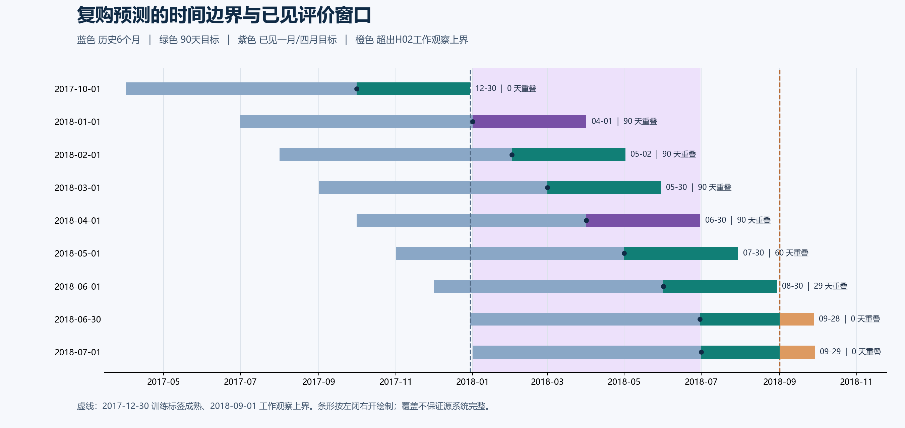

**读法：** 蓝色是预测日前六个自然月历史，右侧是90天标签；紫色为已见一月/四月目标覆盖，橙色为超出工作观察上界的部分。十月训练标签在2017-12-30成熟，一月仍是已见开发期，四月已见回测；五月/六月也不是全新独立盲测。覆盖不等于源系统完整。它是两版共同来源，不算A和B各做过一次独立验证。建议两版都在数据页使用。来源：Role01第三轮时间审计。

## 1. 主结果：A的名单比较，B的概率与跨期检查

|A：团队R3保存预测逐人重数|B：B内部同协议的三期、多指标比较|
|---|---|
|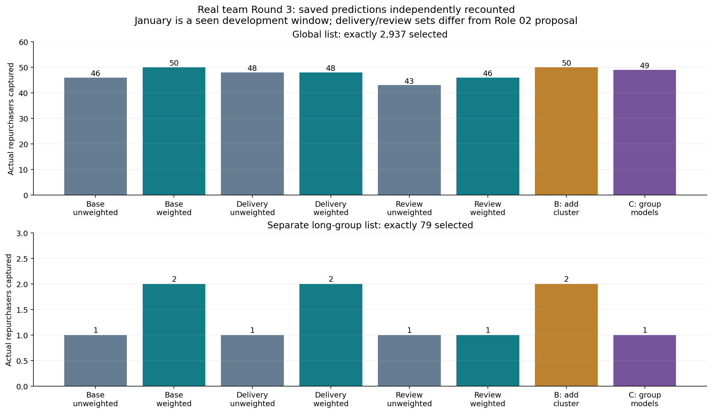|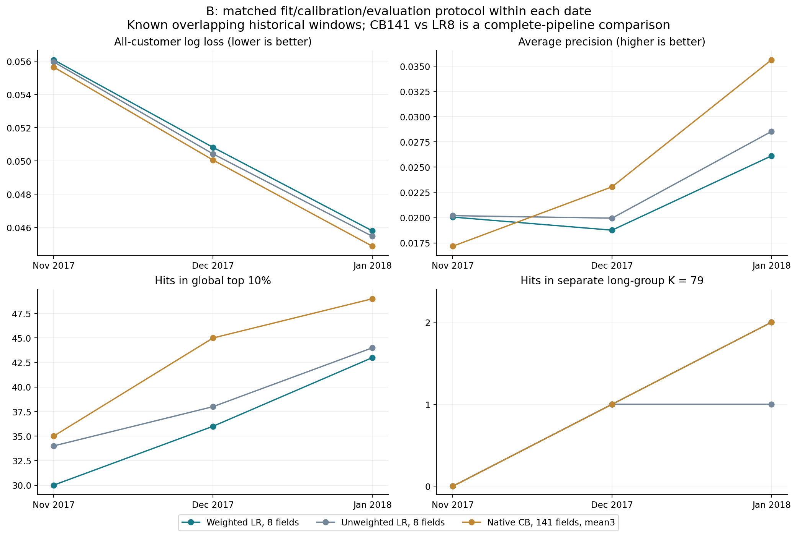|

**A图读法：** 上半同2937席比较各方案，下半另外固定久单79席。F0加权50/2；加群号50/2、群模型49/1。图内“B/C”是R3内部候选编号，**不是本页的路线A/B**。它支持“加权是强基线，所测字段和群模型未改善该月10%主结果”，不支持所有容量或所有新字段都无效。图中R3配送/评价字段不等于2号v1.1提出的两组新组合。适合A主结果页或B基线页。

**B图读法：** 同一时点内，模型fit/cal/eval客户一致；完整141字段CB与八字段LR比较的是整条管线，仍非纯算法效应。CB相对B同协议加权LR三期LL/10%命中更好，固定久单79未改善，11月AP反而较低。三个日期已见且重叠，不能称独立未来测试。适合B主结果与限制页。

**不要把A的50与B的49直接比较：** A全十月21160人拟合；B拟合16928、另4232校准。下面新增口径图把协议并列，数字不是胜负榜。[数据](data/protocol-comparison.csv)

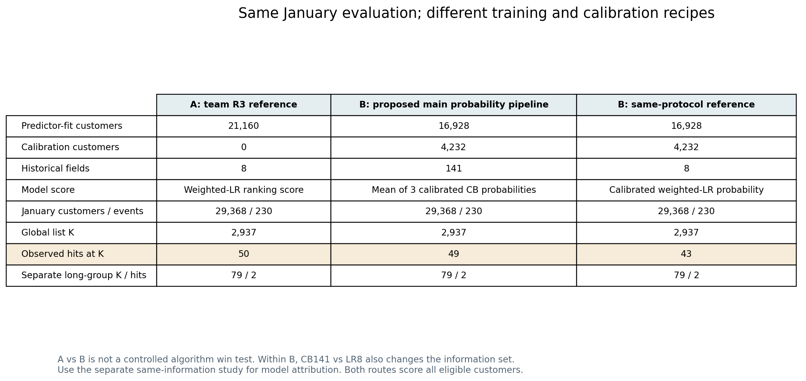

## 2. 特征依据：描述性相关，与受控预测增益是两步

|A：2号v1.1修正后的14项描述效应|B：固定划分下，换信息集的效果|
|---|---|
|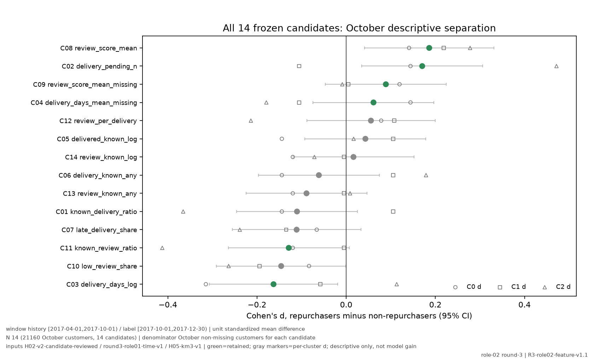|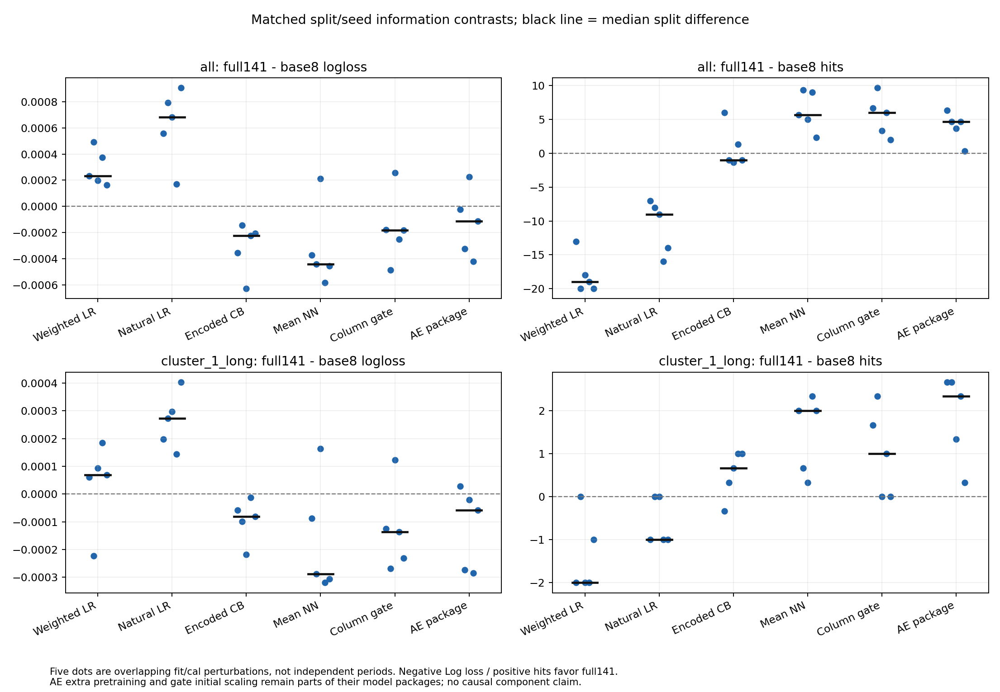|

**A图读法：** 横轴Cohen's d是十月复购与未复购者的标准化均值差。实心点是总体d，绿色为保留候选、灰色为未保留；空心圆/方/三角是各群描述差异，横线为总体d的近似95%区间。相关大小不能直接读成模型命中提升，更不是因果效应。缺失者的分母因候选而异。适合解释“为什么提出字段假设”，不适合单独宣布上线有用。该图已采用v1.1修正，未使用撤回的旧SE图。

**B图读法：** 相同家族/划分里比较不同输入与base8的差异，区分增加信息与学习方式；黑横线为五个划分差值的中位数，蓝点来自五个重叠fit/cal划分，不能把它们看作独立时间实验。它支持“信息增加不保证所有指标提高”，不能把整条CB141对LR8的收益都归给算法。适合B设计选择页；完整数表仍在[既有同口径研究](../common-comparison-20261112/README.md)。

## 3. 稳定性：A有内部CV，B补时间反证和组件检查

|A：十月五折命中，均值±样本SD|B：更早的成熟时点检查，AE不总赢|
|---|---|
|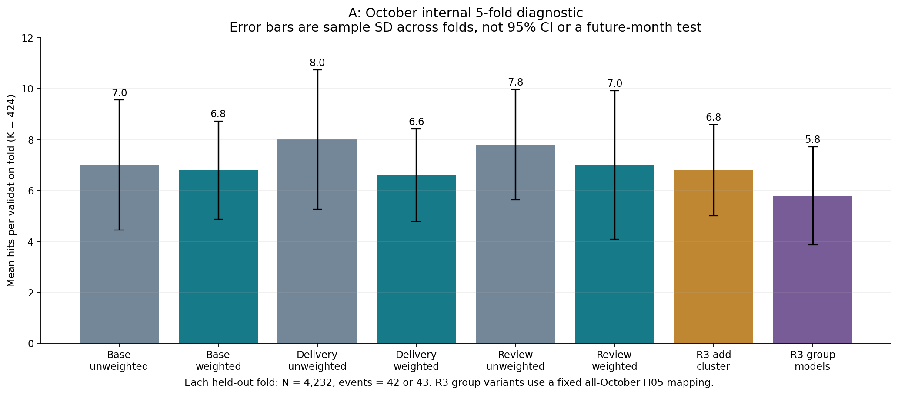|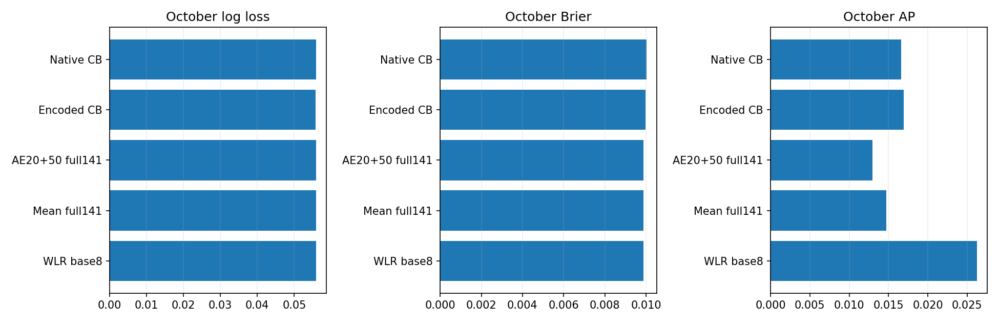|

**A图读法：** 每折N4232、Top10%为424，误差线是五折样本标准差，**不是95%置信区间，不是一月50的误差线，也不是五个月**。加群号/群模型使用固定全十月H05无标签映射；不能称所有表示步骤均在折内重新拟合。适合A方法验证页/两版附录，不能为了提高B评价而说A没有内部对照。[8候选CV数据](data/team-cv-diagnostics.csv)

**B图读法：** 这张旧图画全体LL、Brier、AP，展示更早训练与评价时AE也可能变差；**图中没有画命中人数**。对应保存记录为七月训练→十月AE31/久单1，对照LR36/2。它否定“一月高分就稳定最好”，不证明所有表征学习永久无效。适合B一张反证或问答附页，正文无需讲全部网络结构。[时间对照来源](../ae-ablation-20261112/README.md)

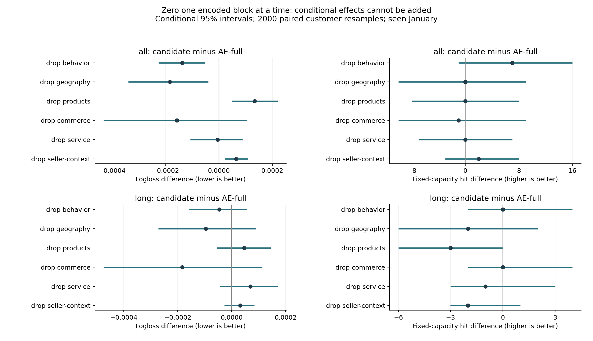

**这张B附图的用途：** 观察删信息块后固定预测结果的变化与条件区间。区间跨0时不能把删行为块一月58当可靠赢家；某些语义代理仍在其他块中，不能声称是纯信息因果重要性。这是既有试验，不是本批新增消融；正文至多选其中一个结论，其余备查。

## 4. 业务解读：群覆盖、名单命中、商品金额不是同一目标

|A：按当前R3分数更新的久单画像|B：同概率下，不同排序目标的取舍|
|---|---|
|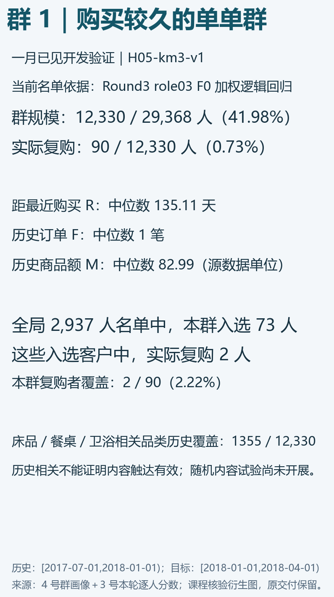|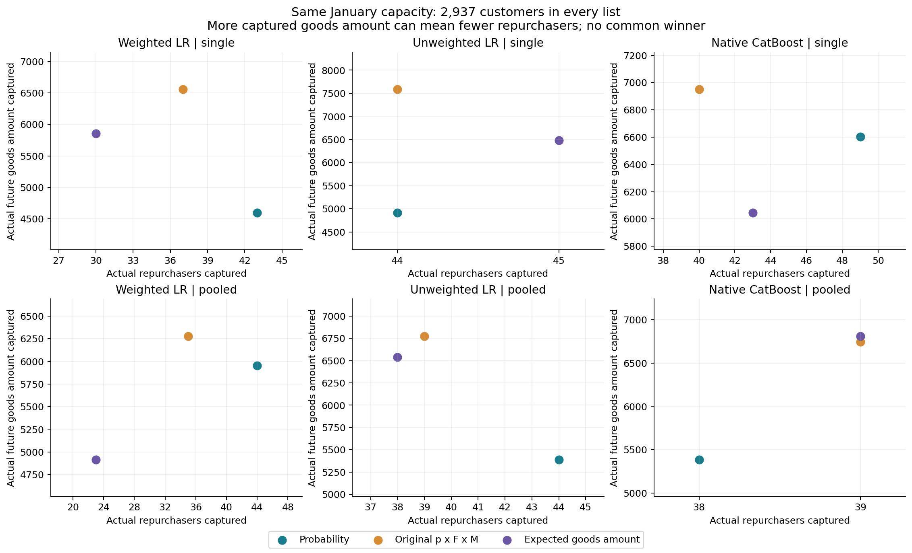|

**A图读法：** 久单群12330人/90复购者；R中位135.11天、F中位1。当前R3全局2937席里该群73席/2命中，与另外固定79席的诊断不同，不能混用。历史相关品类覆盖1355不等于能触达1355人或干预有效。适合A/B群诊断与内容试验下一步，采用4号贡献加本轮重数的派生图。

**B图读法：** 每小图固定一种已校准概率，比较p、p×历史F×M、p×购买条件下预计未来90天商品总额。六面板都是散点图：横轴为名单命中人数，纵轴为捕获商品额；青色、橙色、紫色点分别表示这三条排序规则，各面板有自己的轴尺度。更多金额不一定更多复购者，且不是利润或营销增量。一月单期CB：p命中49/6602.88商品额，pFM40/6951.07，预计金额43/6045.18；不能只挑有利格。适合B经理决策页。[本批提取的一月全规则](data/local-january-value-rules.csv)

## 5. 选图结论与来源边界

A足够形成“数据→字段/群假设→强基线→所测改动→群覆盖→未来试验”的短故事。B另有“概率质量→同口径控制→时间反例→不同业务目标”的证据链；高分潜力来自这条逻辑，而不是图数量。两版都只建议6–8张正文图/表，正式PPT须等团队选择后制作。[页序草案](PRESENTATION-PLAN.md)

本页引用既有8幅图并新绘3幅，共展示11幅；8幅旧图未重算、未重复计为新增科学图。全项目既有89幅＋本批3幅＝92幅素材，不建议全部收入报告。[旧图路径与哈希](reused-figure-index.json) · [本批作图来源](plot-manifest.json)

已实际查看全部11幅选图，逐图解释适用单位、版本和不能推出的结论。读图核验不代替重新训练所有历史模型；本批未追加模型、区间估计或四月评价。
