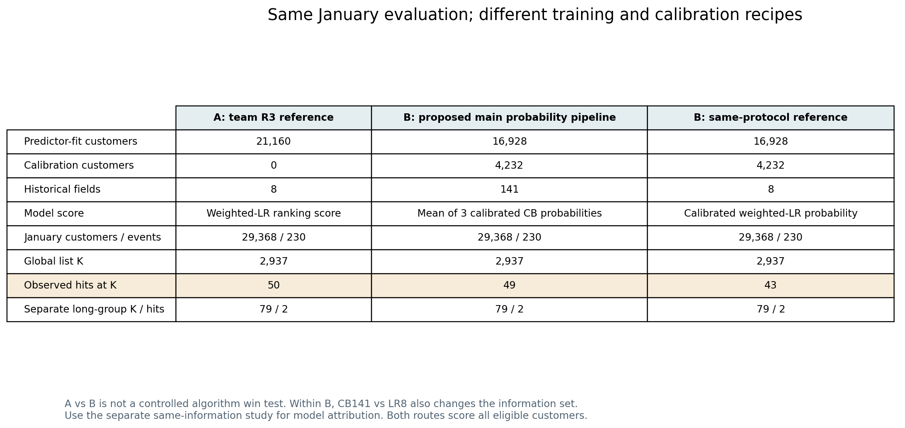
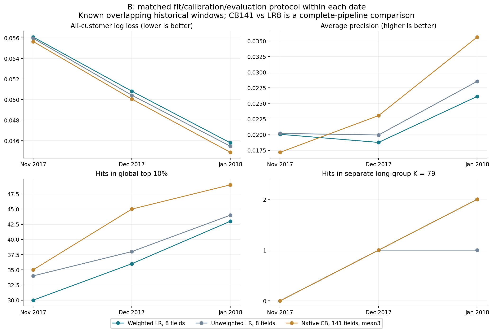

# 两个版本怎样选：设计、效果、材料与得分潜力

2026-11-14｜**当前没有全组确认或正式冻结，等成员投票。** 此前“已采用”的登记已按本人澄清更正为个人倾向；历史原话保留，不倒填集体决定。[更正记录](decision-correction.json)

## 一页结论

**建议选择B“在A基础上的深入分析版”，高分潜力更大，但不是因为模型多或某个数字最高。** 它已经补齐全量概率、信息与模型对照、消融/时间检查及价值/容量决策，更容易形成“为什么这样设计→如何验证→哪些有效/无效→能给经理什么”的完整分析链。前提是正文精简、全员理解并排练；如果大家没时间掌握，A较容易压缩讲清，交付风险更低。

本次比较的是**A：现有成果整理版**和**B：在A基础上的深入分析版**。B承接A已有的数据审计、逻辑回归基线、字段分析、分群画像和核验成果，再补充概率可靠性、信息与模型控制、时间/消融反证，以及客户价值和容量分析。深化体现在分析范围和验证设计，具体预测系统分别按已记录协议拟合；原有成果与贡献来源继续保留。A使用已核修正材料。

|维度|A 现有成果整理版|B 在A基础上的深入分析版|
|---|---|---|
|主问题|固定同等名额，找更多已观察复购者|先评估全体概率，再看名单、价值与容量的不同目标|
|建议主系统|原八字段加权LR，全十月拟合，按排序分取名单|完整141字段原生CatBoost，单期成熟训练，三seed各自校准概率后平均；LR作参照|
|已有验证|十月五折、加权/字段添加/群模型组件对照、一月开发；时间/字段审计|另有信息×模型控制、概率校准、随机/划分扰动、预算/块消融、三期时间检查、价值/容量|
|主要优点|叙事短、模型易解释、各岗材料已有明确分工来源|设计链更完整，能回答更多“为什么”，业务目标的取舍更具体|
|实际效果|本轮F0一月同2937名额命中50；固定久单79命中2|B内部同协议CB49 vs LR43，久单都2；三期概率/名单有支持方向，但有指标反例|
|最大风险|把原始分数当自然概率、固定10%解释过度、现有交接措辞混版|把大量试验全部塞进8分钟、把最高一月分数/条件区间当稳定赢家|
|制作与答辩|转交和压缩成本相对低；并未证明全员已掌握或已有最终PPT|材料/图已齐，整理与共同理解成本更高；未证明全员已能答辩|
|我的专业判断|能做成合格且清楚的项目，也有高分可能|更有条件展示高质量分析与深度，**前提是精简和全员讲得懂**|

[可投票的具体A/B包](vote-packages.json) · [实验图片对照](IMAGE-COMPARISON.md) · [8分钟结构与问答准备](PRESENTATION-PLAN.md) · [可直接发群的投票消息](group-vote.md)

## 1. 按什么判断“更容易拿高分”

已在登录后的Canvas读取当前[Slides作业](https://canvas.cityu.edu.hk/courses/71457/assignments/339540)、[报告作业](https://canvas.cityu.edu.hk/courses/71457/assignments/339541)和[项目指南DocViewer](https://canvas.cityu.edu.hk/courses/71457/files/15909539)。展示截止11月15日23:59、报告截止12月6日23:59，香港时间。没有点击开始提交或上传。

指南明确：应用真实商业问题；展示8分钟＋2分钟问答；全员发言并参加问答；把听众当经理，解释问题、数据、分析、发现与结论。报告通常20–25页、11号字、双倍行距，图表在正文，参考文献附录也计页数，要有一页执行摘要、数据与分析程序及外行能理解的结果。

指南**允许方法不复杂的直接业务应用，也允许较复杂的数据技术项目**，不支持“算法越复杂分越高”。两条线目前都没有真实营销部署或经理背书，不能把A模拟名单或B价值预测包装成已验证经营收益。

本次没有看到细项分数权重rubric，因此下面是按官方要求作的专业判断，**不是老师评分表，不预测A/B分别会得多少分**。Canvas两个作业各显示20 points，不等于它们各占课程20%；指南的5%/15%/10%是另一种课程权重口径。指南旧模板“May 1”不作本期DDL。[当前来源记录](canvas-current-requirements.json)

|官方要求可确认的方向|A能提供什么|B多出的支持|判断与条件|
|---|---|---|---|
|真实商业问题与用途|固定容量名单、群画像、未来内容试验设计|概率/名单/商品金额分层、容量曲线与不同名单目标|B决策链更完整；两版都未证明营销增量/利润|
|数据、变量与分析过程|H02/R1时点审计、RFM、角色2字段证据、R3管道|141字段目录、信息×模型、保存重放与优化诊断|B过程证据更宽；R1是共享基础，不当成双方两次独立证明|
|分析与发现有依据|加权与字段/群模型比较、五折及一月名单|更多机制/预算/时间反证和完整概率质量指标|B更能说明选择理由；A也有基础组件对照，不是没有实验|
|外行能理解的结论|“同名额多找4人”、群覆盖变化，易形成短故事|“概率更准/金额更多/群覆盖”不一定同时最好|B适合更深入解释，前提是只讲3条核心发现|
|8分钟与全员问答|模型与内容相对简洁|更多备查图和追问依据|A更低表达风险；B若无人掌握会失去深度优势|
|20–25页报告结构|足以展开数据/基线/分群与试验设计|适合正文完整论证＋少量有选择附录|B素材更充分；89或92幅全部塞入会失焦，附录也受页数约束|

## 2. B怎样承接A，进一步分析什么

共同数据单位都是“客户×分析日”，用此前六个自然月的合格订单信息，预测未来90天是否出现正商品额的已批准订单。两版**都对全部合资格客户评分**，10%只截输出名单，不是只训练/预测10%的人。

A主要回答“在同样名额里挑谁”。原八字段是7个客户数值摘要加state，不是原始九表只有八列。R3有加权/未加权、实际配送和评价字段、加群号、分群模型及五折诊断；分群还有画像与内容试验规划。其强处是路径清楚，容易讲成业务故事。

B在A已有分析基础上，再回答三层问题：①每人的概率估计怎样；②同样名额能找到多少复购者、遗漏哪些群；③若关心商品金额或经理能力，名单该怎样变化。字段数/模型方式/机制/预算分别对照，负结果也保留；分群是发现问题和检验覆盖的工具，不声称三群天然最优或复杂网络必然更好。

B的技术深度主要体现在**比较是否受控、解释是否诚实、选择是否有反证**，而不是把每种网络都放上去。图模型、列门、AE、采样等已做过的有界试验可放精简附录；GAT没实跑、完整MVSIB没复现的内容不当实测成果。

## 3. 实际效果：先把口径对齐

### 不能用A的50和B的49直接判输赢

|一月评价均为29368人/230正例，名单2937人|预测器拟合|校准专用|输入/系统|全局命中|久单另79命中|
|---|---:|---:|---|---:|---:|
|A 现有成果F0|21160|0|八字段加权LR原始排序分|50|2|
|B 建议概率系统|16928|4232|141字段原生CB三份校准概率均值|49|2|
|B 同协议参照|16928|4232|八字段加权LR＋校准|43|2|

A用了全部十月标签学习基础模型，B将20%客户留给概率校准；处理/编码、信息集和学习方式也不同。**50对49不是受控算法胜负实验。** B内部43对49也同时换了八字段到141字段及学习方式，只能比较完整管线；纯模型/字段作用还需看已有同信息集对照，不能把全部+6归给CatBoost算法。[口径表](data/protocol-comparison.csv)

A的原始加权score可以用于排序，但不应直接解释成自然复购概率。B额外做校准，是为了概率和后续预计金额的含义；不意味着A的名单排序无效。

### A的真实结果与局限

一月10%：加权F0 50、未加权46、加配送加权48、加评价加权46、加群号50、分群模型49。固定久单79分别F0加权2、未加权1、配送2、评价1、加群号2、分群1。部分候选在5%或20%有更高命中，不能概括为所有容量都无效。[完整24行](data/team-capacity-results.csv)

五折提供训练期内部诊断，不能当五个月；平均命中是每折约4232人、K424，不是29368人、K2937的一月结果。加权也并非五折均胜。B/C群模型使用固定全十月H05映射，有无监督表示跨折的条件性，不能说整个群模型流程完全折内隔离。2号v1.1两推荐组还未被3号原F1/F2实际测试，不作“已证无效”结论。

本次A包采用已核修正图/当前画像，不采5号错误95%区间图，不混用legacy46或旧H04久单79席作为当前R3。当前F0全局久单73席/2命中；覆盖变多不等于群内必更准。

### B的三期结果支持什么、没有支持什么

以下同一时点内用相同fit/cal/eval客户、预处理fit-only、成熟训练标签。三个日期是已见且客户/目标区间重叠的历史检查，不是三次独立未来盲测。

|评价日|B同协议八字段加权LR LL|B同协议141字段CB LL|LR/CB全局命中|LR/CB久单79命中|
|---|---:|---:|---|---|
|2017-11-01|0.056087|0.055649|30 / 35|0 / 0|
|2017-12-01|0.050817|0.050052|36 / 45|1 / 1|
|2018-01-01|0.045788|0.044864|43 / 49|2 / 2|

LL是全体概率对数损失，越低越好；AP是平均精确率，概括复购者能否排得靠前，越高越好。CB的三期LL和10%命中相对B同协议WLR方向更好，但**固定久单命中没变好**；11月AP反而较低，Brier也不如当期未加权LR。不能说所有指标都更好。一月CB概率总和约292.93，而真实复购者230，说明跨期偏移仍存在。[全18系统与指标](data/local-rolling-probability-and-lists.csv)

AE一月51、删行为块58不能单点宣布最好：差异条件区间仍跨0，且更早七月训练→十月评价AE31、LR36，久单1对2。删除某块不等于彻底删除所有语义代理，更不代表因果重要性。保留这些反证比包装一个最高分更能体现研究深度。

### 价值层扩展的是目标，不是免费提升所有指标

同一概率下另比p、p×F×M和p×购买条件下预计未来90天商品总额。原式是历史频次/金额偏好分，不直接等于未来货币；预计金额目标更直接，但小样本和重尾使效果有取舍。

18个相关组合里原式与预计金额各15组捕获商品额高于概率排序，预计金额仅11组高于原式；这不是18独立试验或“83%稳定胜率”。一月B提案CB同2937席：p命中49/商品额6602.88；原式命中40/6951.07；预计金额命中43/6045.18。原式金额略多但人数少，预计金额在这格反而不胜，不选有利格掩盖。[价值汇总](data/value-direction-summary.json) · [一月全部规则](data/local-january-value-rules.csv)

两版都没有真实触达实验，捕获商品额不是利润或营销增量；R4随机内容试验与样本量设计可共用，但“设计完成”不能写成“有效”。

## 4. 资料与实验图片怎么选

当前不是A有成品、B要从零做：两版都有可用数据/代码/图和已核输出，**都没有被本次验收到最终Slides/讲稿/报告已完成**。B接下来的工作主要是筛图、组织深化分析主线、统一说法和全员学习，不是重跑实验。A仍要统一版本/说明与排练。

图片按问题配对展示，逐张给“图能证明什么/不能证明什么/适合放哪里”，见[原图与实验对照图库](IMAGE-COMPARISON.md)。同一既有原图不重复制、不计成新实验；本次只由既有聚合补3组比较图。

|材料|A建议正文|B建议正文|其余处理|
|---|---|---|---|
|共同数据/时间图|必需|必需|共享R1来源，不算两条独立验证|
|R3加权/字段/群方法表|主结果|已有基线及核验对照|保留版本与贡献|
|R2修正效应图|解释字段假设|字段假设/相关不等于增益|不作为模型提升证据|
|信息×模型与预算/消融|可作后续建议，不冒称A完成全部|精选一张支撑“改变何处/为何不选复杂模型”|其余少量附录/复现链接|
|三日期概率与名单|不自动算A新增试验|主结果之一|讲同日期相对差，非独立盲测|
|概率/金额/容量取舍|A可讲未来方向，不混用未采用实验分数|主业务发现之一|不选一种分数称所有目标最优|
|当前群画像/内容试验|业务解释/下一步|诊断与下一步|版本正确、实际触达未知|

## 5. 两个可直接投票的冻结包

**以下都是提案，没有投票即没有集体采用。** 本次选择的是有限的报告/展示路线与配置清单；若只选路线、不接受清单中的某项，回复时明确，6号汇总差异后再共同确认，不能各讲各的一套。

### A：现有成果整理版

主系统固定当前R3 F0八字段加权LR全十月拟合，报告其原始排序分，主要参照Top10%名单2937、固定久单79，保留5%/20%敏感性。讲数据时点、描述/分群、基线→加权→字段/群方法比较、群覆盖与未来内容试验；用已核修正图/表，继续清理原记录但不追加模型。不是把旧有错误原包原样提交。

### B：在A基础上的深入分析版（建议）

为使投票可执行，**建议**主概率展示固定完整141字段原生CatBoost，深度3/300轮/lr0.03/l2=10、seeds2026/2027/2028；每份用成熟期留出cal校准后，三个概率先平均。用单期latest-mature策略，原八字段WLR/ULR作参照；不选表现较差的多期CB，不把AE/删块最高分/GAT作正式主模型。

报告主验证包固定：全体LL/Brier/AP/校准；同容量Top10%与久单79；三日期成熟训练检查；已有同信息集、预算/块等对照作选择依据。业务层以p排序为复购名单参照，再并列原pFM、预计金额与1–100%容量，呈现取舍而不自动换成金额主指标。深网络细节与多数候选只作精简附录，不再搜索、重训或打开四月新评价。

这是根据已有开发证据提出的配置建议，**不是事前预注册的优胜方案，也没有因写进对照页就被组员批准**。如果投B但希望换主要模型或主指标，须列具体差异共同确认后冻结。[机器可读冻结包](vote-packages.json)

## 6. 为什么我倾向B，以及什么时候该选A

倾向B的原因是：同一个商业问题能用更完整且可核的分析链回答，能分清“增加信息”和“更换学习方式”，有时间/预算/负结果对照，最后能解释概率与价值名单不同。这比单报命中50更能支撑报告的分析程序、发现、结论与追问。

现有证据没有证明B在团队当前10%命中目标上必然优于A。推荐B基于更完整的设计与分析链，不基于尚未成立的命中胜出结论；此前深化探索54、某些组合56或删块58等单月高值，也不能与当前校准体系的指标拼成一个“最优模型”。

但B的高分潜力有执行条件：正文围绕三条发现，不堆89或92幅素材；两种核心预测器足够，复杂网络不占主舞台；六人都能解释数据时点、口径公平、指标区别和业务限制，并做计时排练。**如果只剩6号一个人能解释，或多数成员没有时间熟悉，A更容易稳定呈现。** 这不是现已验证全员掌握A/B的事实判断，实际需准备与排练。

两版都可用此前视觉模板，投B不等于从零重做美术。建议8页约460秒＋20秒缓冲，另留2分钟问答；分工与时间是草案，未替成员作承诺。[两个版本的8分钟页序](PRESENTATION-PLAN.md)

## 7. 投票和下一步

建议每人回复“A或B＋一句理由”，未回复不算赞成；实际票由6号汇总，平票/异议在群内明确处理，不能自动宣布结果。本文件没有新设已约定的投票截止，也不采附件旧“宽限14”作正式DDL。

票齐并共同确认后，6号公布选定路线、数据/模型/评价/排序配置、冻结时间与分工，再开始正式PPT制作。两版资料都有明确来源，各岗位产出继续保留。本次不代发群、不代投、不上传Canvas、不提前制作正式PPT；只完成对照材料和可复制稿。

## 当前称呼与证据边界

当前统一采用A“现有成果整理版”、B“在A基础上的深入分析版”。历史文件名、实验ID和原始记录保留，实际执行与核验来源沿用交接证据。[本次口径更新](WORDING-UPDATE.md)

## 证据与检查边界

[当前课程要求](canvas-current-requirements.json) · [数据重组/校验](comparison-calculations.json) · [重用图来源](reused-figure-index.json) · [反方源审](review/adversarial-source-review.md)

本次重组已核汇总和作图，没有新训练、新区间估计或四月评分，不冒称重新验了所有历史模型。已有错误修复和其余限制均按前批版本承接。三端发布与更正落地以本批操作回执为准，不预填同步成功。
