# 本批13幅PPT素材

8幅成员有效原图＋5幅课程核验衍生图；加此前72幅，GitHub素材共85幅。旧区间图/旧名单卡不列当前素材。

## 01 1号：训练成熟与已见目标重叠

批准事件与日历边界；有覆盖不等于源完整，May/Jun不是独立盲测。

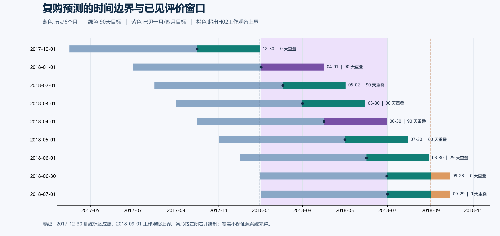

[PNG](members/role01/time-boundaries.png) · [SVG](members/role01/time-boundaries.svg)

## 02 2号：十月群规模与复购

描述性证据，不是模型增益；分布图N可能按字段重复计数，折记录不是独立未来时点。

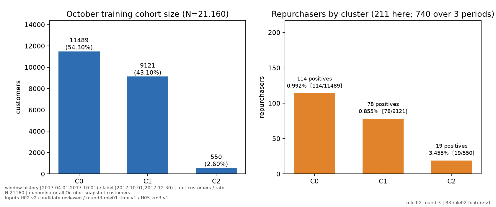

[PNG](members/role02/figures/01-october-groups.png) · [SVG](members/role02/figures/01-october-groups.svg)

## 03 2号：配送特征分布

描述性证据，不是模型增益；分布图N可能按字段重复计数，折记录不是独立未来时点。

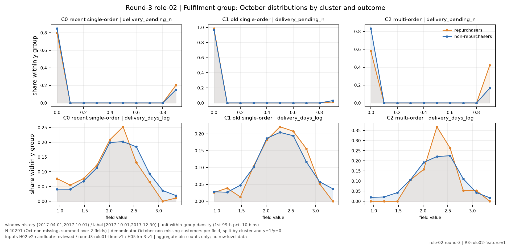

[PNG](members/role02/figures/03-fulfilment-distribution.png) · [SVG](members/role02/figures/03-fulfilment-distribution.svg)

## 04 2号：评价特征分布

描述性证据，不是模型增益；分布图N可能按字段重复计数，折记录不是独立未来时点。

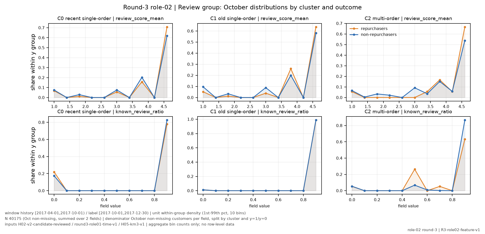

[PNG](members/role02/figures/04-review-distribution.png) · [SVG](members/role02/figures/04-review-distribution.svg)

## 05 2号：字段非缺失支持

描述性证据，不是模型增益；分布图N可能按字段重复计数，折记录不是独立未来时点。

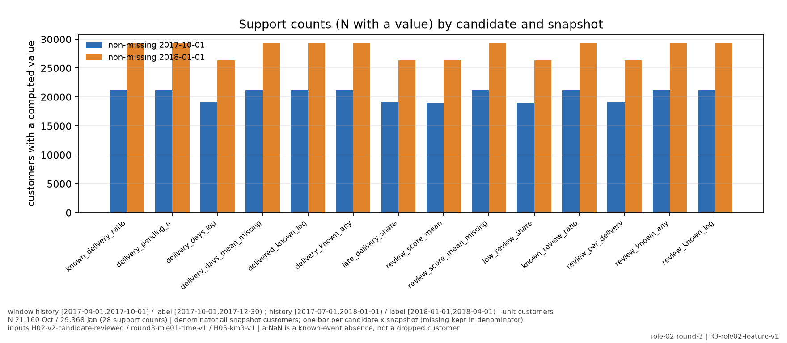

[PNG](members/role02/figures/05-support-and-missing.png) · [SVG](members/role02/figures/05-support-and-missing.svg)

## 06 2号：训练折内筛选诊断

描述性证据，不是模型增益；分布图N可能按字段重复计数，折记录不是独立未来时点。

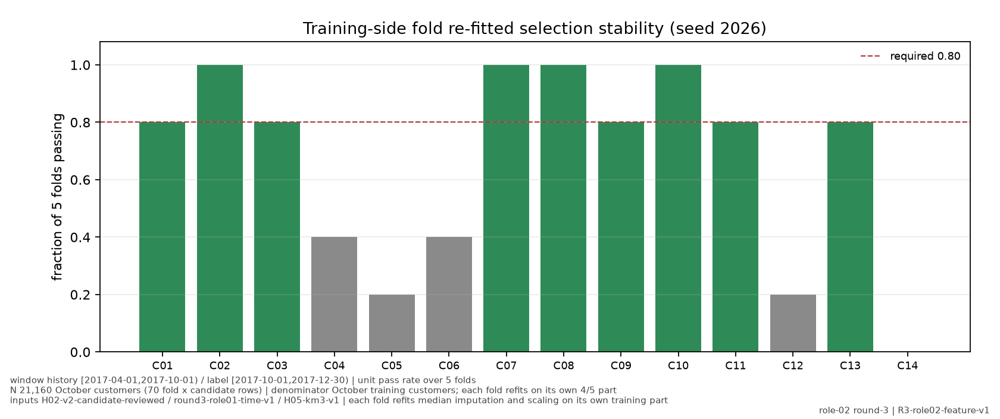

[PNG](members/role02/figures/06-fold-selection.png) · [SVG](members/role02/figures/06-fold-selection.svg)

## 07 2号：十月到一月方向变化

描述性证据，不是模型增益；分布图N可能按字段重复计数，折记录不是独立未来时点。

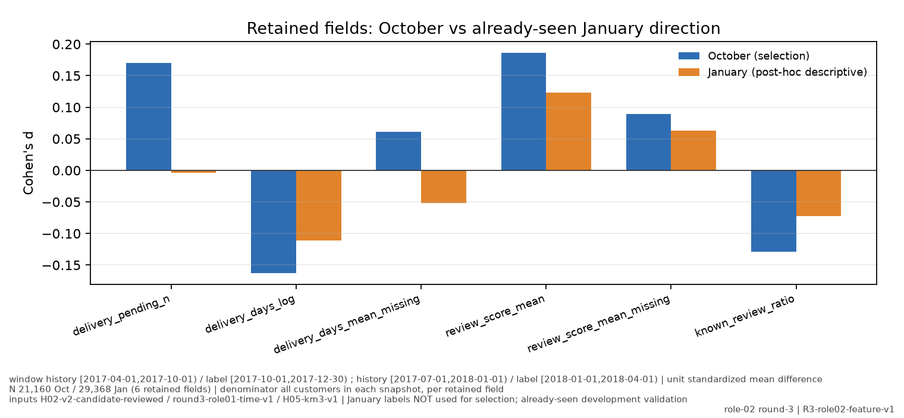

[PNG](members/role02/figures/07-october-january-direction.png) · [SVG](members/role02/figures/07-october-january-direction.svg)

## 08 2号：预测日可得性边界

描述性证据，不是模型增益；分布图N可能按字段重复计数，折记录不是独立未来时点。

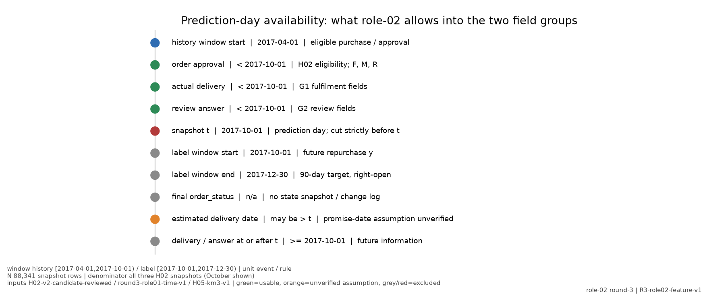

[PNG](members/role02/figures/08-prediction-day-availability.png) · [SVG](members/role02/figures/08-prediction-day-availability.svg)

## 09 真实组员本轮模型与固定久单79

同一月同容量；加权全局50/2。群覆盖与固定群内挑选分开。

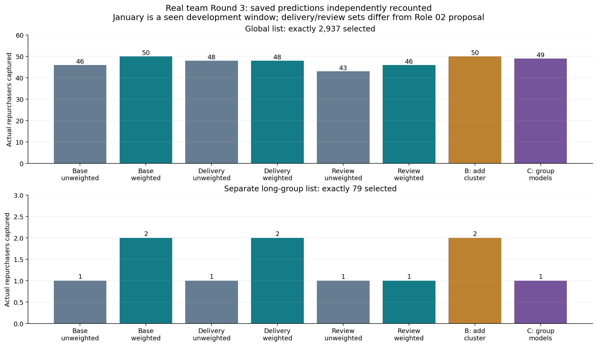

[PNG](figures/01-team-models-and-long79.png) · [SVG](figures/01-team-models-and-long79.svg)

## 10 2号效应区间修正版

点差不变，以非缺失正负样本数补SE；近似、未作多重比较校正。

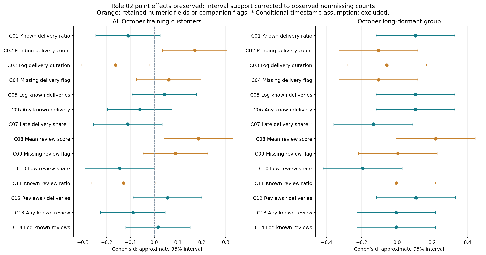

[PNG](figures/02-role02-corrected-effect-intervals.png) · [SVG](figures/02-role02-corrected-effect-intervals.svg)

## 11 当前R3群0画像

与本轮R3 F0名单对齐，非旧46命中卡；三张可并排一页。

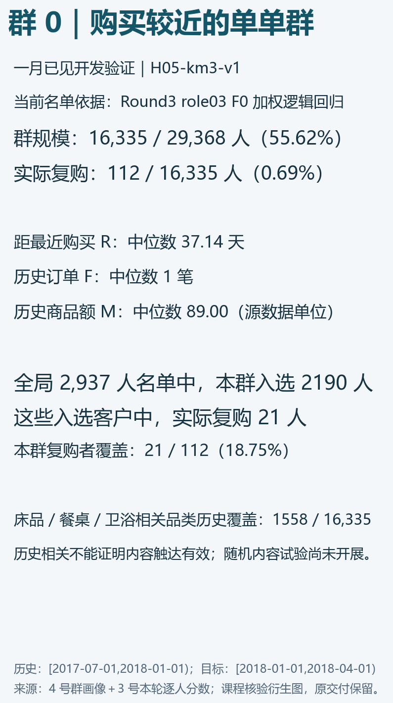

[PNG](figures/03-current-group-0.png) · [SVG](figures/03-current-group-0.svg)

## 12 当前R3群1画像

与本轮R3 F0名单对齐，非旧46命中卡；三张可并排一页。

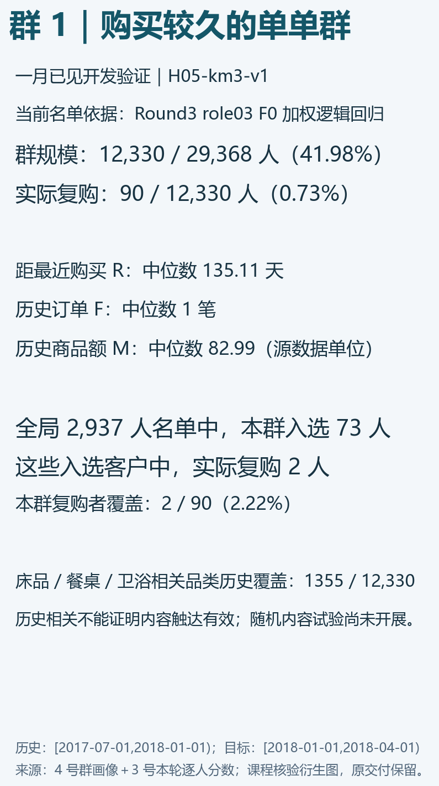

[PNG](figures/03-current-group-1.png) · [SVG](figures/03-current-group-1.svg)

## 13 当前R3群2画像

与本轮R3 F0名单对齐，非旧46命中卡；三张可并排一页。

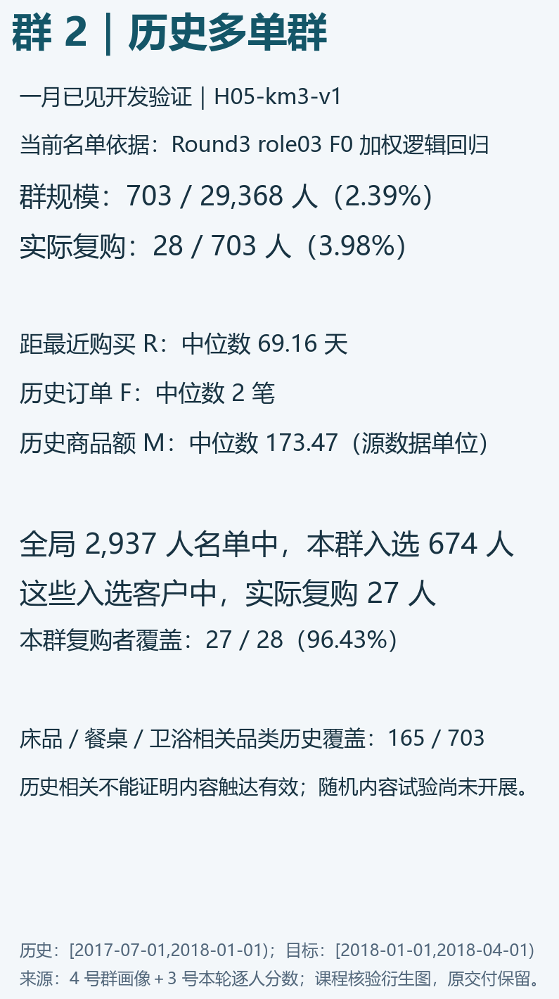

[PNG](figures/03-current-group-2.png) · [SVG](figures/03-current-group-2.svg)

[根验收](README.md) · [绘图源](plot_acceptance.py) · [当前名单群汇总](audit/current-profile-summary.csv) · [修正区间表](audit/role02-evidence-recomputed-corrected.csv)
