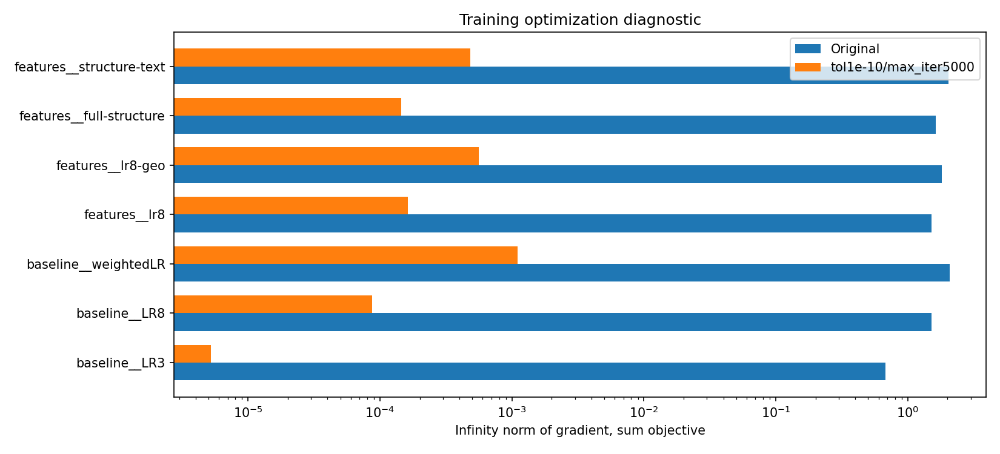
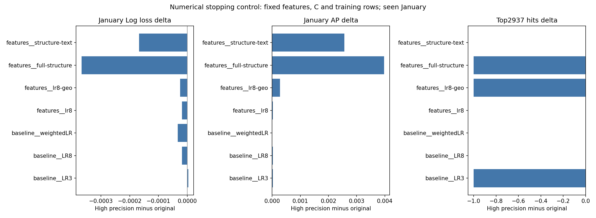

# 七个既有 LR 的数值停止精度控制

本批只提高优化停止精度，不改变信息、模型结构、C、class_weight 或预处理。七项训练目标都下降，梯度显著缩小；部分名单有较多人员替换。**P2“更多规定字段在同一 LR 下没有全面改善”的方向保留，但原具体数值不能被当成已充分优化的唯一读数。** 原基线完整保留，本表是额外数值控制，不是新机制带来的收益。

## 冻结和执行

[plan.md](plan.md) 先于新 Jan 评分冻结。唯一矩阵为 full-Oct 既有 LR3 / LR8 / weightedLR，以及 P2 lr8 / lr8-geo / full-structure / structure-text，共 7 项，各 1 次确定性拟合。只把 sklearn LogisticRegression 改为 **tol=1e-10、max_iter=5000**，所有其他参数逐项核对不变，solver 仍为 lbfgs。

Oct 21,160 / 211 正例，Jan 29,368 / 230 正例。前三项重用原保存预处理，不重新 fit 变换；P2 四项直接使用原保存 sparse 矩阵。所有客户评分；全局 K2937，H05-km3-v1 cluster_id1 的 12,330 / 90 人群内独立 K79。没有更换共同久单定义，没有根据 Jan 选择精度，也没有改变 C/特征、添加校准或扩大候选。四月快照/标签解析 0 行，CPU2threads。

## 优化结果与实际停止边界

目标为 `sum weighted BCE + ||beta||²/(2C)`，bias 不罚。balanced 的每类权重为 n/(2n_class)，其他样本权重为 1；下表梯度是该**求和目标**的无穷范数，不是除以样本数后的数值。

|既有模型|旧→新迭代数|旧→新求和目标|旧→新梯度∞|触及5000/警告|
|---|---|---|---|---|
|baseline LR3|9→16|1162.923657→1162.922563|0.6751→5.24e-6|无/无|
|baseline LR8|27→140|1155.933313→1155.467058|1.5109→8.69e-5|无/无|
|baseline weightedLR|105→441|14002.598511→14002.323139|2.0690→1.10e-3|无/无|
|P2 lr8|27→145|1155.925938→1155.461112|1.5172→1.62e-4|无/无|
|P2 lr8-geo|72→331|1069.844148→1068.993700|1.8109→5.63e-4|无/无|
|P2 full-structure|115→728|1008.312826→1003.290767|1.6332→1.45e-4|无/无|
|P2 structure-text|118→674|986.365759→981.778648|2.0307→4.82e-4|无/无|

**无警告不等于证明梯度已达指定 tol。** 新模型的梯度除权重和后为 2.48e-10～5.21e-8，全部仍略高于 1e-10。sklearn 也可按相对目标变化停止，而且不公开保存完整 optimizer 状态；所以本报告只声称“指定更严格停止条件后无警告返回、目标和梯度改善”，不声称七项都严格达梯度阈值或全局精确最优。全部原/新停止参数、梯度尺度、警告字段见 [old-new-metrics.csv](old-new-metrics.csv)。没有触顶后再搜索其他精度。

## Jan 读数：原值与数值控制并列

|既有模型|Log loss 旧→新|Brier 旧→新|AP 旧→新|AUC 旧→新|全局2937 旧→新|久单79 旧→新|
|---|---|---|---|---|---|---|
|baseline LR3|0.044976→0.044979|0.00770666→0.00770645|0.032458→0.032480|0.560782→0.560837|51→50|2→2|
|baseline LR8|0.045072→0.045053|0.00771366→0.00771163|0.028239→0.028269|0.577847→0.578937|46→46|1→1|
|baseline weightedLR|0.660372→0.660338|0.23446377→0.23441344|0.029797→0.029806|0.582041→0.581678|50→50|2→2|
|P2 lr8|0.045071→0.045053|0.00771365→0.00771162|0.028243→0.028269|0.577879→0.578962|46→46|1→1|
|P2 lr8-geo|0.045999→0.045974|0.00775568→0.00775474|0.024914→0.025194|0.600939→0.598704|49→48|0→0|
|P2 full-structure|0.047910→0.047542|0.00796229→0.00789775|0.019658→0.023632|0.585599→0.588328|42→41|0→0|
|P2 structure-text|0.047689→0.047521|0.00794997→0.00790262|0.020542→0.023110|0.592453→0.592794|39→39|0→0|

完整 CSV 为权威精确值，表格为展示舍入。更低训练目标不保证每项 Jan 指标更好，例如 LR3 的 Log loss 略升且命中减 1。weighted raw 仍处于错误的自然概率尺度，不能把这次微小数值变化称为完成概率校准。

在相同高精度控制内，P2 full / text 的 AP 从约 .020 提高到 .023，但仍低于 P2 lr8 的 .028269，Log loss 也仍更差；地理的 AUC 仍较高，但 AP/Log loss 较差。因此原“未全面改善”的解释可以保留，旧具体差值应同时展示数值控制。全结构 CatBoost 此批没有重训或改变；不能把本次求解改进归因为新字段或 CatBoost 机制。

既有 P1 bootstrap 区间只绑定原模型/原 score，**不自动适用于本批新 score**。本批不重抽区间、不据一月读数宣称显著胜出。一月已见、客户重复及时间漂移等原限制继续保留。

## 名单与逐人变化

|模型|最大概率绝对差|全局替换人数|久单替换人数|
|---|---:|---:|---:|
|baseline LR3|0.003506|8|2|
|baseline LR8|0.014853|219|19|
|baseline weightedLR|0.028410|18|3|
|P2 lr8|0.014859|219|19|
|P2 lr8-geo|0.040781|108|4|
|P2 full-structure|0.434681|225|12|
|P2 structure-text|0.388665|241|10|

“替换人数”是新名单进入而旧名单未选的人数；对称差为它的 2 倍。命中数不变也可能更换大量客户，不能据“仍命中46”宣称逐人分数和名单完全稳定。[score-and-list-changes.csv](score-and-list-changes.csv) 同时保存平均/最大分数差、对称差和训练目标变化。

## 核验与交付

[run_convergence.py](run_convergence.py) 约 11.1 秒完成，[verify_convergence.py](verify_convergence.py) 约 4.3 秒独立读回，无 fit 调用。运行使用 `D:\anaconda3\python.exe -B -X utf8`。独立核验：19 个原输入哈希未变；7 个 estimator 的参数差仅 tol / max_iter；14 组原/新模型的训练目标、梯度、Jan 自然指标和两份固定名单复算一致；保存的逐人 Jan 分数由模型重算最大差 **0**。两张 PNG 均已实际查看，SVG 同源保存。

`private/` 只保存 7 个新模型、7 份原/新 Jan score 与训练 logit、共同 train/Jan 键和真实 y，以及原模型/矩阵引用与参数；原模型、原特征和历史结果没有覆盖。[readback-verification.json](readback-verification.json) 保存局部 PASS，`verification.json` 保存冻结/来源/运行范围；`deliverable-manifest.json` 绑定最终文件字节。局部完成不代表整项研究采用或三端同步完成；本任务未操作 Git/看板、未安装或外发。
