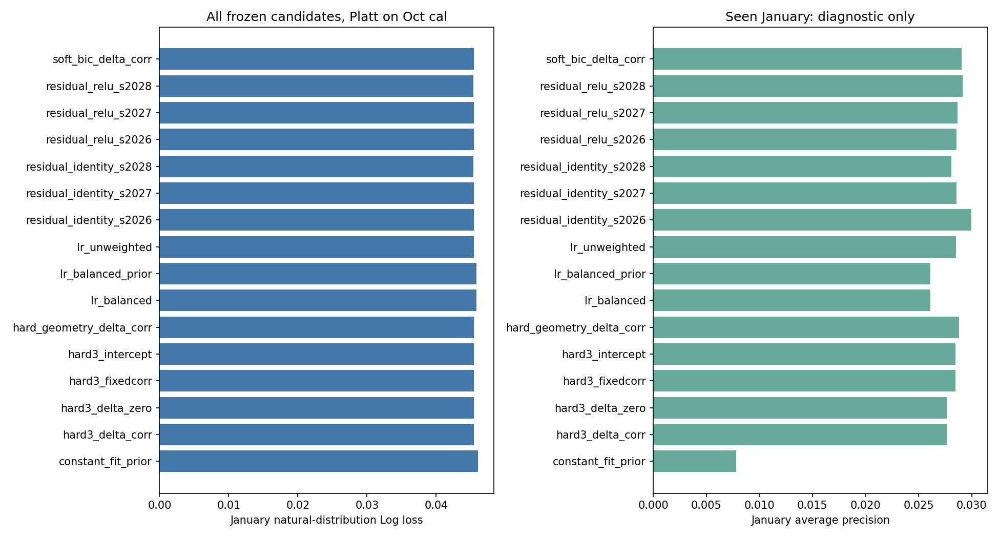
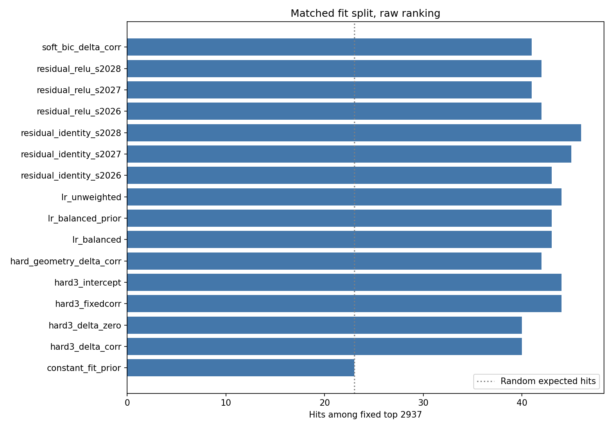

# P4A：群统计初始化、群特征权重与共享残差验证

本批完成 16 个冻结 score 变体：共同 80% fit 的基础 LR、balanced 与 prior 校正、固定群相关偏移、可学习群斜率、K/软硬群对照、仅群截距，以及两个共享残差支路各 3 seed。**相关初始化与零初始化到达几乎相同凸解；当前群斜率/非线性方案没有形成概率质量和固定容量名单同时稳健改善的证据。** 本批不据 Jan 指定赢家，也不自动追加搜索。

## 共同口径

Oct 的 21,160 人按 stratified / random_state20261111 划分：fit 16,928 / 169 正例，cal 4,232 / 42 正例。所有候选只用同一个 fit 拟合原 8 字段的变换和群：7 数值 log1p + StandardScaler，state OHE 后 34 列。cal 只作 raw 诊断与 Platt 拟合；Jan 29,368 / 230 正例只作冻结后的开发诊断，没有用于选 K、初值、阈值、epoch 或 seed。四月解析 0 行。

本批的 matched LR 只用 80% Oct，不能把其 44 命中与此前全 Oct weighted LR 的 50 命中当成单独组件效果。所有本表候选在相同 split、预处理和客户集合中比较。Jan 本来已经见过，客户重复与目标日历窗口重叠仍然保留；当前没有真正未见的最终时间评估。

群模型也仅 fit：R 原值 / logF / logM 标准化，训练 silhouette 在 K2..8 选 K2；diagonal GMM 训练 BIC 在 K2..8 选上界 K8。它们分别是几何 / 密度拟合准则，未因 Jan 预测效果选择。BIC 上界结果不证明存在 8 个真实群，连续高斯对离散和零值聚集特征也有假设限制。

## 什么是“群权重”与“统计初始化”

共享线性预测为 logit=b+xβ；群特征分支额外加 `eta * sum_g(w_g * (x dot delta_g))`，eta 固定 0.1。硬群 w 是 KMeans one-hot，软群 w 是 GMM 成员后验。这里的 delta 是**按群共享的特征斜率偏移**，w 是事先冻结的群门控，不是端到端注意力，也不是每位客户单独自由学习的权重。

相关初值只由 fit 的群内 corr(x_j,y) 得到，再乘 `npos/(npos+20)`；常量列/常量标签置 0。硬 K3 的 fit 群支持分别为 436 / 9,148 / 7,344 人，正例 14 / 93 / 62，收缩系数 0.412 / 0.823 / 0.756。软群以成员后验为权重计算对应协方差和正例质量，另报有效样本数。这是**群内相关与收缩，不是控制变量 ANCOVA，更不是因果效果**。见 [group_fit_support.csv](group_fit_support.csv)、[correlation_initialization.csv](correlation_initialization.csv)。

固定相关分支保留 delta 不训练；可学习分支把 delta 当参数，两种初值使用同一凸目标和优化预算。主线性目标为 sum BCE + .5||β||² + .5||delta||²，共享 bias 不罚，群偏移正则系数 1。eta=.1 会使实际群斜率受到较强收缩；这只是一个预定规格，不能据其负结果排除所有群模型。仅群 one-hot 截距对照有群基率偏移而没有群特征斜率，用于区分两种贡献。

## 一月读数

下表 Log loss / Brier 越小越好，AP 越大越好。Platt 一律仅用 Oct cal 的 42 个正例拟合。固定全局 K=2,937；久单始终是既有 H05 cluster_id=1 的 12,330 / 90 人，在该群内独立取 79，不用新群替换。随机期望分别为 23.002 / 0.577 命中。

|冻结候选|raw Log loss|Platt Log loss|raw AP|K2937 命中|久单79 命中|预测参数数|
|---|---:|---:|---:|---:|---:|---:|
|matched unweighted LR|0.045287|0.045462|0.028529|44|1|35|
|matched balanced LR|0.652303|0.045788|0.026114|43|2|35|
|balanced + fit prior 校正|0.045908|0.045788|0.026114|43|2|35，复用上项|
|硬 K3 + 固定相关偏移|0.045289|0.045461|0.028474|44|1|35，另102固定统计|
|硬 K3 + learn delta，零初值|0.045406|0.045466|0.027664|40|0|137|
|硬 K3 + learn delta，相关初值|0.045406|0.045466|0.027664|40|0|137|
|几何 K2 + learn delta|0.045360|0.045464|0.028804|42|1|103|
|软 GMM K8 + learn delta|0.045389|0.045458|0.029039|41|1|307|
|硬 K3，仅群截距|0.045268|0.045455|0.028470|44|1|38|
|fit 基率常数|0.046034|0.046021|0.007832|23|2|1|

所有 Platt 斜率为正，因此本批校准没有改变排名或 AP；表中容量命中同时适用于 raw / Platt。常数的 23 / 2 来自客户 ID 破平规则，不是一次真正随机抽样的结果，也不表示它识别了谁会复购。

balanced raw 的平均预测为 46.456%，实际 Jan 复购率 0.783%；其 raw Brier 为 0.230808，不能当正确的自然概率。训练 prior 校正把平均预测降为 0.981%，raw Brier 为 0.007734；Platt 后 Log loss 为 0.045788。matched unweighted raw Brier 为 0.007722。理论 prior 修正仍不保证完全校准，Platt 也不是自动有益：多数未加权候选在这个 Jan 的 raw Log loss 反而低于其 Platt 版本。不能因此在 Jan 上反选是否校准。

完整 [january_summary.csv](january_summary.csv)、[natural_probability_metrics.csv](natural_probability_metrics.csv) 还给出 Brier、AUC、10 等宽箱 ECE、预测均值偏差和 .5 阈值混淆；[capacity_metrics.csv](capacity_metrics.csv) 保留 cal / Jan 的 top 5/10/20% 及 Jan 久单 79。**Octcal 的 Platt 后指标是拟合后的再代入读数，不是独立的校准后泛化证据。** Octcal raw 读数同样不能证明对未来时间稳定。

## 相关初值没有产生可宣称的改进

硬 K3 零 / 相关初值的同一目标分别为 918.8626437715 / 918.8626437555，相差约 1.61e-8；最大参数差 3.70e-5，cal 最大 logit 差 5.83e-5，Jan 最大概率差 4.85e-6。两个初值均为 40 命中，不能称“统计初始化提升模型”。初值可影响求解速度，但这里迭代 115 / 114 的差异也不足以宣称工程优势。

L-BFGS-B 均在 maxiter1000 以内返回 success，实际停止原因为**相对目标变化达到 ftol**，不是所有候选都达到了 gtol1e-7。末梯度最大值和 message 全列于 [model_fit.csv](model_fit.csv)，balanced 的约 0.0050 最大。分数的微小差别没有被当作新效果。凸模型确定性，不虚构 3 个 seed；初值比较见 [convex_initialization_comparison.json](convex_initialization_comparison.json)。

## 共享残差支路与线性预算对照

共享 hidden16：logit=b+xβ+eta·sum_g w_g[V_g activation(Wx+a)]。ReLU 是非线性；identity 是相同参数形状、相同预算的线性残差对照。基础 β/b 从 matched unweighted LR 初始化，V 初始 0，hidden 由对应 seed 初始化；全部参数可训练。两个模型各 seed2026/2027/2028，50 epochs、batch512、Adam lr.001、dropout0、未加权 BCE，均 643 个参数。weight 矩阵及基础 β 使用相同 `.5/n` 的 L2，bias 不罚。没有提前停止、挑 epoch 或挑 seed。

|支路|3 seed raw Log loss|3 seed Platt Log loss|3 seed AP|3 seed K2937 命中|久单79|
|---|---|---|---|---|---|
|identity|0.045332 / 0.045298 / 0.045254|0.045453 / 0.045449 / 0.045376|0.029989 / 0.028590 / 0.028107|43 / 45 / 46|全0|
|ReLU|0.045287 / 0.045241 / 0.045218|0.045456 / 0.045447 / 0.045385|0.028574 / 0.028647 / 0.029128|42 / 41 / 42|全0|

identity / ReLU raw Log loss 均值为 0.045295 / 0.045249；Platt 后均值为 0.045426 / 0.045429。ReLU 在这三个固定 seed 的 raw Log loss 略低，但容量命中更低，校准后没有一致的概率质量优势。因此本轮支持“目标之间存在小幅取舍，尚未建立稳健增益”，不能宣布非线性必胜或必败。只完成了固定预算，不声称非凸模型已经全局收敛。[seed_summary.csv](seed_summary.csv) 给均值/样本标准差/范围，[training_trajectory.csv](training_trajectory.csv) 给全部 300 个 epoch 记录。参数数未包含预处理、事先群模型及额外 Platt 的 2 个参数。

## 交付与核验

[plan.md](plan.md) 先于新 Jan 评分冻结；[run_group_learning.py](run_group_learning.py) 实验约 19.2 秒；[verify_group_learning.py](verify_group_learning.py) 独立读回约 9 秒；[summarize_group_learning.py](summarize_group_learning.py) 只汇总已有结果。均由 `D:\anaconda3\python.exe -B -X utf8` 执行，CPU2threads，无安装或外发。首启在取得特征名时出现 `FunctionTransformer` 缺少名称映射的元数据报错，已增加 `feature_names_out='one-to-one'`；当时尚未训练或评分新候选，不涉及修改搜索范围。

`private/` 保存共同 split 索引、fit/cal/Jan 键与真实结果、精确 float64 变换数组、预处理与所有 K2..8 群模型、硬/软成员权重与相关初值、全部线性参数、6 个 torch state_dict、16 个 Platt 模型、16 个逐人分数 NPZ。每个 `*-scores.npz` 中有 cal/Jan 的 logit、raw、Platt 概率，行序对应各自 `*-keys-outcomes.csv`。真实 y 和个人键没有写入外层聚合 CSV。

[readback_verification.json](readback_verification.json) 为 PASS：重新生成 split 并核键序；核 scaler 均值/州类别仅由 fit 产生；重算全部群成员与相关初值；从保存模型独立重算 **16 个 score 变体的逐人分数，最大 logit 差全部为 0**；重新调用保存的 Platt；复算 64 行自然概率指标、224 行排名指标。两张 PNG 均已实际查看，SVG 同源。最终全部文件哈希见 `deliverable_manifest.json`。

本批不编辑原件、不运行 Git / 看板操作。`verification.json` 和此处完成状态只表示 P4A 冻结实验及本地核验完成，整项研究采用、P4 其余模块、最终独立时间验证和三端同步由主任务继续处理。
