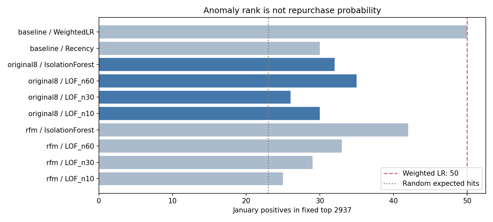
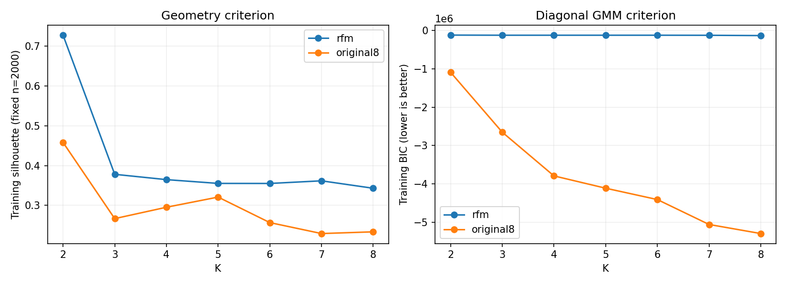

# P3：异常排序与分群结构验证

本批已完成冻结配置的基础实验。**LOF / IsolationForest 未显示超过既有 weighted LR 的支持，依预定规则停止扩展异常检测后端。** 两个表示空间的 KMeans 都由训练 silhouette 选中 K=2；这不表示 K=2 的复购预测最好。软群、硬群、无显式 K 的密度法已经形成可核验对照，后续监督权重实验尚未执行。

数据只由既有 `read_dev()` 解析 H02 前 50,528 行：Oct 21,160 人 / 211 正例，Jan 29,368 人 / 230 正例。四月解析 0 行；仅 Oct fit 变换、聚类和异常模型，Jan y 只在方案冻结后用于结果诊断，没有用于选 K、空间、阈值或异常超参数。一月早已见过，因此不称最终盲测；客户重复和目标日历窗口重叠仍然限制跨期证据的独立性。

## 异常分数与真实复购

主空间 `original8` 是既有原模型的 **7 个数值字段 + state**：数值 log1p 后训练侧标准化，state 训练侧 OHE；并非 8 个数值。LOF 的 novelty=True 在 Oct fit，只用 Jan 的 `-score_samples` 作为越大越异常的排序。没有把训练 `negative_outlier_factor_` 当成测试分数，也没有把异常度当复购概率，故不对未校准异常度计算 Log loss / Brier。

固定全局 K=2,937，Jan 正例 230，随机期望命中 23.002；久单切片固定为既有 H05 cluster_id=1，共 12,330 人 / 90 正例，**群内独立排名选 79 人**，随机期望命中 0.577。这与全局名单中落在久单群的名额是两种读数。

|方法 / 主空间|全局命中|精确率|召回率|富集倍数|AP|久单 79 命中|
|---|---:|---:|---:|---:|---:|---:|
|LOF，10 邻居|30|1.021%|13.04%|1.304|0.008795|1|
|LOF，30 邻居|26|0.885%|11.30%|1.130|0.008723|2|
|LOF，60 邻居|35|1.192%|15.22%|1.522|0.011456|0|
|IsolationForest，200 树|32|1.090%|13.91%|1.391|0.012776|2|
|Recency 参照|30|1.021%|13.04%|1.304|0.008590|1|
|既有 weighted LR 参照|50|1.702%|21.74%|2.174|0.029797|2|

RFM 诊断空间 LOF10/30/60 与 IF 分别命中 25 / 29 / 33 / 42，AP 0.010808 / 0.012367 / 0.024948 / 0.027061，也没有超过 weighted LR。RFM 的 LOF30 和 LOF60 久单 79 各命中 3 人，是固定参数下的一月描述；不能依据该 1 人差距改选空间或超参数。完整 top 5% / 10% / 20%（ceil）和久单指标见 [anomaly_outcomes.csv](anomaly_outcomes.csv)。阈值没有扫描最佳值。

这支持“异常排序不是当前任务中有力的直接复购排序替代品”，不证明所有异常检测方法都无效，也没有把少数命中差异称为统计显著。依冻结 [plan.md](plan.md) 的规则，本批不自动加入监督后端、反向分数或更多异常参数。

## K、表示与稳定性

|空间|训练 silhouette 所选 K|K2 silhouette|K3 silhouette|K2 最小群|K2 三次抽样 ARI|K3 三次抽样 ARI|
|---|---:|---:|---:|---:|---|---|
|R 原值 / logF / logM 标准化|2|0.727924|0.378136|550|1 / 1 / 1|0.987503 / 0.997789 / 0.997604|
|original8|2|0.458395|0.266811|4,191|1 / 1 / 1|0.993105 / 0.999247 / 0.992398|

固定训练侧 K=2..8，seed42 / n_init20；silhouette 用 seed2026 固定 2,000 人。DB、CH、最小群数和全部候选保留在 [kmeans_geometry.csv](kmeans_geometry.csv)。winner 与 K3 用三次 80% 无放回抽样重新拟合 KMeans，输入变换固定为全 Oct 训练侧变换，并在同一完整 Oct 参考集比较预测 ARI；不是完整“抽样后重拟合预处理”的稳定性，也不是跨期稳定性。

RFM K2 完全等于单单 / 多单区分：Oct 20,610 / 550，Jan 28,665 / 703。K3 则额外拆分单单的 R，Jan 与原 H05 分区 ARI=1；**数字群号有置换**：本批 RFM K3 标签 0/1/2 对应 H05 的 0/2/1。因此共同久单始终使用原 H05 cluster_id=1，不能拿本批 label=1 替代。original8 K2 的 Jan 两群 5,364 / 24,004，R 中位数约 18.88 / 92.53 天，主要是近期行为分离。

在标签完全没参与选择的前提下，保存了群内 Oct/Jan 复购率作描述：[cluster_outcomes_descriptive.csv](cluster_outcomes_descriptive.csv)。例如 RFM 单单群 Jan 202 / 28,665，多单群 28 / 703；这不是新模型的预测成绩，也不改变固定 H05 诊断切片。

## 软群与密度法

Diagonal GMM 的 K=2..8 全部收敛；两个空间的训练 BIC 都选择搜索上界 K=8。这仅表示 **这组有限候选中 K8 的拟合/复杂度准则最低**，不能宣称真实群数就是 8，亦未追加扩大搜索。F 的集中取值、多个零值及 OHE 的离散性不符合连续高斯密度的理想假设，较小方差与 reg_covar 会影响 BIC；两个空间的 BIC 绝对值不能横向比较。训练 BIC、KMeans 几何分离、复购预测是三件事。所有候选见 [gmm_bic.csv](gmm_bic.csv)。GMM K3/K8 后验权重和模型已保存供受控下游对照，后验属于群成员，不是复购概率。

KMeans 距离额外提供 `softmax(-0.5 * distance**2)` 的描述性亲近权重（temperature=1），不是概率模型后验。它与 GMM posterior 分开命名保存，不把两者混称同一“软概率”。

|训练 HDBSCAN|簇数|噪声人数 / 比例|最小非噪声群|三次 80% 抽样交集 ARI（含噪声）|
|---|---:|---|---:|---|
|RFM，min_cluster_size200|2|1 / 0.0047%|549|1 / 1 / 1|
|RFM，min_cluster_size500|2|1 / 0.0047%|549|-0.0389 / -0.0327 / -0.0391|
|original8，min_cluster_size200|21|2,492 / 11.78%|224|0.9675 / 0.9325 / 0.9198|
|original8，min_cluster_size500|11|3,436 / 16.24%|519|0.8364 / 0.8726 / 0.8536|

统一 min_samples20。RFM 500 的全量结果看似稳定的单单 / 多单，但 80% 抽样中多单只有 427 / 442 / 443 人，低于 500，结果剧变为噪声 82.60% / 69.62% / 79.61%。不能仅展示全量两群就称鲁棒。original8 的地理 OHE 也参与密度，部分群为单一州，故不能把密度簇直接解释成自然消费意图。排除双方噪声的交集 ARI、保留人数及完整群规模另见 [stability.csv](stability.csv)、[density_subsamples.csv](density_subsamples.csv)、[cluster_composition.csv](cluster_composition.csv)。含噪声 / 排噪声读数不能互相替代。

当前 sklearn 1.5.1 确有 HDBSCAN，但没有 out-of-sample predict；第三方 hdbscan 未安装。本批只描述 Oct 训练密度结构，**不生成 Jan 密度群、不给未知/噪声客户伪造标签，也不进行后续群权重预测**。若以后需要下游使用，必须先定义可复现的训练外分配机制及噪声处理。

## 可复算交付与边界

- [plan.md](plan.md) 是先于执行冻结的规则；[run_structure.py](run_structure.py) 是完整实验代码；[verify_structure.py](verify_structure.py) 是保存后读回核验代码，均用 `D:\anaconda3\python.exe -B -X utf8` 执行，无安装和外发。
- `private/` 保存训练拟合变换、float64 Oct/Jan 输入数组、所有候选模型、选中 KMeans K2/K3 的 Oct/Jan hard labels / distances / soft_distance_weights、GMM K3/K8 的 labels / soft_posterior、HDBSCAN 全量和三次抽样模型/labels、全部 Jan 异常分数，以及分开的键/真实结果文件。顺序由 `oct_keys_outcomes_h05.csv` / `jan_keys_outcomes_h05.csv` 定位；个人键和真实 y 不在外层 CSV 中。HDBSCAN `probabilities_` 是每人的所属群强度标量，不是全簇软权重矩阵。
- [verification.json](verification.json) 记录来源与输出哈希、未读四月、版本和 2 线程；[readback_verification.json](readback_verification.json) 记录独立读回：40 行排名指标复算、16 组选中模型数组对模型重算、逐行键顺序、soft weights 行和、精确 float64 变换与 120 个既有文件哈希核对均通过。PNG 两张已实际查看，SVG 同源保存。
- 初轮约 66 秒；为完整保存密度抽样模型、噪声证据及无损变换数组，最终冻结产物重跑约 69 秒，读回约 5 秒。CPU 数探测初次出现缺少系统命令的 joblib 警告；计算完成，后续设 `LOKY_MAX_CPU_COUNT=2`，并始终以 threadpool_limits(2) / n_jobs2 控制计算。没有将警告说成模型失败。
- 本批没有执行 P4 的可学习群权重，没有改变共同 H05 群，没有编辑原件、Git 或看板。主代理负责按主任务统一同步；这里的 complete 仅指 P3 冻结基础验证与局部读回，不代表整项研究或三端同步完成。
